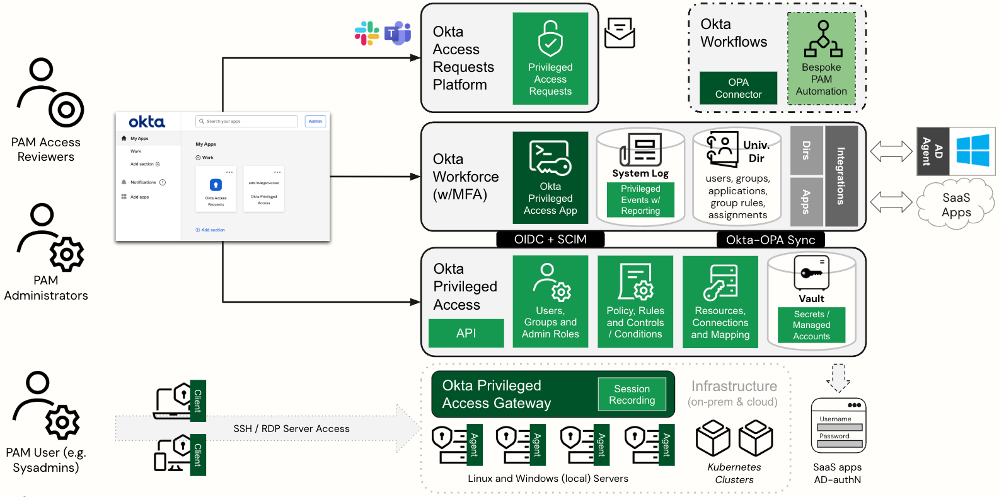
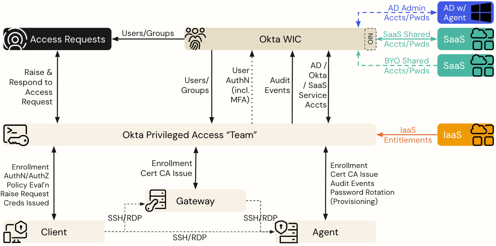
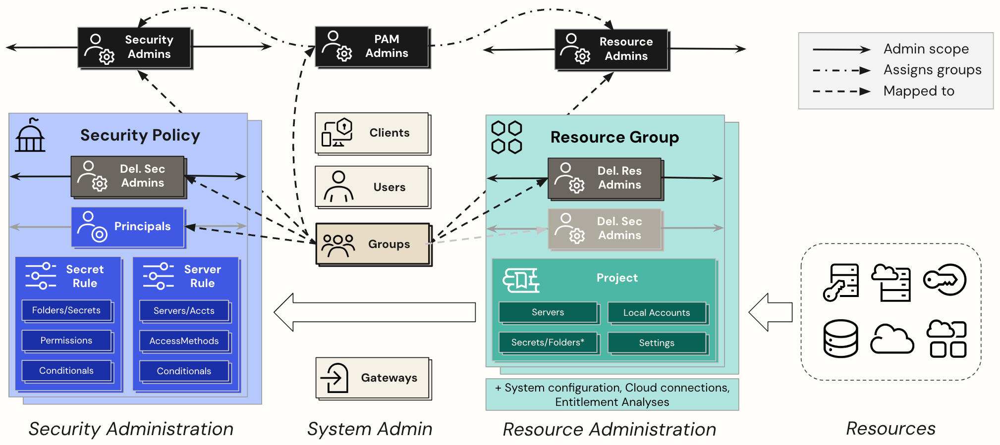

# Okta Privileged Access

Okta Privileged Access (referred to as OPA throughout this guide for
simplicity) is Okta’s Privileged Access Management (PAM) offering.

This section provides an architectural overview of the Okta Privileged
Access components, the main components and interactions in the product
and a look at the main objects in the data model and how they relate to
each other.

### Architectural Overview

OPA represents an evolution of the existing Okta Advanced Server Access
(ASA) product and shares a lot of components and a similar architecture.

The following diagram shows the major components and capabilities of
OPA.

The major components are the infrastructure components, the OPA tenant,
the Okta Workforce tenant, the Okta Access Request platform and Okta
integrations.

The major components:

- The **Okta Privileged Access team** (tenant) is managing the access to
  resources through policy. More detail is provided below.

- The **Okta Workforce** org (aka **Okta Workforce Identity or OWI**) is
  managing the identities (users and groups), leveraging **Okta
  Universal Directory** and the Okta System Log, and integrating with
  the Okta Privileged Access tenant as an app in Okta (for SSO and
  provisioning).

  - It also leverages **Okta MFA** for mfa conditions in OPA policy.

  - The Okta org manages **applications** (like Saas apps) and has
    provisioning integration through the Okta Integration Network (OIN)
    integrations. This will be explored in the SaaS use cases later in
    this guide.

  - The Okta org also integrates with **directories** (like Microsoft
    Active Directory) where directory identities can be used for
    authentication in Okta and the directory groups can be used similar
    to how Okta groups are used. The integration involves use of an
    agent (like the AD Agent) deployed on or close to the directory.
    This will be explored in the AD integration use cases later in this
    guide.

- The infrastructure components are: **Clients**, (server) **Agents**,
  and **Gateways**. These are explored in detail in the relevant
  sections of this guide and there is also a ***Technical Guide for
  Infrastructure Components*** on the [<u>OPA product
  hub</u>](https://support.okta.com/help/s/product-hub/okta-privileged-access?language=en_US).

- The **Okta Access Requests components** (platform and portal) are used
  for the PAM governance capabilities, and can be extended (though Okta
  Identity Governance SKUs) for wider governance use cases.

- **Okta Workflows** (sold separately) could be used for bespoke process
  automation (as is done for other Okta products today). There is an
  **OPA Connector** available for Workflows that abstracts many OPA API
  calls into Workflows Actions.

There are two main integrations between Okta and OPA shown:

- Okta Privileged Access is represented in Okta WIC as an **Okta
  Integration Network (OIN) private application**. This application uses
  OIDC for Single Signon and SCIM for provisioning. It is similar to
  other OIN applications in Okta WIC.

- A background two-way sync mechanism has been implemented to support
  the SaaS/Okta service accounts and AD integration use cases. A change
  in Okta, such as a new account discovery triggers a sync into OPA.
  Similarly a change in OPA, such as a password rotation, triggers a
  sync into Okta.

The diagram does not highlight the integrations between the other
components, although they are discussed in the next section of this
guide.

The diagram also shows Kubernetes. This feature is in beta, but will be
replaced by a new Kubernetes integration at some point.

The main OPA capabilities are:

- **Users, Groups and Admin Roles** - OPA has users and groups
  provisioned from Okta (and some local users/groups). It has
  administrative roles (admin roles) for administering the product.
  Groups are assigned to admin roles (for administration) and policies
  (to grant access to privileged resources).

- **Policy, Rules and Controls/Conditions** - policy defines who can
  access what privileged resources (e.g. servers, AD accounts, secrets)
  and how (e.g. via a gateway, with specific accounts, after MFA).

- **Resources, Connections and Mapping** - OPA supports different
  resource types that are stored in containers for management. There are
  other constructs like connections and mapping to applications and
  directories.

- **Vault** - OPA has an encrypted datastore (vault) where secrets and
  managed accounts are stored.

- **API** - OPA exposes API endpoints.

- **Reporting and Auditing** - to address audit and compliance
  requirements, OPA will introduce PAM-specific reports. It integrates
  with the Okta System Log to route all audit events there.

- **Governance** - OPA will leverage Okta Identity Governance
  capabilities such as Access Requests and Access Certification for
  privileged users and access.

The cloud tenants, Okta Access Requests, Okta WIC and the Okta
Privileged Access team are SaaS apps that can be accessed via the Okta
Dashboard.

### Major Components and Interactions

The following figure shows the main components and interactions. These
components are the same as the diagram above, but highlighting the
interactions between the components. The arrows show data flow
direction, not which component initiated the flow.

To enable the SSH/RDP functionality between the client and the server
(with vaulted, managed credentials) both the OPA Client and OPA (server)
Agent interact with the Okta Privileged Access tenant. If network
proxying or session recording is needed, the traffic must be routed via
a Gateway. Otherwise, the Client - Server access can be direct.

Where there is a need for user authentication, OPA calls Okta (browser
redirect from the client browser session). Where there is a need for
access requests, OPA calls the Access Requests platform.

This Okta WIC tenant is managing users and their group memberships,
which are provisioned/pushed to both the Access Requests platform and
OPA.

Okta Workflows is not shown as it’s not part of the product.

Recently added to the diagram are three new use cases:

1.  OPA can manage the passwords of Okta shared administration accounts.
    There is a synchronization between Okta WIC to share account
    details.

2.  OPA can manage the passwords of SaaS app shared accounts. Using the
    same synchronization as the Okta accounts, OPA can rotate passwords
    and have them applied to SaaS apps via the Okta Integration Network
    (OIN) connectors where the connectors support them. You can also
    bring your own app shared accounts.

3.  OPA can leverage the Okta integration with AD via AD Agents to
    discover and vault AD accounts. These can then be used to direct
    domain-joined server access or a check-out/in model where AD creds
    can be used in any AD-authenticated service.

### Data Model of Major Objects

Throughout this document we will refer to various Okta Privileged Access
objects and their relationships. The following figure shows most of them
(newer resource types not shown).

OPA has users and groups, either locally defined or provisioned/pushed
from Okta, and registered clients.

Security policies define who can access what and how. They tie
Principals (groups) to Resources via one or more Rules with access
types, methods and conditions around access. Resources are assigned to
Policy Rules.

Resource Groups have owners (delegated resource administrators) and
Projects containing resources (such as servers and their local
accounts).

There are different types of administrative roles with different scopes:

- PAM Administrators can manage users/groups/clients and assign user
  groups to other roles but cannot manage resources or policies

- Security (Policy) Administrators can manage all security policies and
  rules

- Delegated Security Administrators can manage policies and rules that
  they are assigned to (and secret folders in resource groups)

- Resource Administrators can manage all resource groups, projects and
  resources

- Delegated Resource Administrators can manage resource groups and
  projects that they are assigned to

There are other objects managed by the PAM admins or Resource Admins.
This includes the gateways (PAM admins) and system configuration, cloud
connectors and entitlement analysis (Resource Admins). The Okta/SaaS
service accounts are not highlighted in the diagram.
