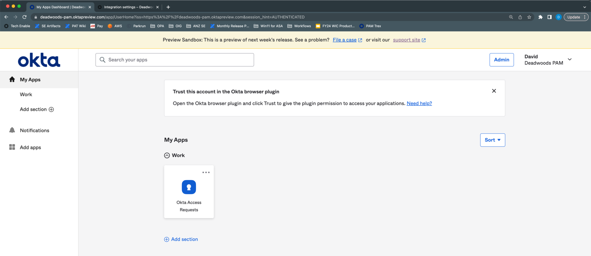
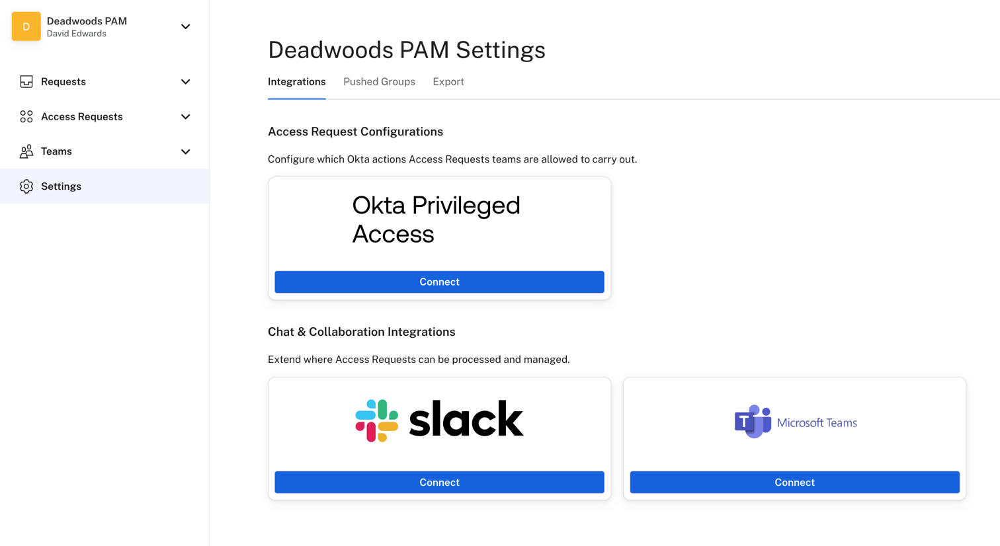
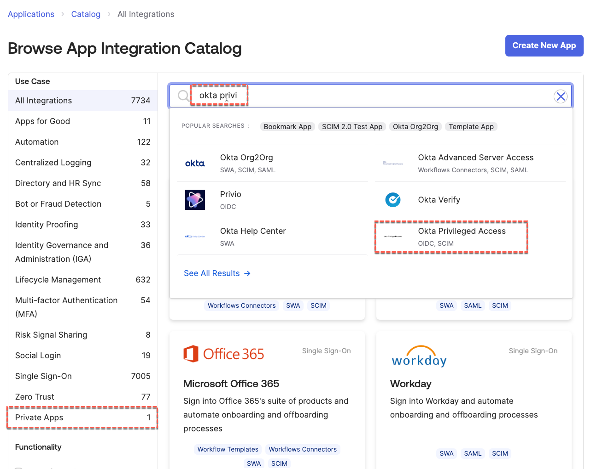
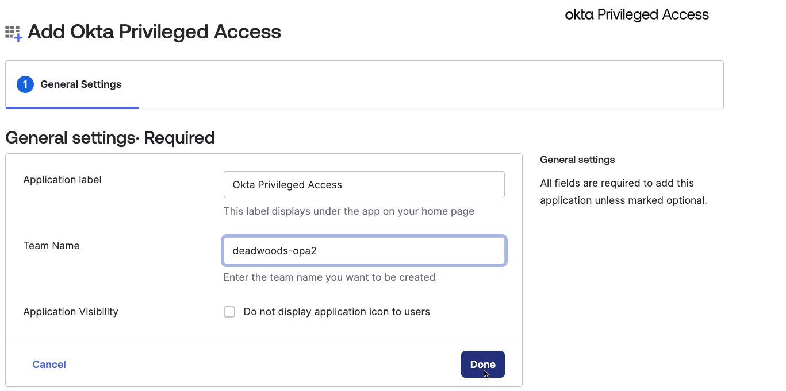
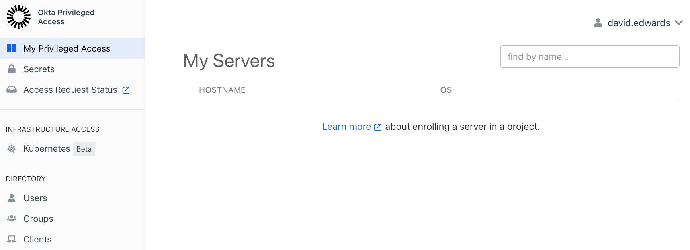

# Create New OPA Tenant

Okta Privileged Access (OPA) is an OIDC/SCIM application and there is an
OIN connection for it. The following sections will walk through the
steps to create it.

### **Check Okta Org is Ready for OPA Tenant**

Before creating the OPA app instance, we will check that your Okta org
is configured ready for it. If the following steps are successful, the
relevant product flags are enabled.

Steps:

1.  Log into Okta desktop as administrator account

2.  Confirm the **Okta Access Requests** app is there

3.  Click on the tile and go into **Access Requests**

4.  Go to **Settings** and check there is an **Okta Privileged Access**
    integration (it won’t be configured yet)

5.  Go to **Teams** (menu item, not the Microsoft Teams tile) and click
    on the ***Privileged Access*** team to open it

6.  Click the **Add Member** button and yourself as a team member

7.  You can exit the Access Requests UI for now.

This confirms you are ready to install the OPA application in Okta.

### **Add the Okta Privileged Access app to your Okta Org**

The application is created in the same way as any other Okta Integration
Network (OIN) application, however the steps are simpler than most OIN
apps. We will create the app instance, assign an admin. Note we will
skip the SSO verification step in the documentation and come back to it
later.

Steps:

1.  Go to the Okta Admin console and **Applications**

2.  Click the **Browse the App Catalog** button and find the ***Okta
    Privileged Access*** ‘private’ app

3.  Select the *Okta Privileged Access* app (or go to the Private Apps
    filter and find it there) and select it.

    **\**

4.  Click the **Add Integration** button

5.  Enter the team name for the new team (perhaps the org name) and
    click **Done\**
    

Note, you will need that team name later, such as for connecting Access
Requests to OPA. The team name is used as the unique identifier for the
OPA tenant and will be used in the URL to access OPA. It does not need
to be the same as the Okta org name, but it does make it simpler to
identify if you do set it the same. You can only have one OPA instance
per Okta tenant.

### Assign an admin to Okta Privileged Access & Verify SSO and user configuration

That’s it, SSO is already configured, but provisioning is not enabled
yet (we’ll come back to that).

4.  Assign your administrator account to the app

5.  Go back to the admin users **Dashboard** (refresh if necessary) and
    click the **Okta Privileged Access** tile

You should be taken into the Okta Privileged Access User Interface. This
confirms that the OPA team has been provisioned and SSO is working.

With the app set up and SSO confirmed, we can continue to configure
provisioning.
