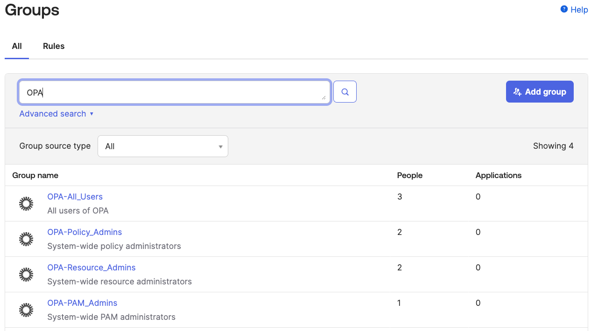
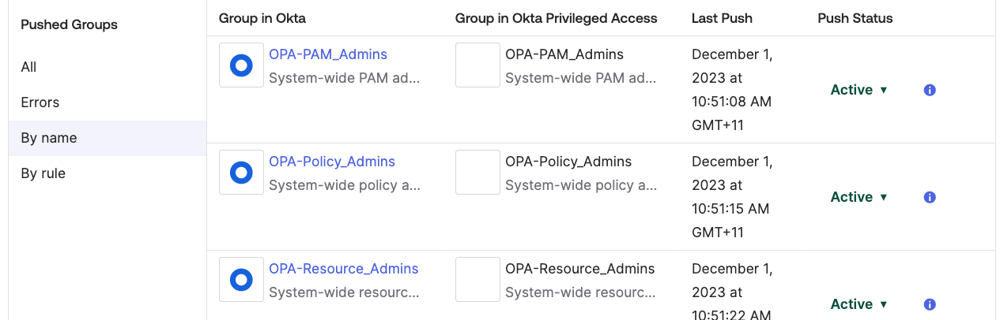

# Configure Identity Lifecycle for the App

Prior to running these steps, you will need to have a set of users and
groups in Okta that will be used with OPA (and Access Requests). You
will need users for the different admin roles (Okta admin, PAM Admin,
Resource Admin, Security Admin), and also ordinary users and access
request reviewers. You will also need groups to represent different
functions. You might want a group for each of the three roles (PAM
Admin, Resource Admin, Security Admin) plus one or two resource-specific
admin groups for the Delegated Resource Admin role.

For example, for the screenshots in this guide I have created some
sample users and groups:

<table style="width:73%;">
<colgroup>
<col style="width: 28%" />
<col style="width: 44%" />
</colgroup>
<thead>
<tr>
<th style="text-align: left;"><strong>Group</strong></th>
<th style="text-align: left;"><strong>User(s)</strong></th>
</tr>
<tr>
<th style="text-align: left;">OPA-PAM_Admins</th>
<th style="text-align: left;">david.edwards</th>
</tr>
<tr>
<th style="text-align: left;">OPA-Resource_Admins</th>
<th style="text-align: left;">
reggie.resadmin

david.edwards
</th>
</tr>
<tr>
<th style="text-align: left;">OPA-Policy_Admins</th>
<th style="text-align: left;">
peter.poladmin

david.edwards
</th>
</tr>
<tr>
<th style="text-align: left;">OPA-All_Users</th>
<th style="text-align: left;">
david.edwards

reggie.resadmin

peter.poladmin
</th>
</tr>
</thead>
<tbody>
</tbody>
</table>

We will add other groups and users as needed for specific use-cases
later.

For your environment you should create the users and groups and assign
the appropriate users to the groups prior to performing the following
steps. These continue the steps in the product documentation.

### Enable provisioning

Steps:

1.  In the **Okta Admin console**, go to **Applications** &gt;
    **Applications** and select the **Okta Privileged Access**
    application

2.  Go to the **Provisioning** tab and select **Configure API
    Integration**

3.  Click **Enable API Integration** then **Authenticate with Okta
    Privileged Access**

4.  On the OPA screen, select your new team

5.  On the **Grant Permissions** screen have a look at the permissions
    granted, then enter a username for the service account used for the
    SCIM provisioning (e.g. okta-connection) and click **Approve**

6.  Back in Okta **Save** the changes

7.  **Edit** and **Enable** the provisioning settings on the
    **Provisioning &gt; To App** screen (Create, Update and Deactivate)
    and **Save**

8.  Your original admin user will show an error beside them. Click on
    the error icon and follow the steps to provision them.

This completes the provisioning setup.

### Assign users and groups & Push groups to Okta Privileged Access

Now we can assign users and push groups to OPA.

9.  Assign your users and/or groups to the application - this will be
    all users that need to be defined to OPA, both users to connect to
    servers, and administrators of the OPA application. We recommend
    assigning users via groups

10. Go to **Push Groups** and add any groups that you want to use in OPA
    (such as the administrative groups).

    

11. Go back to the **Okta Dashboard** and click the **Okta Privileged
    Access** app tile

12. Go to **Users** and confirm the users assigned to the app in Okta
    are in OPA

13. Go to **Groups** and confirm the groups defined as push groups in
    Okta are in OPA

If the users and groups are in OPA as expected, this set of steps is
complete.
