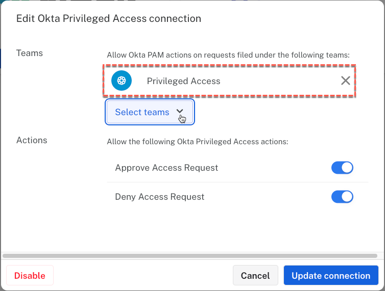

# Configure Access Requests

The last step here is to configure the Access Requests platform for the
new OPA tenant. You only need to do this if you will use Access Requests
in policies, such as with server or secret access. But we recommend you
walk through the configuration even if you don’t plan on using it.

The product documentation for this can be found at
[<u>https://help.okta.com/oie/en-us/content/topics/privileged-access/pam-access-request.htm</u>](https://help.okta.com/oie/en-us/content/topics/privileged-access/pam-access-request.htm).
Note that the Access Requests component is the same as used in Okta
Identity Governance, but has some usage restrictions built in.

### Configure the Okta Privileged Access connection in Access Requests

Steps:

1.  As you did earlier, go to **Access Requests** from the **Okta
    Dashboard** as the administrator

2.  Go to **Settings** and click on the **Connect** button for the
    **Okta Privileged Access** connection

3.  On the new dialog (**Connect to Okta Privileged Access**) enter your
    new OPA team name and click **Connect**

4.  On the next screen (**Edit Okta Privileged Access connection**)
    select your default team and ensure both actions are enabled. Click
    **Update** connection

    

5.  Go back into **Okta** as the administrator and go to **Applications
    &gt; Applications**

6.  Find the **Okta Access Requests** app and assign the same users that
    you assigned to the OPA application (you could restrict it to only
    those users who will need to raise an approval request, but this is
    simpler).

We will not connect Slack or Microsoft Teams for this guide, but you
could do so using the relevant Okta Identity Governance documentation.

We will follow the **Create a Request Type** instructions in the product
documentation later in this guide. Access Requests is ready to use in
the relevant use case.
