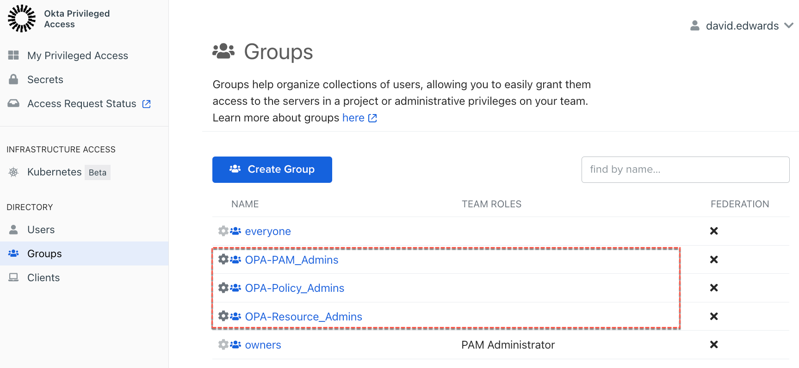
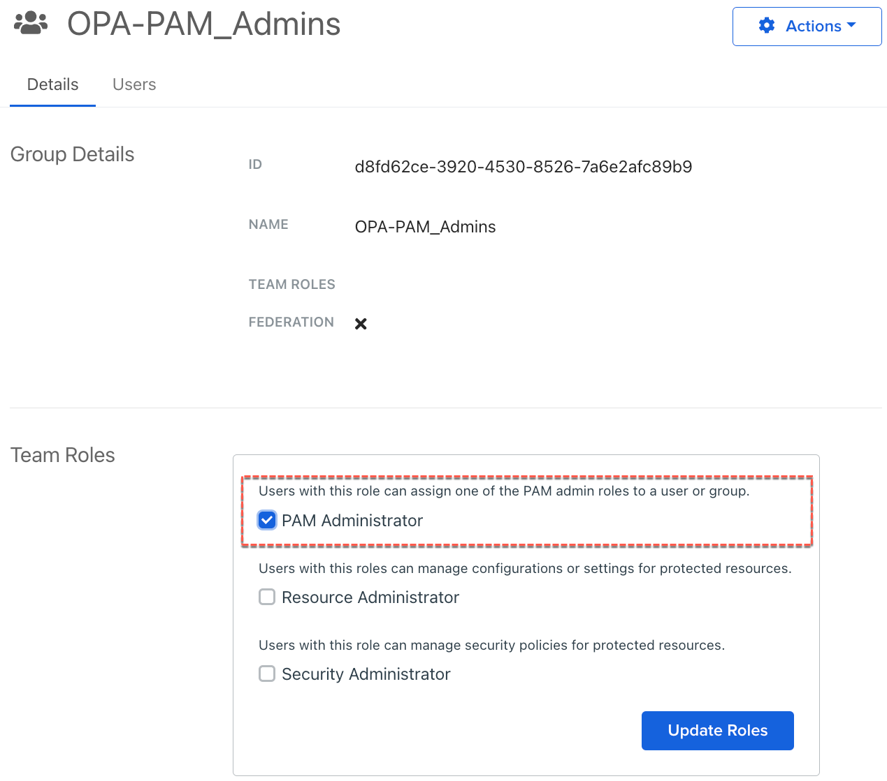
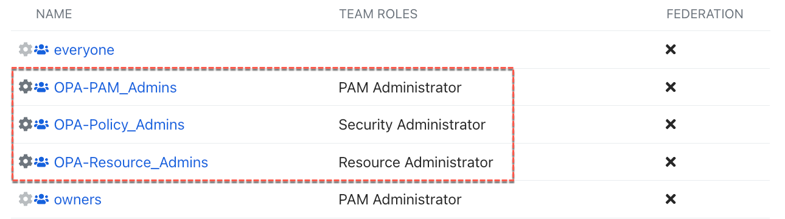
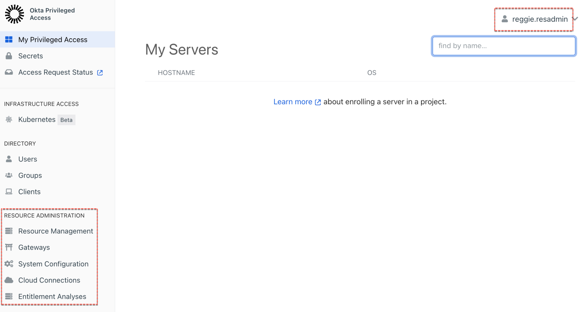
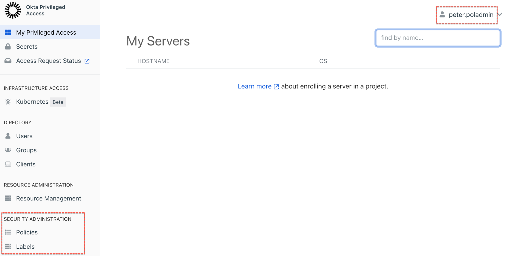

# OPA Administration and Administrators

Prior to starting this section , you must have set up the OPA
application in Okta, assigned users to it and pushed groups from Okta to
OPA.

### View admin roles in OPA

We have not assigned any roles to user groups yet. We will do this in
the following sections. To confirm no roles have been assigned:

1.  If not already there, go to the **OPA UI** and go to the **Groups**
    menu item

2.  Confirm there are no roles listed against the groups, except for the
    owners group that will be in the PAM administrator role.

    

We will add user groups to the different roles in the following
sections.

### Assign PAM Administrators

The PAM Administrator role is for assigning groups to the other roles.
It is not a true “super admin” role as it doesn’t give the assigned
users rights to do everything in the product. To be a “super admin” a
user needs to be assigned to the Resource Administrator and Security
Administrator roles. This is not recommended - you should keep a
separation of administrative roles policy.

The step assumes you created an Okta group for PAM Administrators that
has been pushed to OPA.

1.  Select your *PAM Administrator* group from the list

2.  In the **Team Roles** section, select the ***PAM Administrator***
    role

    

3.  Click the **Update Roles** button and go back to the **Groups** list

### Assign Resource Administrators

The step assumes you created an Okta group for Resource Administrators
that has been pushed to OPA.

1.  Select your *Resource Administrator* group from the list

2.  In the **Team Roles** section, select the ***Resource
    Administrator*** role

3.  Click the **Update Roles** button and go back to the **Groups** list

Repeat for any other Resource Admin groups (not the groups you want to
be Delegated Resource Administrators - this will come later).

### Assign Security Administrators

The step assumes you created an Okta group for Security Policy
Administrators that has been pushed to OPA.

1.  Select your *Security Policy Administrator* group from the list

2.  In the **Team Roles** section, select the ***Security
    Administrator*** role

3.  Click the **Update Roles** button and go back to the **Groups** list

Repeat for any other Security Policy Admin groups.

### Confirm Role Assignments

The **Groups** display should now show each of the groups with Team
Roles.

With the sample data I have used, the user ***david.edwards*** is in all
three groups so has superadmin across the product (not recommended, but
done for simplicity), whereas ***reggie.resadmin*** and
***peter.poladmin*** are restricted to specific functions. You may want
to log in as each user to confirm, but it will become apparent as you
continue with the guide.

The following shows the menu items for a Resource Administrator.

It shows Directory and Resource admin. Note that the Directory functions
are limited to resource management.

The following shows the menu for a Security Administrator.

It shows Directory and Security admin. The directory and resource admin
functions are limited.

You can now proceed with the specific use cases in the following
sections.
