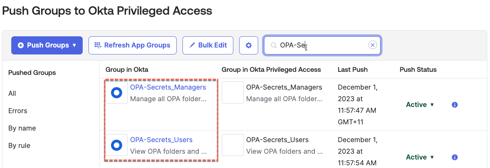
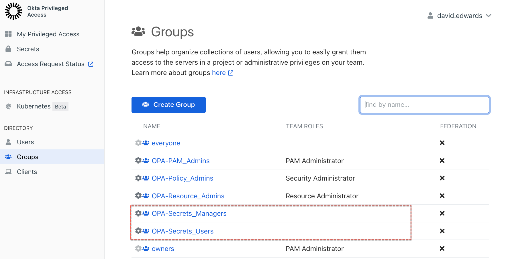

# Create Secrets Users and Managers

For this section of the guide, we will have dedicated users and groups
to manage and use the secrets. You could use the groups we created
earlier, but to highlight the access model in OPA, we recommend setting
up separate groups for the secrets.

For the examples, I have two groups and two users:

| **Group**            | **User(s)**  |
|----------------------|--------------|
| OPA-Secrets_Managers | mike.manager |
| OPA-Secrets_Users    | ursula.user  |

These are just to show the functions - you could have any sort of
topology of users and groups to suit your business needs to manage/use
secrets.

Steps:

1.  If not done, create users and groups in Okta. If you have a group
    for all OPA users assigned to the app, make sure you add any new
    users to it also

2.  Assign the relevant groups as **Push Groups** to the **OPA app** in
    Okta and confirm they are pushed to OPA (see [<u>Assign users and
    groups & Push groups to Okta Privileged
    Access</u>](#assign-users-and-groups-push-groups-to-okta-privileged-access))

    

    

These new groups are not assigned to OPA Team Roles. As we walk through
the following steps you will see how they are assigned through policy to
access secret folders and secrets.
