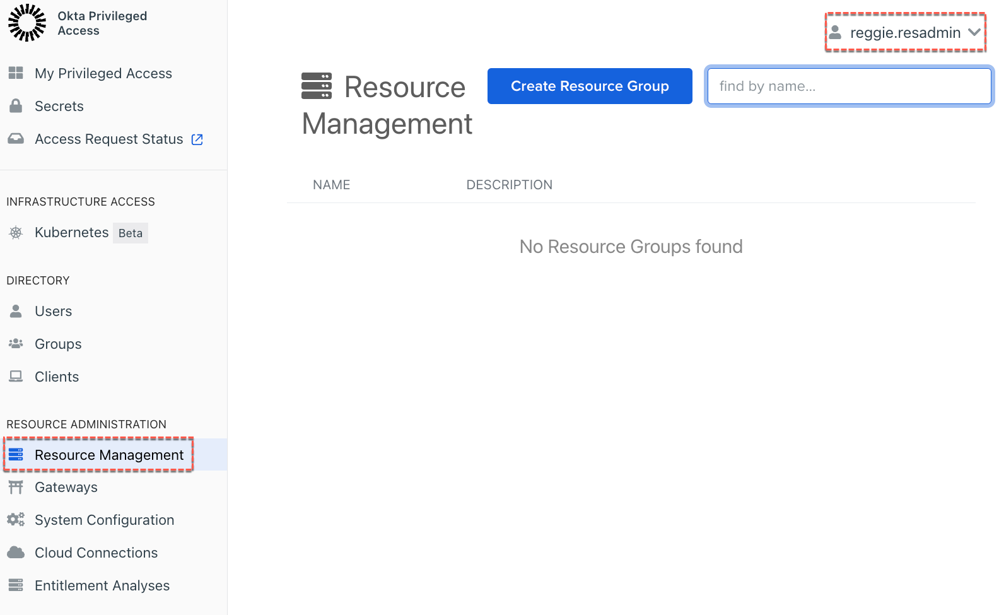
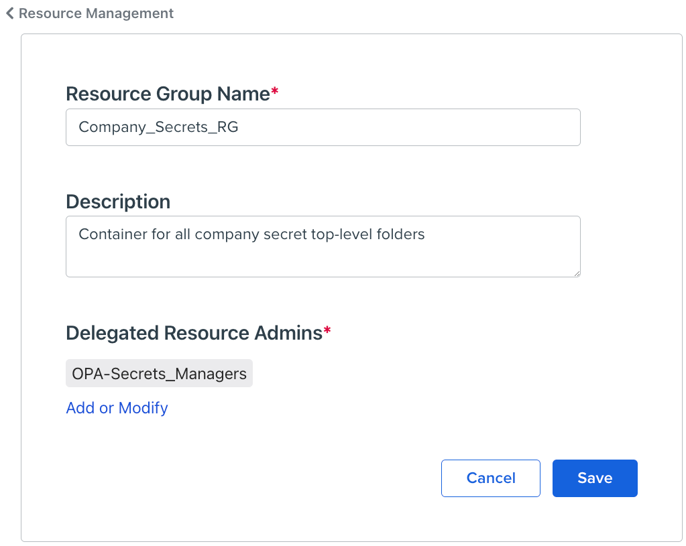
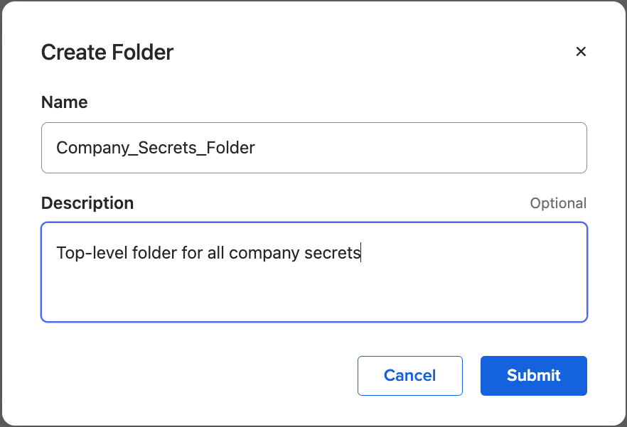
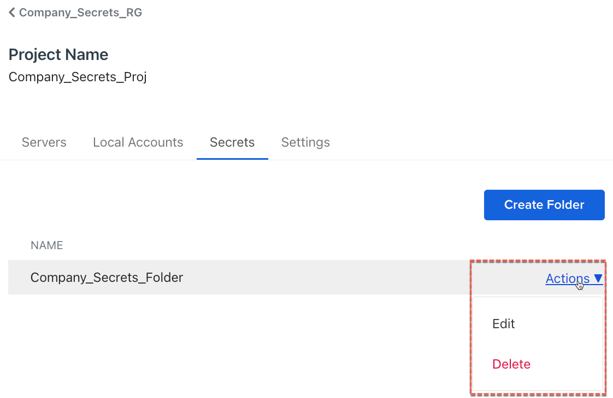
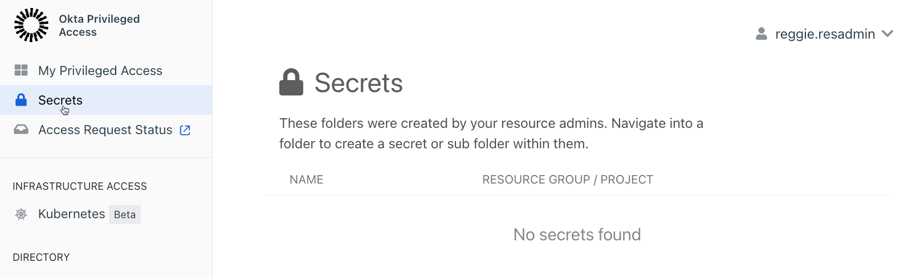

# Create Top-Level Secret Folders

OPA separates **resources** (what users are accessing) from **policies**
(who can access resources and how) and who can administer them. The
resources in secrets management are the **secrets** and the **folders**
to store them. The policies define who can manage or view the folders
and secrets.

Folders are built up in hierarchies to match the access needs of a
deployment. You may have folder hierarchies based on organizational
lines so secrets can be managed by departmental teams. Or you may have
folder hierarchies based on applications or services.

The first step in setting up secrets management is to define one or more
top-level folders. These are the resources we attach initial policy to
so admins can define the structure under them. Hopefully this will
become clearer as we work through the scenarios below.

More information on this can be found in the product documentation
[<u>https://help.okta.com/oie/en-us/content/topics/privileged-access/pam-secrets.htm</u>](https://help.okta.com/oie/en-us/content/topics/privileged-access/pam-secrets.htm).

There is also an external blog article exploring this in more detail -
[<u>https://iamse.blog/2023/11/30/introducing-secrets-management-in-okta-privileged-access/</u>](https://iamse.blog/2023/11/30/introducing-secrets-management-in-okta-privileged-access/).

### Create a Resource Group for Top-Level Folders

Resource groups are containers for resources, and are used to assign
delegated administrators. If you wanted to have different teams or
departments managing different sets of resources, you would create
different resource groups. We will create a single resource group for
all the secrets and folders.

Steps:

1.  As a *resource administrator*, log into **Okta** and access **Okta
    Privileged Access** 
    Notice that this user sees the RESOURCE ADMINISTRATION items as well
    as their self menu items (My Privileged Access, Secrets and Access
    Request Status) and the DIRECTORY menu items. This is because they
    are in the Resource Administration role.

2.  Go to **Resource Management** under **RESOURCE ADMINISTRATION**

    

3.  Click the **Create Resource Group** button

4.  Give the Resource Group a **Name** and **Description**. For the
    Delegated Resource Admins, add a group for managing secrets.

    .

5.  Click the **Save** button

The resources in this group can now be managed by any system-wide
resource admins (like my ***OPA-Resource_Admins*** group) and anyone in
the Delegated Resource Admins list (like my ***OPA-Secrets_Managers***
group). These admins can create and manage projects and the top-level
folders in them. You could check the group list and see the Delegated
Resource Administrator Team Role assigned to the group.

### Create a Project

Projects are the next level of containers. They are used for like sets
of resources, i.e. resources with common PAM settings or needs. This is
more relevant in the server access use cases we will explore in other
parts of this document. But you need to create one or more projects for
the top-level folders for secrets.

To create a project:

1.  On the Resource Group page, click the **Create Project** button

2.  Give it a name and click the **Save** button

3.  Ignore the <u>Servers</u>, <u>Local Account</u>s and <u>Settings</u>
    tabs as they apply to servers. Go to the **<u>Secrets</u>** tab

You are now ready to create one or more top-level folders.

### Create a Top-Level Folder

Top-level folders are the anchors to assign policy and start to build a
folder hierarchy. We will create a single top-level folder.

1.  In the **Project** screen, **<u>Secrets</u>** tab, click the
    **Create Folder** button

2.  Give the new folder a name and description

    

3.  Click the **Submit** button

You now have a top-level folder. If you want you can add others and
edit/delete them.

Note that you cannot add subfolders to the top-level folder - you need
a policy to do that.

4.  Click on the **Secrets** menu item towards the top of the page

    

This is the end-user view of secrets. You might expect to see the
top-level folder(s) here. Why don’t you? Because you need a policy to
see the folders (and secrets) in this view.

We will do that in the next section.
