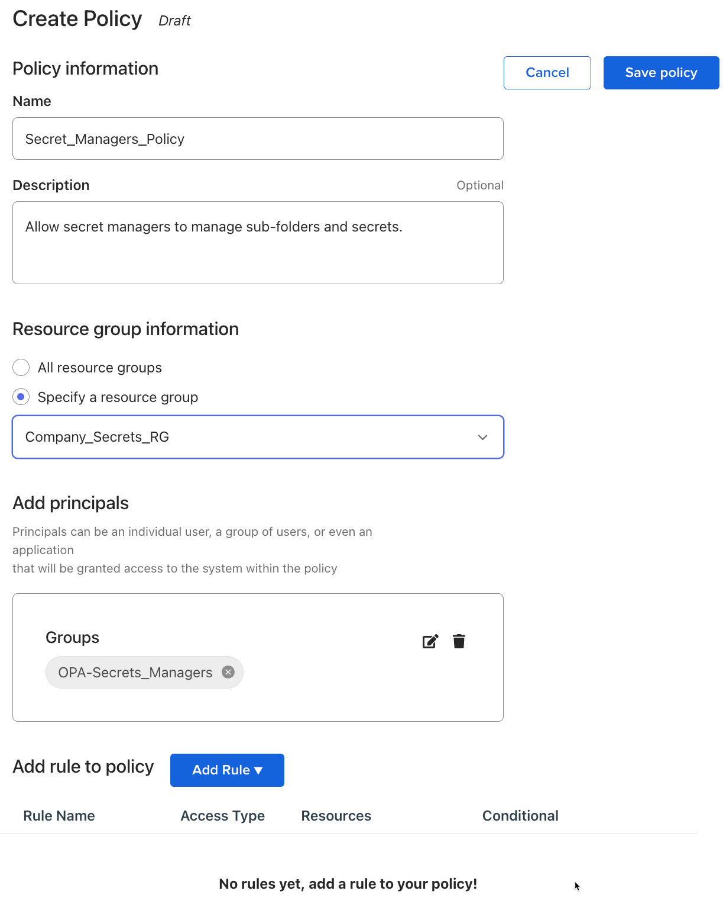
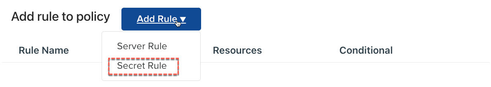
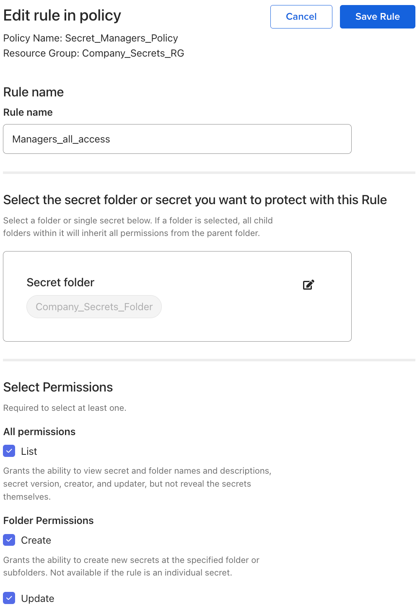
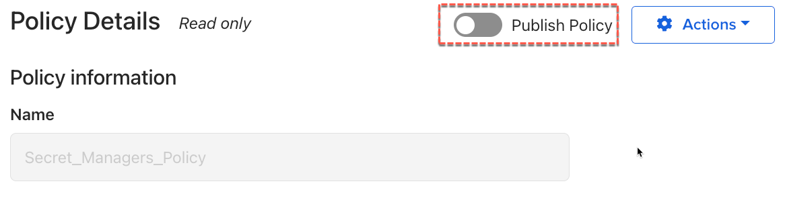
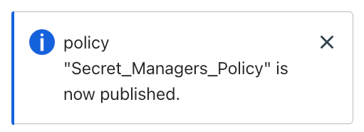
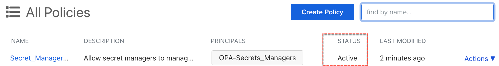
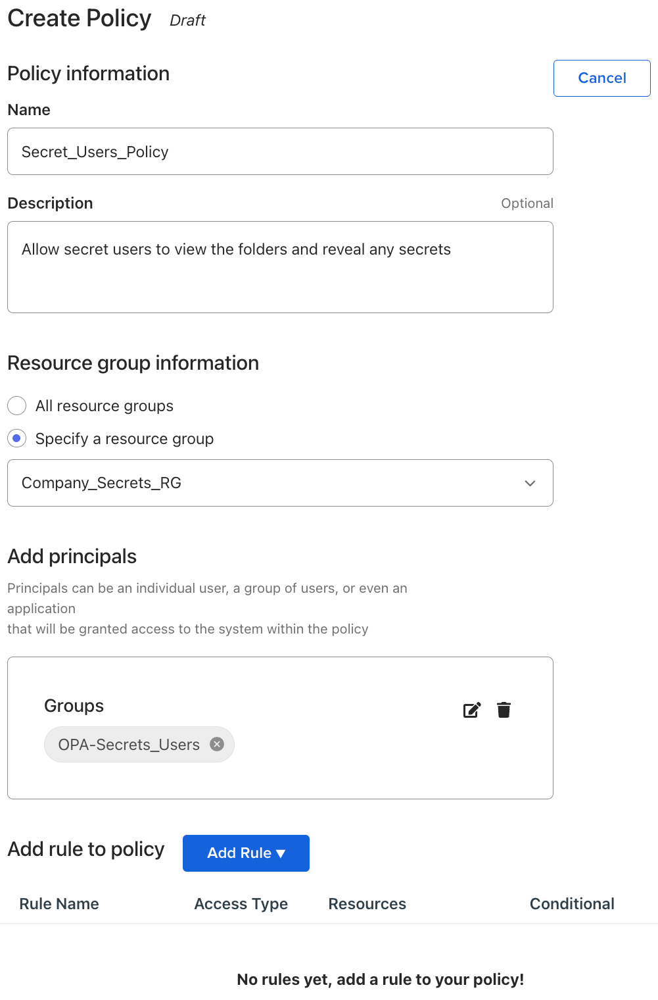
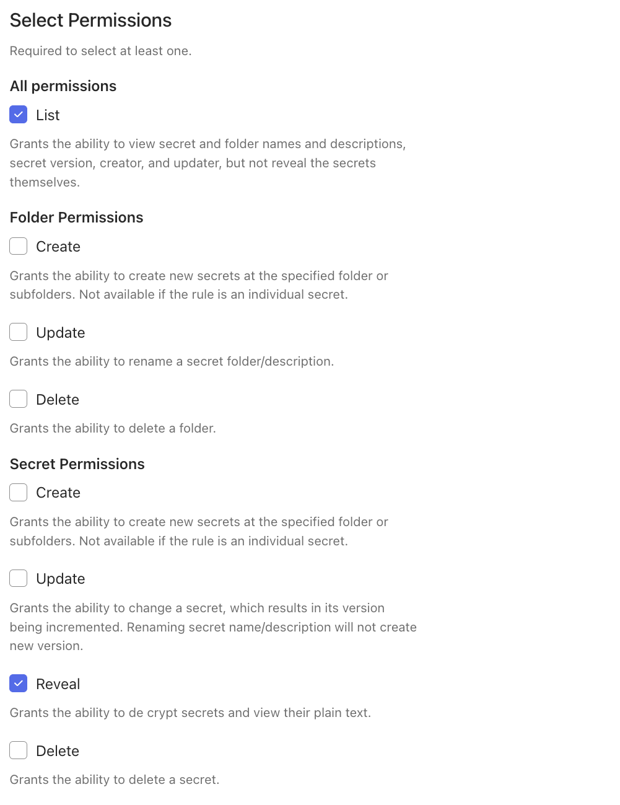

# Create Policies for Folders and Secrets

In the previous section we created a top-level folder, but cannot do
anything useful with it (such as creating secrets) because you need
policy to do that.

Security policies map groups of users (Principals) to resources with
controls. As we have two user populations (secret managers and secret
users) we will need two policies. Policies can be scoped to specific
resource groups (and thus the top-level folders in them) or across all
resource groups.

The rules in a policy for secrets are based on folders and secrets. The
rules apply hierarchically - if you assign it to a folder, the rule will
apply to all folders and secrets in it, if you apply it to a specific
secret then it will only apply to that secret. If you want rules for
parallel folders or secrets (e.g. multiple top-level folders), then you
will need multiple rules. You can also have different permissions in
each rule, so you could have a policy for a group of users that grants
different levels of access to different folders.

We will create two policies, one for each group (managers and users),
and a rule in each.

### Create Managers Policy with Rule

First we will create the policy for the secret managers.

Steps:

1.  As a *security policy administrator*, log into **Okta** and access
    **OPA** via the **Dashboard**

    Notice that this user sees the RESOURCE ADMINISTRATION and SECURITY
    ADMINISTRATION items as well as their self menu items (My Privileged
    Access, Secrets and Access Request Status) and the DIRECTORY menu
    items. This is because they are in the Security Policy
    Administration role. There is a particular scenario where a policy
    administrator needs to manage delegated security admins in resource
    groups that we won’t cover here.

2.  Go to **Policies** under **SECURITY ADMINISTRATION**

3.  Click the **Create Policy** button to create a new policy

4.  For the policy:

    1.  Give the policy a **Name** and **Description**.

    2.  Select ***Specify a resource group*** under **Resource group
        information** and select the resource group you created earlier
        (this will keep the policy separate from other resource groups
        created later in this guide)

    3.  In the **Add principals** section add your secrets managers (or
        similar) group in the pop-up dialog and click **Save**

5.  Select the **Add Rule** button and select ***Secret Rule*** from the
    pulldown

    

6.  On the Add rule to policy page:

    1.  Specify a **Rule name**

    2.  In the **Select the secret folder or secret you want to protect
        with this Rule** section, select the top level folder you
        defined earlier (and click the **Save** button to return to the
        **Add rule to policy** screen).

        Note that you could leave this blank and have the rule apply to
        every folder/secret in the resource group

    3.  In the **Select Permissions** section, select all the
        checkboxes

        It may be worthwhile reading all the descriptions of the
        permissions to understand what is being granted.

    4.  Ignore the **Approval requests (optional)** section. It is used
        to assign an access request to the actions permitted by this
        policy. We will discuss that condition when looking at
        infrastructure (server) access later in this document.

7.  When satisfied with what you’ve set, click the **Save Rule** button

8.  Back on the **Create Policy** page, click the **Save policy** button

9.  On the refreshed **Policy Details** page, toggle the **Publish
    Policy** switch to on

    

10. On the **Publish Policy** dialog, click the **Publish Policy**
    button to confirm the policy should be published and notice the
    confirmation message (bottom right of screen)

    

    You can close this message or it will go away automatically as do
    any messages displayed in OPA.

11. Click **&lt; Policies** to return to the Policies view

This policy is now live (published).

We will test it in the next section.

### Create User Policy with Rule

Next we will create the policy for the secret users.

1.  Repeat the steps from above to create a **Policy** for the secret
    users. It should look something like this.

    

2.  Create a single **Rule** similar to what you did earlier. But under
    **Select Permissions** only select **All permissions - List** and
    **Secret Permissions - Reveal**. This will restrict access to
    viewing and traversing folders, seeing and revealing secrets.

    

3.  As before, **Save Rule**, then **Save policy** and finally **Publish
    Policy**

You should now have two live rules, a full-access managers policy and a
read-only users policy. In the next section we will test the manager
policy.

Before we switch over to a manager, go back to the Secrets menu item at
the top. Can this admin see the top-level secrets folder? No. Why?
Because this user is not in either of the groups we just created a
policy for. Even the system-wide resource admin cannot see
folders/secrets unless their user group is assigned to it in a policy.
