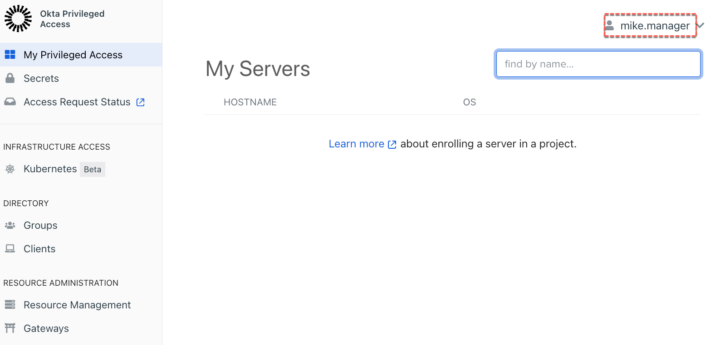
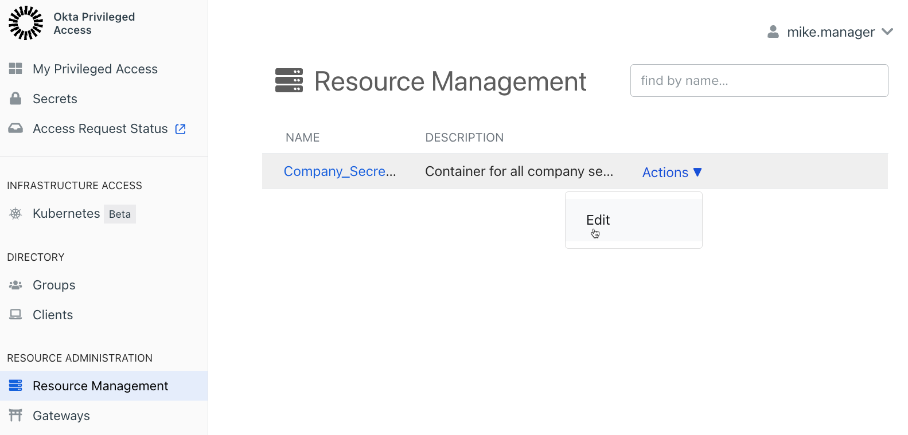
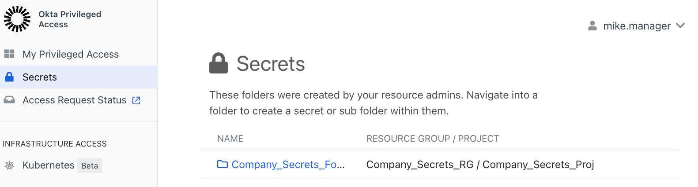
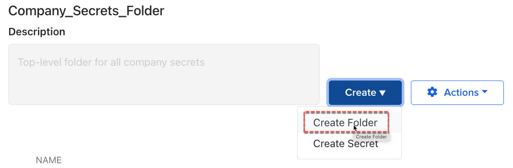
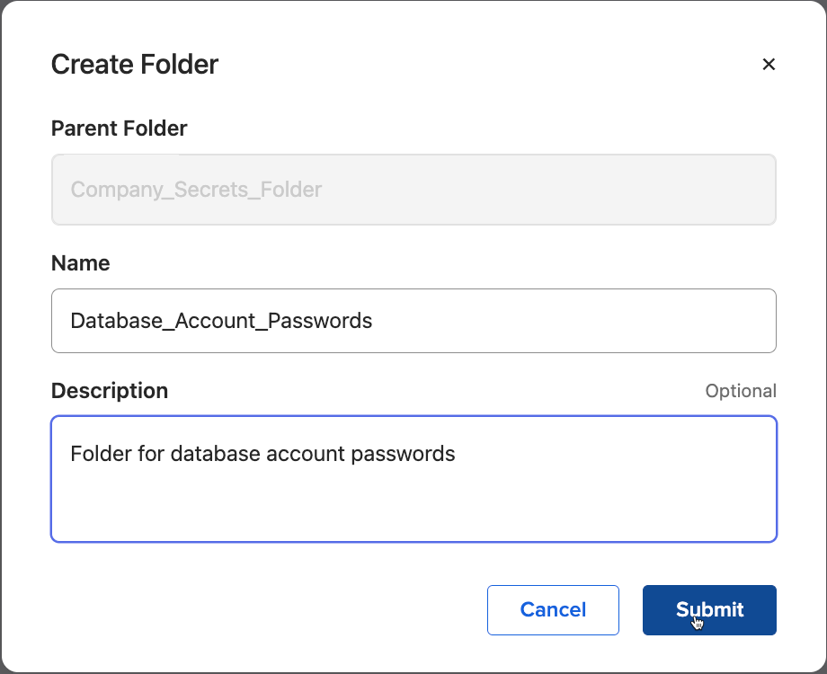
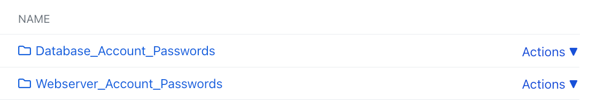

# Create Sub-Folders for Secrets

We now have a top-level folder and policies to allow management of
subfolders and secrets in it. Let’s create some subfolders to test the
policy.

Steps:

1.  As a *secret manager*, log into **Okta** and access **Okta
    Privileged Access** via the **Dashboard**

    

    Notice that this user sees the RESOURCE ADMINISTRATION items as well
    as their self menu items (My Privileged Access, Secrets and Access
    Request Status) and some DIRECTORY menu items (only Groups and
    Clients, and limited functions in each). This is because they are
    the managers group that was assigned as a delegated Resource
    Administrator for that resource group.

2.  Go to **Resource Management** under **RESOURCE ADMINISTRATION**.

    

    They can edit the existing resource group, but cannot add a new one
    or delete the one that is there.

3.  Click the **Actions &gt; Edit** option (or the name of the Resource
    Group). 
    As they are resource admins, they can create, modify or delete
    projects within that resource group. This means that they can also
    create/modify/delete top-level folders.

4.  Go to the **Secrets** menu item

    

    Unlike the other users we’ve used so far, this one can see the
    top-level folder in this view. This is because he is in a group tied
    to a policy granting this.

5.  Click on the top-level folder name. There are no secrets or sublevel
    folders.

6.  Click the **Create** button and select ***Create Folder*** from the
    pulldown menu

    

7.  On the **Create Folder** dialog give the new folder a **Name** and
    **Description**

    

8.  Click the **Submit** button to create it

9.  Repeat the steps to create a second folder

    

    Note that you can edit/delete the folders as well.

We now have some folders that we can add secrets to. You could also go
back and create policy rules that apply to these subfolders only, but we
will not do that.
