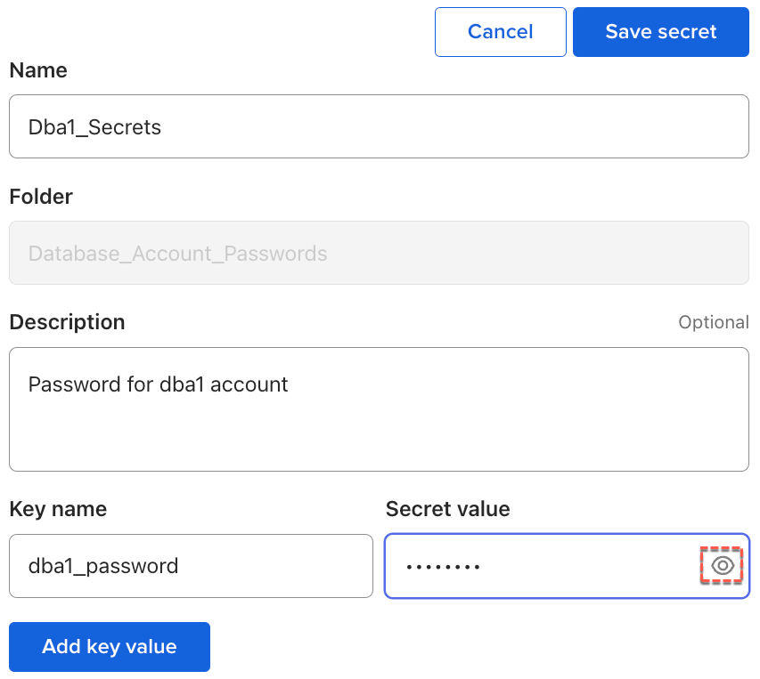
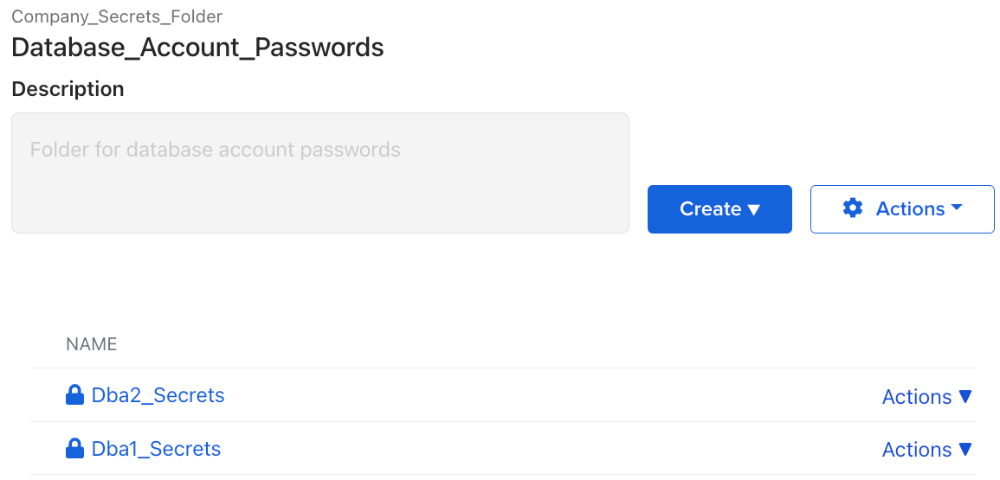
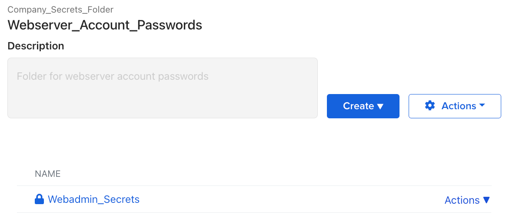

# Create Secrets

Next we will create some secrets, as the same user.

Steps:

1.  Click on the first of your folders

2.  When you are in the subfolder, select **Create &gt; Create Secret**

3.  Give the new secret a **Name**, **Description**, **Key name** (such
    as the account) and **Secret value** (it will be hidden, but you can
    click the eye icon to reveal)

    

    Note that you can add multiple key:value pairs in a single secret.

4.  Click the **Save secret** button

5.  Go back to the subfolder and repeat adding another secret

    

6.  Go back up to your top-level folder, then down into your second
    subfolder

7.  Add another secret there

    

We now have three secrets across two subfolders.

As the secret manager, we can both manage and reveal the secrets. But
what about secret users? Let’s try that.
