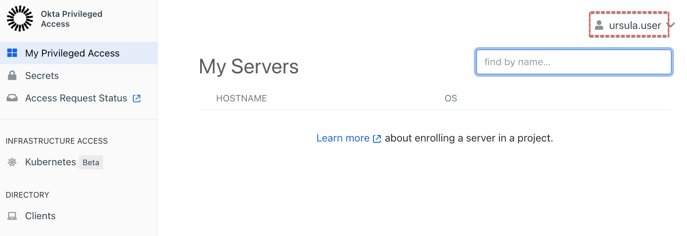
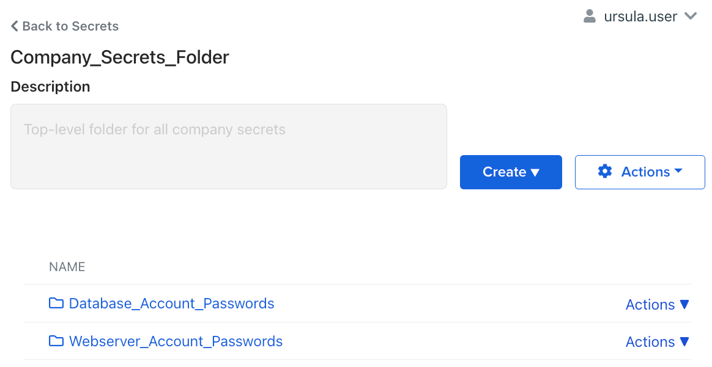
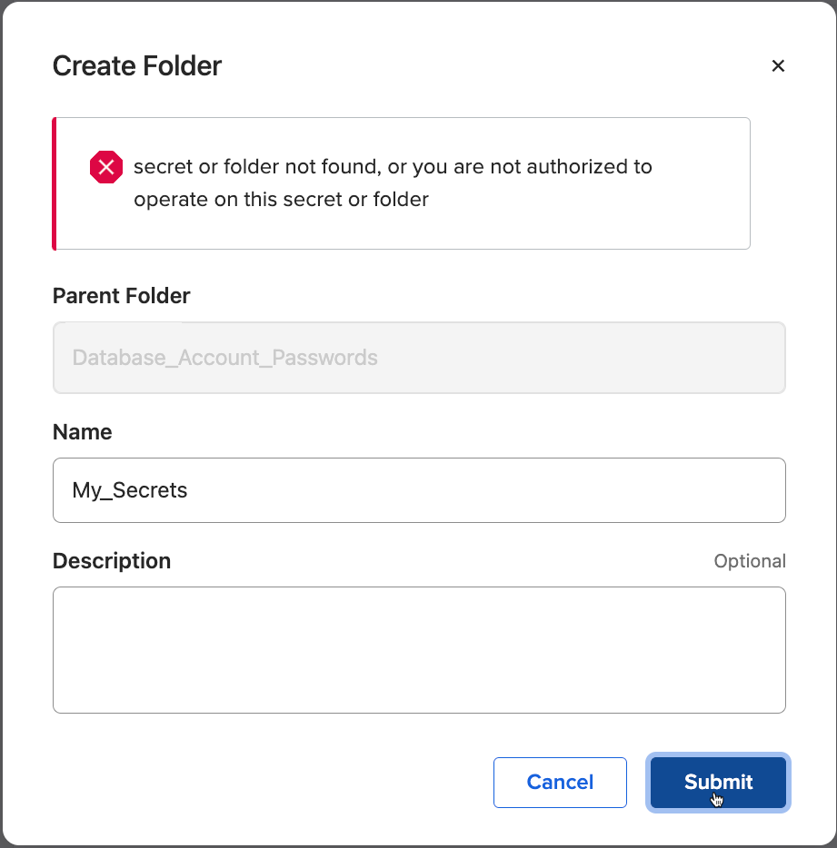
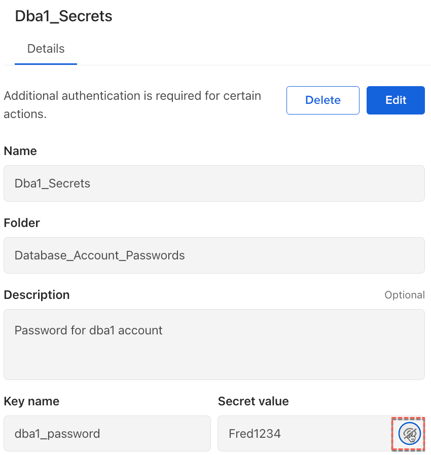

# Access Secrets

We have defined a policy so that secrets users can only go through the
folders and reveal secrets but not manage the folders or secrets. In
this last section of this secrets management lab, we will explore the
end-user experience.

1.  As a *secret user*, log into **Okta** and access **Okta Privileged
    Access** via the **Dashboard**

    

    This is the standard end-user view. They do not see any of the
    administrative menu items (ignore the Kubernetes Beta item).

2.  Click on the **Secrets** menu item. It shows the top-level folder as
    we saw earlier.

3.  Click on the top-level folder name to see the subfolders we created
    above.

    

4.  Try to create a new subfolder with the **Create &gt; Create Folder**
    action.

    

    You will be blocked at submission time as the user policy does not
    allow create/update/delete operations on folders or secrets. 
    **Cancel** out to return to the folder view.

5.  Select the first folder and one of the secrets

6.  On the secret page, click the **Reveal Value** button

7.  Click the eye icon to reveal the secret value

    

The user can copy and use the secret, but cannot modify or delete it.
This is based on the policy rules.

That completes the steps for the secrets management lab.
