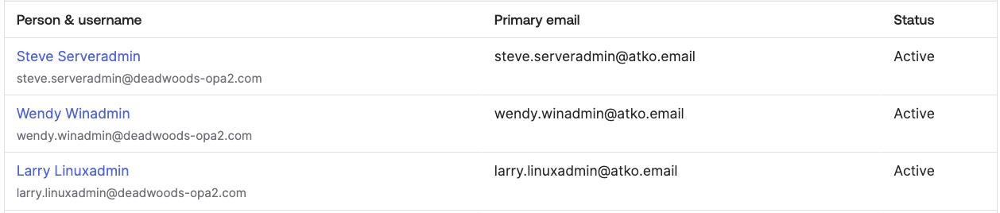
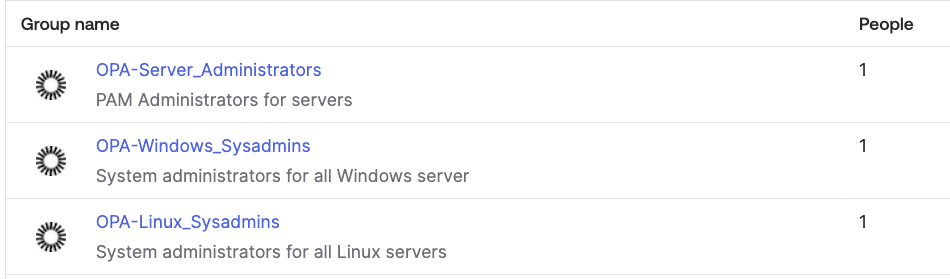
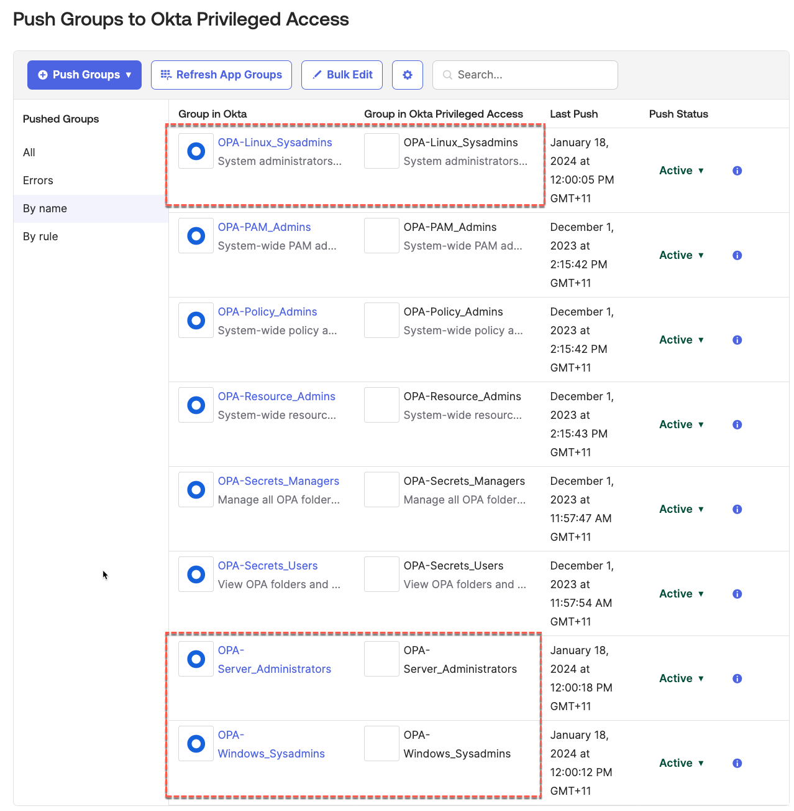
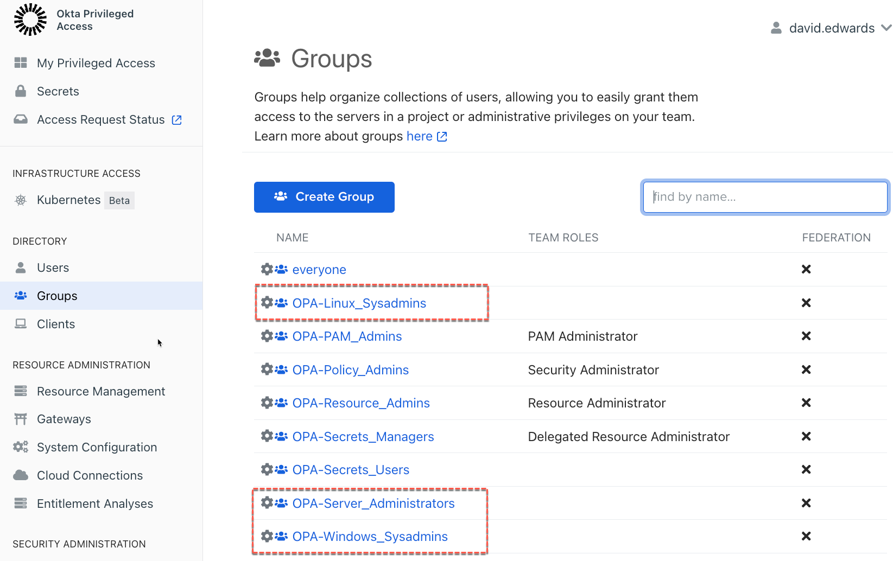

# Create Server Users and Administrators

As with the secrets management use cases we need to have users and
groups in Okta, in this case to represent the users (sysadmins) who need
to access servers and the set of admins to manage the server resources
in OPA (delegated resource admins).

This section will provide an example of the users and groups that could
be applied (and will be used in the later sections) but the users and
groups you assign is up to you.

### Create Okta Users and Groups

As users and groups are pushed from Okta to OPA, you will need Okta
users and groups to represent the users and administrators in OPA.

I created the following three users.

I also created three groups to represent the different groupings I want
in OPA - one each for the different sysadmin functions and one for the
OPA delegated admins.

These are just examples for the sake of the steps in the guide. How you
design the groups (and policies and resources in OPA) is up to your
business needs.

### Push Groups to OPA

The users were assigned to the three groups and also to the common group
I have for all OPA users. The three new groups were set as Push Groups
on the OkaPA application.

### New Groups in OPA

They appear in OPA.

Once you have users and groups in OPA for the server access use cases,
next you need to install the infrastructure components.
