# Infrastructure Component Installation

To access servers via OPA, there are some infrastructure components to
be installed

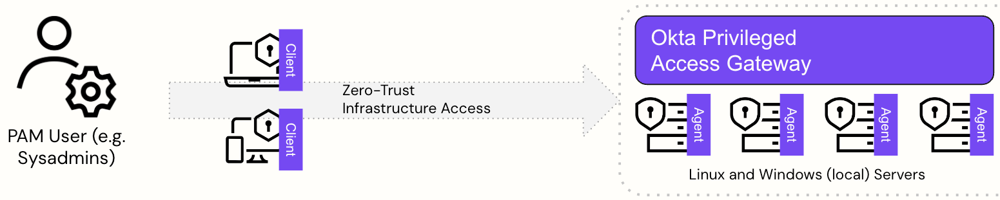

They are: the **client** on the user workstations for anyone that needs
to access servers, the **agent** on the servers being connected to and
optionally the **gateway**. We will install all three.

### Client Installation and Enrollment

Clients are installed on every workstation for users that will connect
to servers. Note that if you want to access secrets via the command line
interface, you also need the client installed and enrolled.

Client installation for the different platforms are documented
[<u>https://help.okta.com/oie/en-us/content/topics/privileged-access/clients/pam-clients.htm</u>](https://help.okta.com/oie/en-us/content/topics/privileged-access/clients/pam-clients.htm).
You need to install the client, then enroll it and confirm it’s working
(steps for this are shown in the documentation). I followed the steps
for an Ubuntu client installation, but choose the steps appropriate for
your workstation(s).

1.  Install the OPA client package

    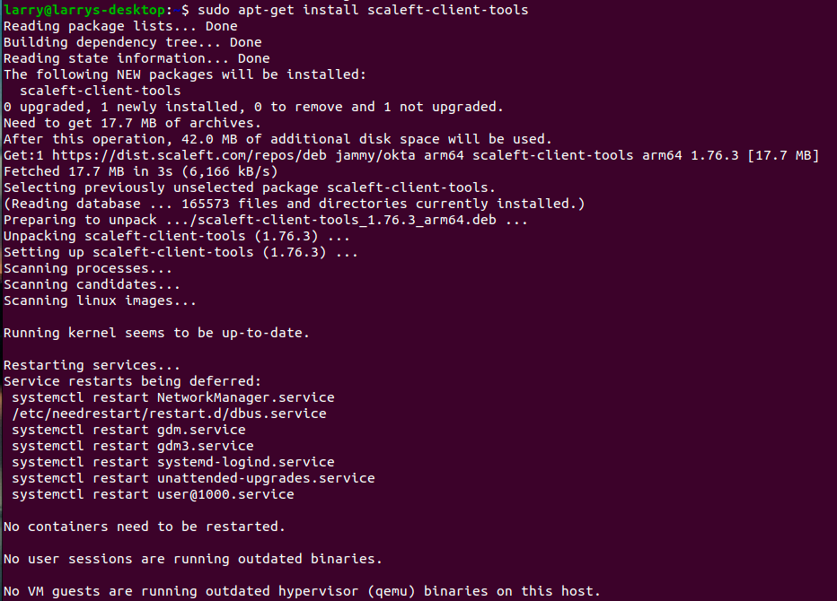

2.  As a *PAM administrator*, go into OPA and find the client enrollment
    command on the **Clients** view in the OPA administrator console.

    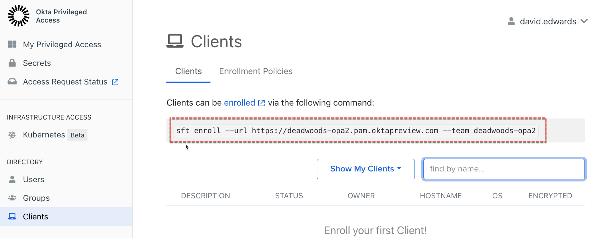

3.  Use that command, with browser login as your user and following the
    browser prompts, to enroll the client.

    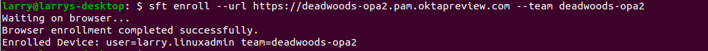

4.  In the browser window that was opened as part of the enrollment, got
    to the Clients menu item and confirm you can see the new client

    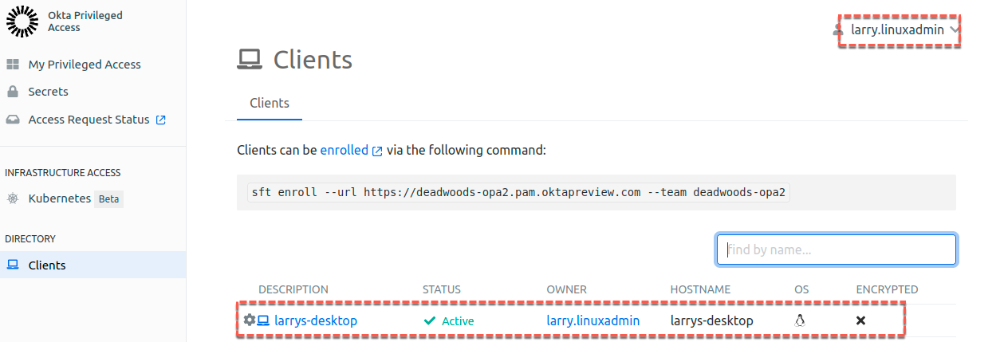

5.  In the terminal window run the command sft list-teams to confirm the
    client is working.

    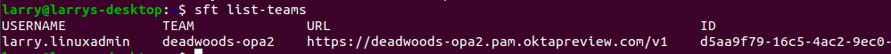

The client is enrolled and working.

You can repeat the process for any other accounts you want to use to
test server access in OPA.

### Server Agent Installation and Enrollment

For the labs, I have created three servers in AWS EC2, two Linux (one as
a target and one for the gateway) and a Windows server. You could have
any number of physical or virtual machines, it won’t change the steps to
install and enroll the agents.

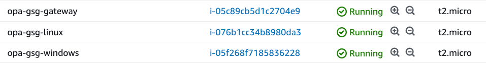

There are two tasks required:

1.  Install the agent onto the servers,

2.  Create resource groups, projects and enrollment tokens, and use the
    enrollment tokens to enroll the servers.

This is the order shown in the product documentation
([<u>https://help.okta.com/oie/en-us/content/topics/privileged-access/server-agent/pam-deploy-and-manage-servers.htm</u>](https://help.okta.com/oie/en-us/content/topics/privileged-access/server-agent/pam-deploy-and-manage-servers.htm))
and we will follow that.

Note that you could create the relevant resource groups/projects and
enrollment tokens, then install the agents with the tokens. This is the
approach used for automation (like using terraform scripts).

#### Install the OPA Server Agent on Linux

1.  Install the agent on Linux. There are specific steps for different
    flavors of Linux in
    [<u>https://help.okta.com/oie/en-us/content/topics/privileged-access/tool-setup/install-agent.htm</u>](https://help.okta.com/oie/en-us/content/topics/privileged-access/tool-setup/install-agent.htm).
    The following shows Ubuntu, but follow the steps for your Linux
    platform.

    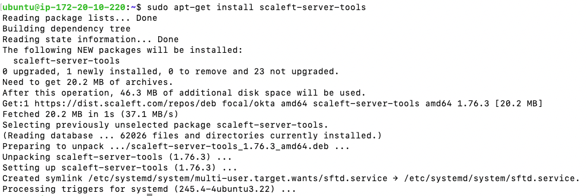

2.  Verify the daemon is running

    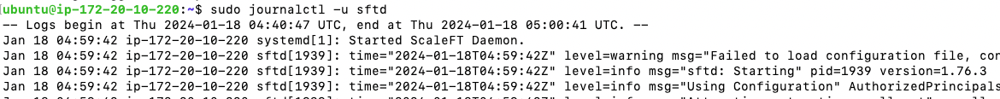

You could also install the agent on the gateway server(s).

#### Install the OPA Server Agent on Windows

3.  Follow the steps in
    [<u>https://help.okta.com/oie/en-us/content/topics/privileged-access/tool-setup/pam-sftd-windows.htm</u>](https://help.okta.com/oie/en-us/content/topics/privileged-access/tool-setup/pam-sftd-windows.htm)
    to download and install the agent on the Windows server(s).

4.  Use the Services app to confirm that the agent is installed and
    running

    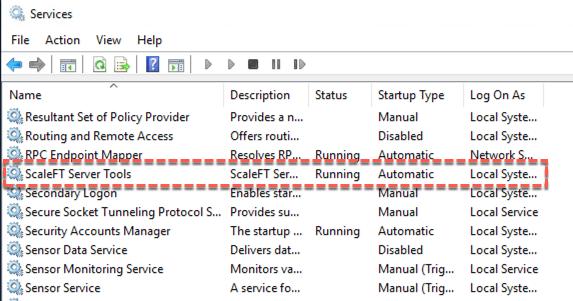

#### Create a Resource Group

5.  Go into **OPA** as a *Resource Administrator* and go to **Resource
    Management** (under Resource Administration). If you have run the
    secrets management lab, you may see a resource group already there.

6.  Click the **Create Resource Group** button to start the creation.

7.  We will use a single resource group for all servers. Give it a
    **Name** and **Description**. Select the server administration group
    you defined for the **Delegated Resource Admins**

    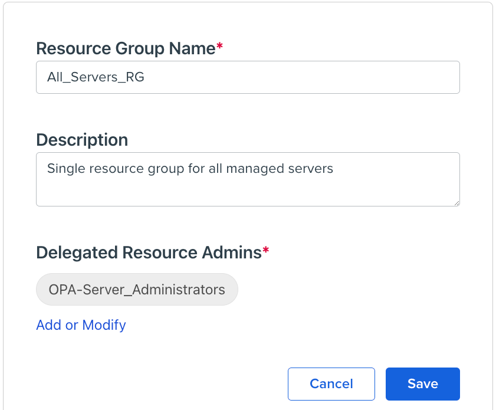

8.  Click the **Save** button

In this example we have created a single resource group for all the
servers. You would probably create multiple to suit the administrative
needs of your business.

We will create two projects, one for the Linux servers and one for the
Windows servers.

#### Create a Project for Linux Servers with Enrollment Token

9.  On the page for the new resource group, click the **Create Project**
    button

10. Give the new project a **Name** and click the **Save** button

11. On the **<u>Settings</u>** tab click **View** for **Enrollment
    tokens**

12. Click the Create Enrollment Token button

13. Give the new token a **Description** (it’s a label and isn’t
    important) and click **Save**

There are many settings on this page. We will explore Account discovery,
Password Settings and Gateway Selector in a later section. For the
others refer to the product documentation.

#### Create a Project for Windows Servers with Enrollment Token

14. Repeat the steps above to create a project for the Windows servers
    and create an enrollment token

15. Confirm that you have a single resource group with two projects in
    it

    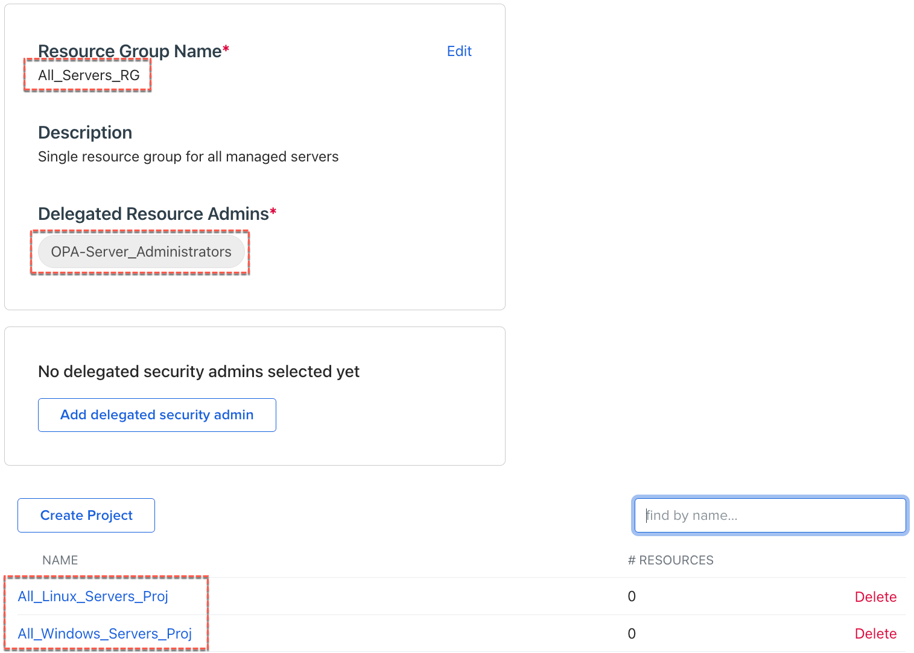

Next we will use the enrollment tokens to enroll the server agents.

#### Enroll the Linux Server

16. Copy the Linux enrollment token from the Linux project

17. On the Linux server create the file /var/lib/sftd/enrollment.token
    and add the token to it

18. Restart the **sftd** service (e.g. systemctl stop sftd then
    systemctl start sftd on Ubuntu)

19. Back in the OPA project, switch to the **<u>Servers</u>** tab and
    check that the server is there (there may be a slight delay for the
    enrollment to register)

    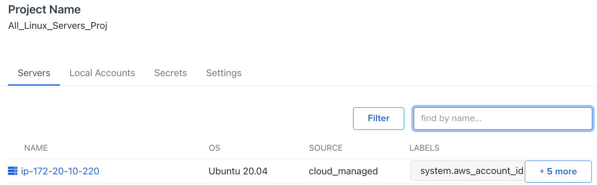

20. Click on the server name and view the details of the server

Note that there have been labels applied to the newly enrolled server.
This will become relevant when creating policy to control access to the
servers.

#### Enroll the Windows Server

21. Copy the Windows enrollment token from the Windows project

22. On the Windows server create the file
    C:\windows\system32\config\systemprofile\AppData\Local\scaleft\enrollment.token
    and add the token to it (as it’s Windows make sure the filename ends
    with .token, not .token.txt)

23. From Services, restart the **ScaleFT Server Tools** service

24. Back in the OPA project, switch to the Servers tab and check that
    the server is there (there may be a slight delay for the enrollment
    to register)

    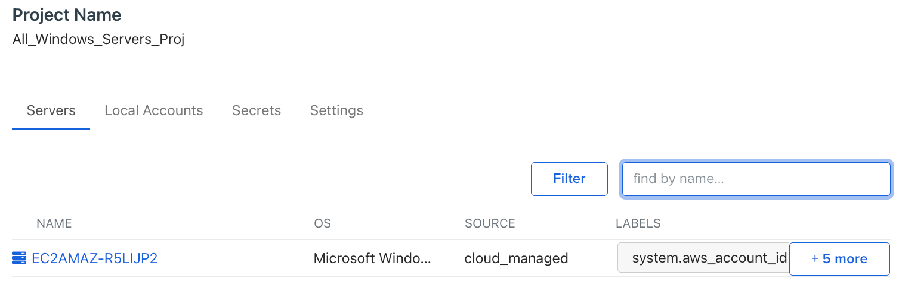

25. Click on the server name and view the details of the server

At this point we have installed the server agents and enrolled two
servers (one Linux and one Windows) into two separate OPA projects
within the one OPA resource group.

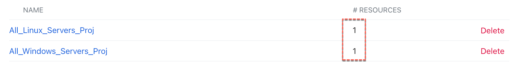

At this point no-one can access these servers via OPA - we need to
define policies to allow that, which we will do in later sections.

We did not mention it above, but you could also create and configure the
agent configuration file, sftd.yaml. It is used for additional settings
on the agent, such as setting a canonical name. See
[<u>https://help.okta.com/oie/en-us/content/topics/privileged-access/server-agent/pam-configure-server-agent.htm</u>](https://help.okta.com/oie/en-us/content/topics/privileged-access/server-agent/pam-configure-server-agent.htm)
for more information.

### Gateway Installation and Enrollment

Gateways are used for network proxying and session recording (and likely
future functions). If you don’t need these capabilities, you don’t need
to deploy gateways. But in most cases it is recommended. Details on
Gateways can be found in the product docs -
[<u>https://help.okta.com/oie/en-us/content/topics/privileged-access/gateways/pam-gateways.htm</u>](https://help.okta.com/oie/en-us/content/topics/privileged-access/gateways/pam-gateways.htm).

The following sections follow the installation steps in the
documentation.

#### Before you Begin

The pre-reqs for the gateway can be found at
[<u>https://help.okta.com/oie/en-us/content/topics/privileged-access/tool-setup/pam-install-gateway.htm</u>](https://help.okta.com/oie/en-us/content/topics/privileged-access/tool-setup/pam-install-gateway.htm).
These include:

- Having a server with the appropriate Linux OS for the gateway (see
  [<u>https://help.okta.com/oie/en-us/content/topics/privileged-access/pam-supported-os.htm</u>](https://help.okta.com/oie/en-us/content/topics/privileged-access/pam-supported-os.htm))

- Having the relevant incoming/outgoing ports open for the gateway (22
  if you will still allow direct SSH, 7234 for the client-gateway
  brokering)

Capacity planning is not covered in this document, but if you are going
to perform session recording and transcoding, you will need to allow for
sufficient disk space and processing capacity (particulalry for RDP
transcoding). See
[<u>https://help.okta.com/oie/en-us/content/topics/privileged-access/gateways/pam-gateway-capacity-planning.htm</u>](https://help.okta.com/oie/en-us/content/topics/privileged-access/gateways/pam-gateway-capacity-planning.htm).

#### Install the OPA gateway

I used the Ubuntu/Debian instructions for my Ubuntu server, but there
are similar instructions for Red Hat/CentOS.

1.  Install the gateway as per the documentation. This is similar to
    installing the agent.

    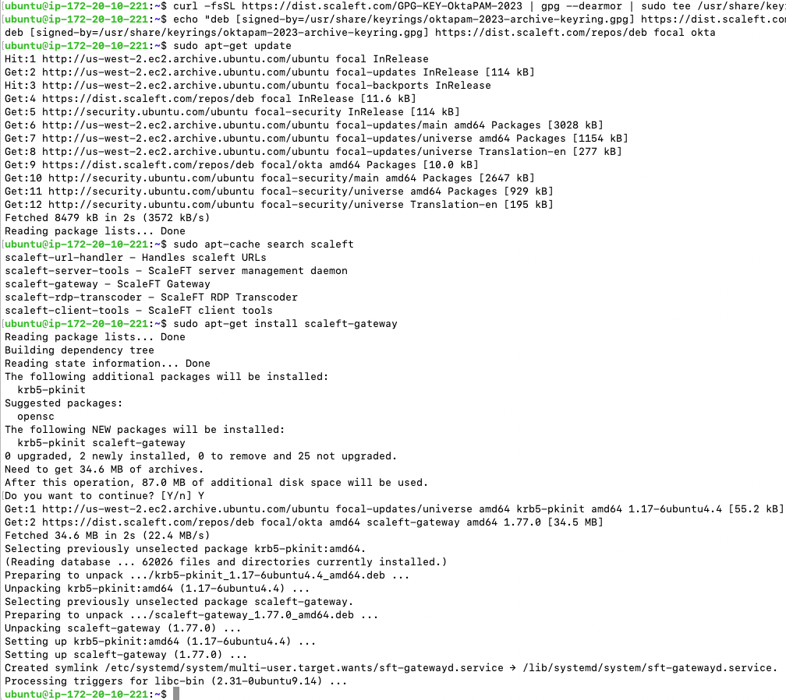

The next step is to enroll the gateway.

#### Create tokens and labels

2.  Log into **OPA** as a *Resource Administrator* (in our example it
    could be someone in the system-wide resource group or the server
    administrators group)

3.  Go to **Resource Administration &gt; Gateways**

4.  Click **Set up gateways &gt; Create setup token\**
    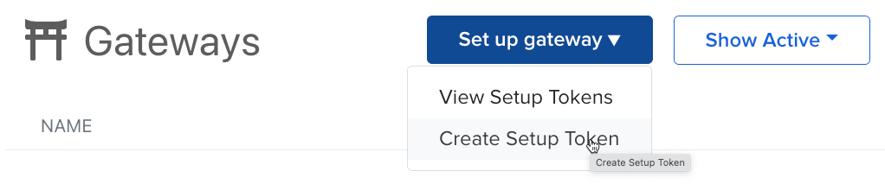

5.  Give the token and **Name** and add one or more **gateway labels**.
    These labels will be assigned to the gateway and used to associate
    gateways to the resource groups for servers, so naming will be
    relevant in a real deployment.

    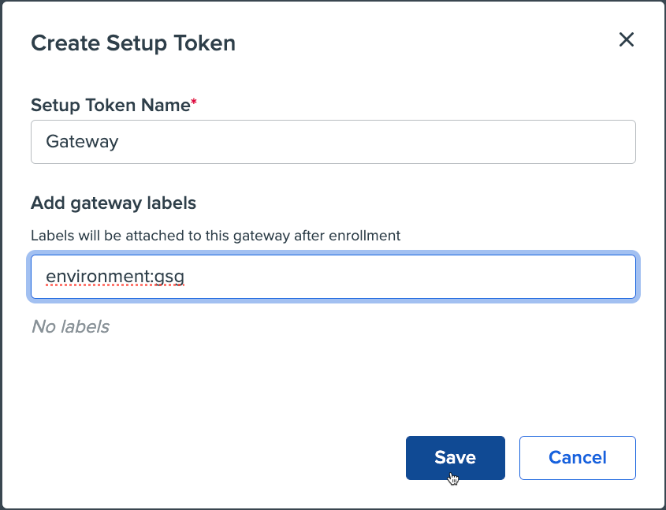

6.  Click the **Save** button

7.  Copy the generated Token so you can use it to enroll the gateway.

    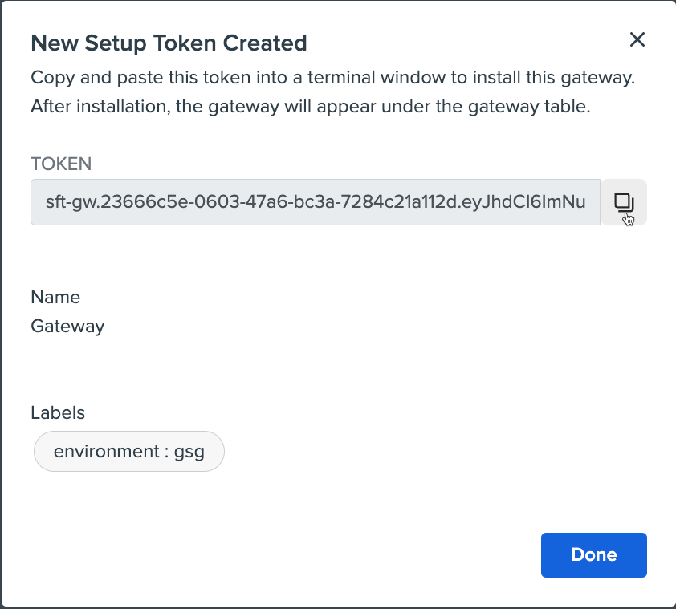

8.  Click the **Done** button. Note that the token will not show
    (whereas you saw the tokens when setting up server agents).

You will use the token to configure and enroll the gateway.

#### Configuring the OPA gateway

You need to configure some gateway files, including the configuration
file
([<u>https://help.okta.com/oie/en-us/content/topics/privileged-access/gateways/pam-gateway-configure.htm</u>](https://help.okta.com/oie/en-us/content/topics/privileged-access/gateways/pam-gateway-configure.htm))
to enroll the gateway. Note that there are two options for loading the
token (“SetupToken”), it can be copied into the configuration file but
will then be visible to anyone who can access the file, or it can be
stored in a separate file that is deleted after it’s used. We will do
the latter.

9.  If not still there, log back into the gateway server

10. Copy the /etc/sft/sft-gatewayd.sample.yaml file into
    /etc/sft/sft-gatewayd.yaml

    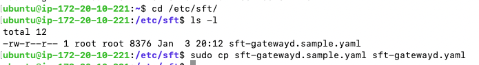

11. Edit the sft-gatewayd.yaml file and find the SetupToken options

12. Uncomment the SetupTokenFile attribute and set it to the file you
    want to use for the token (I used the recommended one from the
    documentation)

    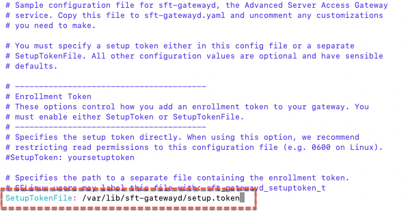

13. Save the file

14. Create that file and put the token into it

    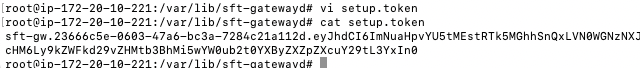

15. Restart the **sft-gatewayd** process (on ubuntu that is systemctl
    stop sft-gatewayd then systemctl start sft-gatewayd)

16. The token file should disappear on startup

17. Return to the OPA Gateways list and confirm the new gateway has been
    added. Note the labels added earlier are listed.

    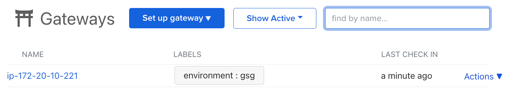

The gateway is now ready for use. We will walk through assigning the
gateways to server access in later sections.

This completes the setup of the OPA infrastructure components.
