# Individual Server Access Use Case

Privileged access to servers can be via individual accounts provisioned
to the servers (optionally elevated to an administrator) or via a shared
account managed in the vault. Over the next few sections we will build
up the policy to allow a mix of these use cases for a system
administrator. As we build up the policies we will add in different
controls to show the different options.

In the first scenario we will create the most basic policy to allow
individual (non-elevated) access to servers. Policies are assigned to
groups of users (“Principals”) to control access, so if you have
multiple groups of users with different access needs, you need multiple
policies. We will create two policies, one for Linux access for our
Linux sysadmins and one for Windows access for our Windows sysadmins.

### Pre-reqs

You should have sysadmin user(s) defined in a group in Okta and pushed
to OPA. You will also need a user with the Security Administrator role.

You should also have client(s) installed on the workstation(s) for the
user(s). You will need the Linux and Windows servers configured with
enrolled agents as covered earlier. You do not need the Gateway for this
use case.

### Configure and Publish Policy for the Linux Server Access

If you have performed the secrets management labs earlier in this
document you will be familiar with creating policies. The following
steps will walk through creating server policies for SSH.

#### Create a Policy

1.  Log into **OPA** as a *security administrator* and go to
    **Policies** under Security Administration

2.  Click the **Create Policy** button

3.  Give the new policy a **Name** and (optionally) **Description**

4.  Select **Specify a resource group** and assign it to the server
    resource group created earlier.

5.  Click the **Add Principals** button and add the Linux sysadmin group
    you created earlier. Your policy should look similar to the below.

    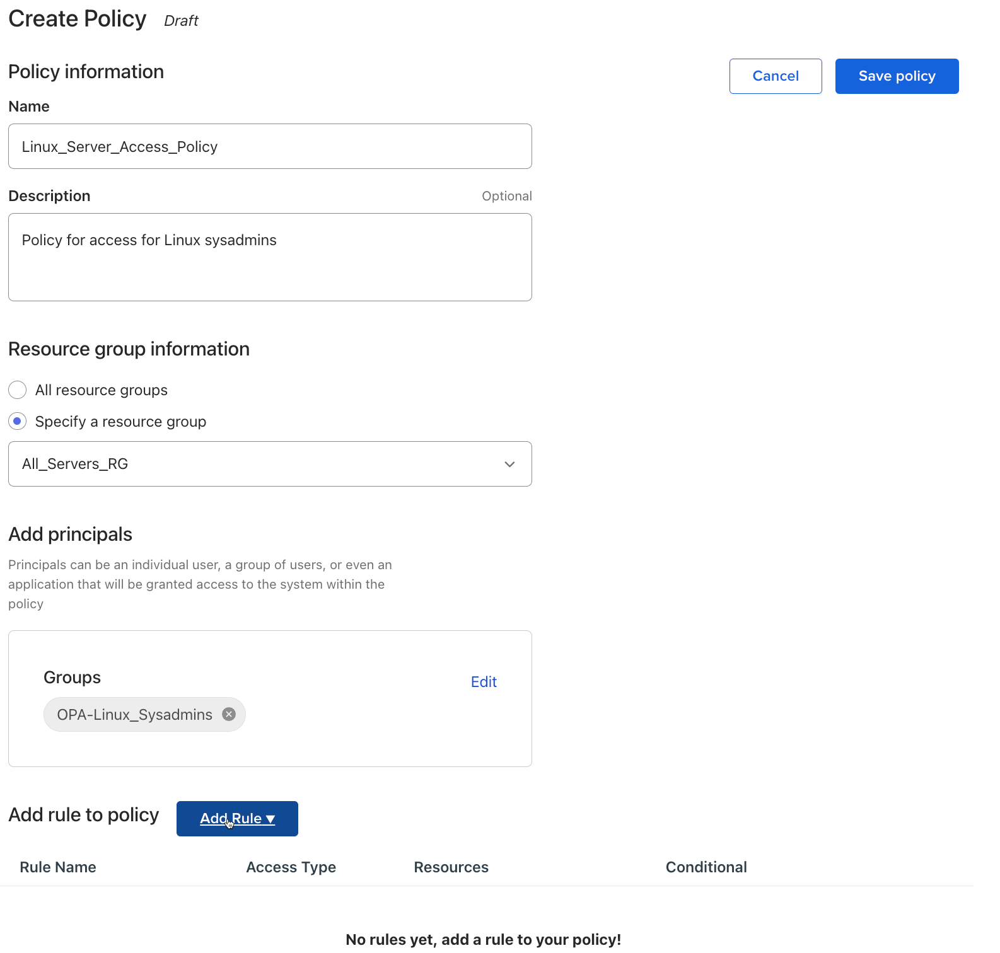

#### Add Rule to Policy

Policies can have multiple rules to control the different types of
access for the selected principals. We need to add a rule for ordinary
individual access.

6.  Click **Add Rule &gt; Server Rule**

7.  Give the rule a **Name** and select ***SSH session*** for the
    **session type**

8.  Toggle on the **Select resources by system generated label** item

    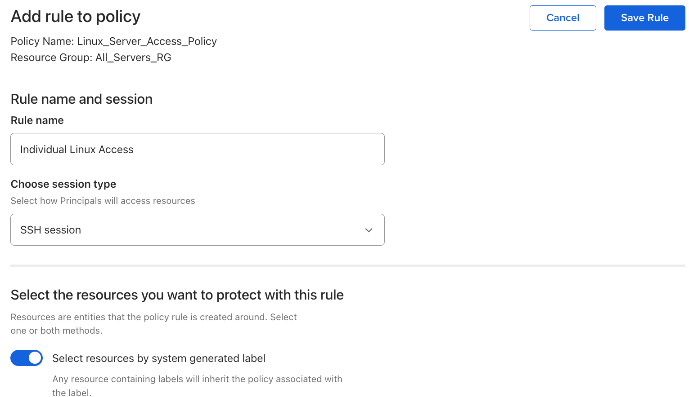

For individual access, we need to define the servers a user can connect
to via labels. As mentioned earlier, these labels are assigned when the
server is enrolled. They include labels like system.cloud_provider,
system.hostname, system.os and system.os_type. You can add other labels
via the agent. For this example, we will use system.os_type (linux or
windows). You can see all the labels in the Labels menu item under
Security Administration.

9.  In the **Add resource label** field, enter a label (like
    system.os_type:linux). Note that it will offer options as you type.

10. Under the **How do you want Principals to access resources**, select
    the **Access resources by individual account** option and de-select
    the **Access resources by a vaulted account**. This is because we
    only want to use individual accounts.

    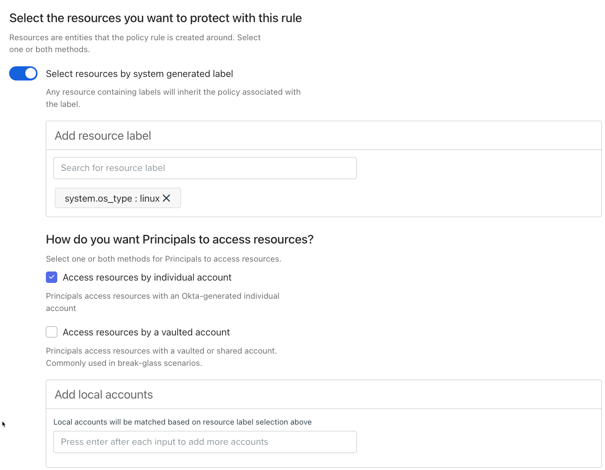

11. You do not need to make any further changes to the rule. Click the
    **Save Rule** button at the top

12. On the **Create Policy** page click the **Save policy** button to
    save the new policy

#### Publish the Policy

Even though the policy has been saved, it is not active. It needs to be
published.

13. After the save, the page changes to Policy Details. Enable the
    Publish Policy toggle and click Publish Policy in the confirmation
    dialog. Observe the message on the bottom of the screen

    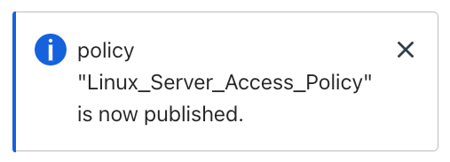

14. Return to the Policies view

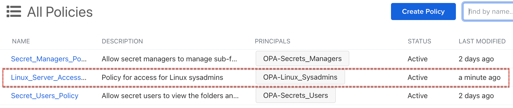

This shows all policies, with the principals assigned and the status.

### Configure and Publish Policy for the Windows Server Access

We will repeat the process for a Windows server access policy.

1.  Create a new policy for Windows server access and assign it to your
    Windows sysadmin group

    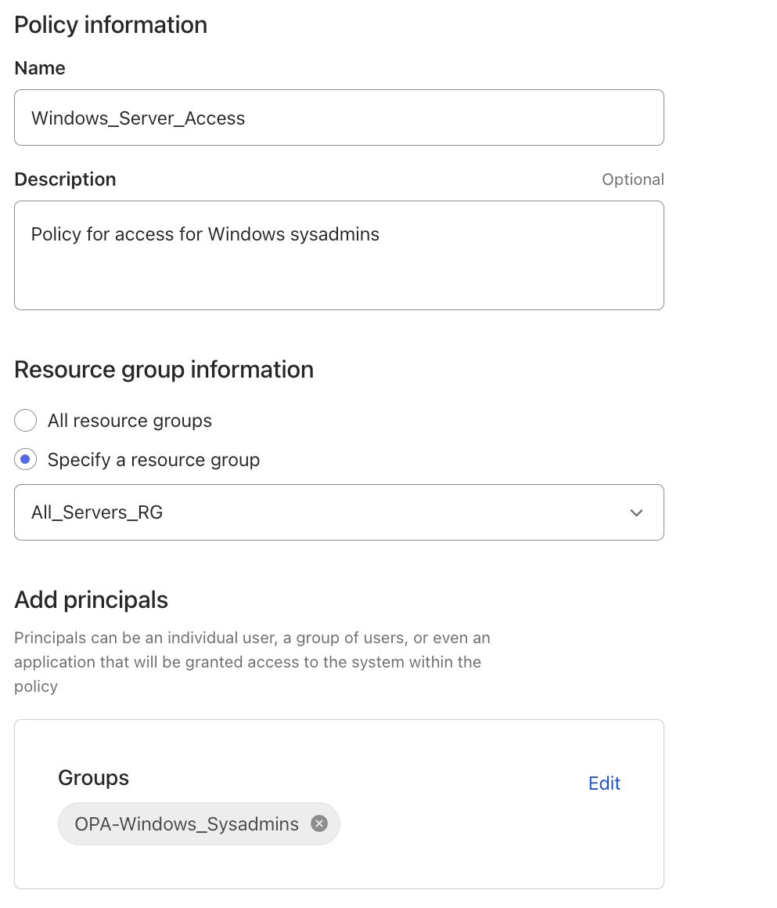

2.  Create a server rule in the policy, with the session type being
    ***RDP session*** and the label being system.os_type : windows

    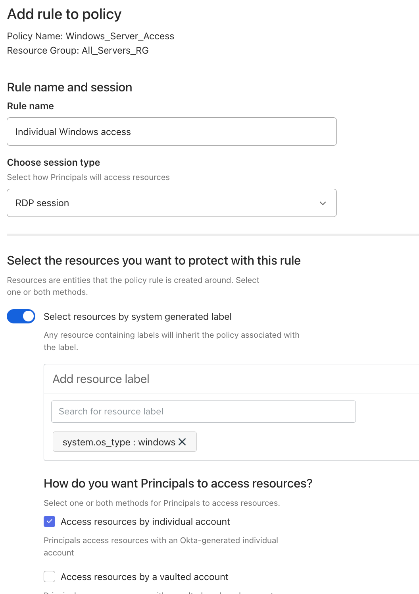

3.  Save the rule and policy

4.  Publish the policy

You should now have two active policies, one for each of Linux and
Windows access.

### Testing Linux Access

We can test server access from either the client in a command line or
via the OPA web interface. We will test the Linux server access from the
client.

1.  Go to a command line for the workstation where you have installed
    the client for one of your Linux sysadmins.

2.  Enter the command sft list-servers to see what servers this user is
    entitled to access.

3.  When the browser pops up, authenticate the user to Okta

4.  When the Credential Request confirmation dialog pops up, click the
    Approve button

    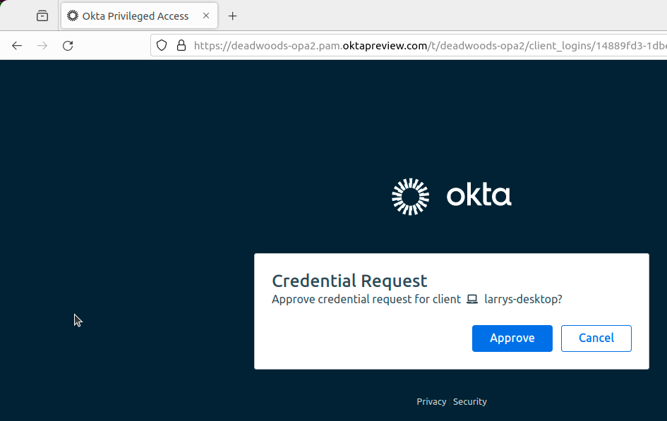

    This is an extra layer of security to confirm this user did ask for
    a session token to be issued for the OPA application

5.  The user is presented with the list of servers in their OPA browser.
    Go back to the command line to see the same results.

    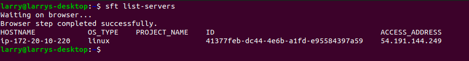

6.  To access the server enter sft ssh &lt;servername&gt;. You should be
    logged in as the individual user.

    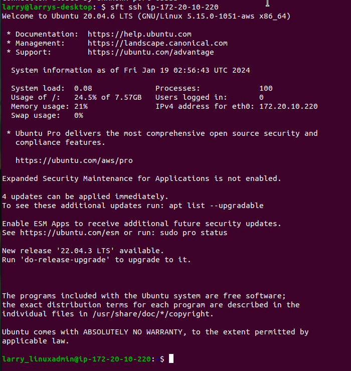

7.  You can try running privileged commands, but you should be denied as
    you are an ordinary Linux user. For example, you cannot run sudo
    commands as the provisioned account doesn’t have a password.

8.  Exit out of the server session

This has proven that the user has individual access to the Linux server.
This means the server is enrolled correctly into OPA and that the policy
is valid.

### Testing Windows Access

To test the Windows use case, we will use the Connect function in the
web interface. It could be run via the command line also. You need to
have one of the support RDP clients
([<u>https://help.okta.com/oie/en-us/content/topics/privileged-access/tool-setup/pam-rdp.htm</u>](https://help.okta.com/oie/en-us/content/topics/privileged-access/tool-setup/pam-rdp.htm))
installed and configured on the workstation.

1.  Log into **Okta** as your Windows user

    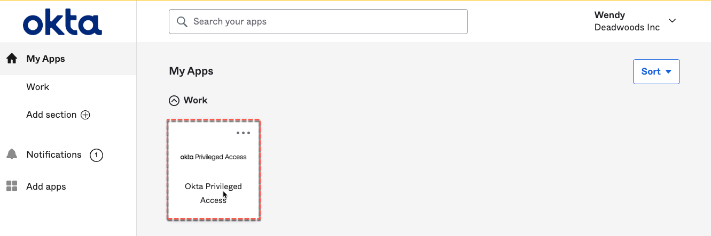

2.  Click on the **Okta Privileged Access** tile to SSO to OPA

    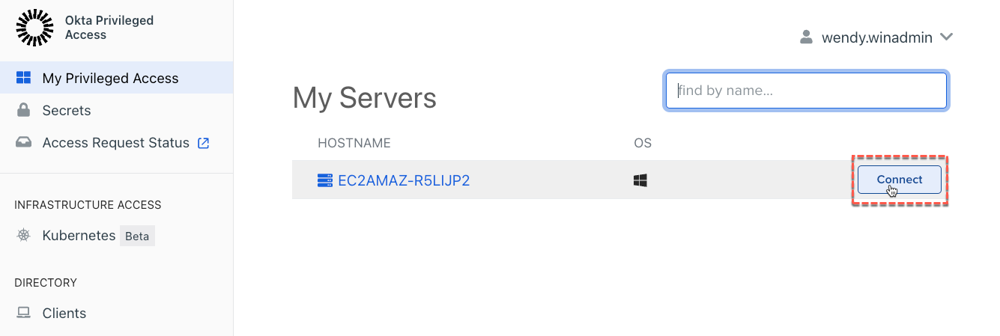

3.  The Windows server should be listed (and not the Linux server as
    this user doesn’t have access to the Linux servers if the policies
    were set up earlier). Click the **Connect** button.

Note that this step has changed slightly since this guide was
originally written. You now click on the server hostname, and on the
following page you are shown the access methods with Connect (or
Request Access) buttons for each. You will see this when you run this
step.

4.  If prompted, allow the browser to open the scaleft (client) app

5.  On the Credential Request prompt, click the **Approve** button

6.  The RDP client should open with the individual user

    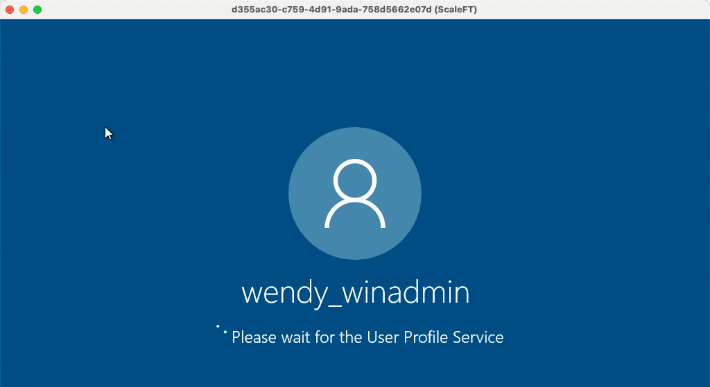

7.  You should be logged in as an ordinary user with no administrative
    rights. You can check by going to **Computer Management**, **Local
    Users and Groups**, **Users**, selecting the user and checking what
    groups they are a member of.

    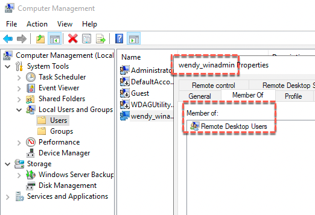

This has proven that the user has individual access to the Windows
server. This means the server is enrolled correctly into OPA and that
the policy is valid. We will now build on this and explore more advanced
use cases.
