# Admin Level Individual Access Use Case

The previous section walked through the simplest server access use
case - an individual with no elevation and no additional controls. For
this next use case, we want to allow an individual to select an Admin
Level access with their individual account.

As this is a higher risk activity we will force the connections to go
via a gateway and perform session recording. We will also turn on MFA
for the Windows access.

### Enable RDP and Session Recording in the Gateway

The gateway must be configured to perform session recording. Also for
RDP to be routed through the gateway, this must also be configured. All
the gateway configurations are defined in
[<u>https://help.okta.com/oie/en-us/content/topics/privileged-access/gateways/pam-gateway-configure.htm</u>](https://help.okta.com/oie/en-us/content/topics/privileged-access/gateways/pam-gateway-configure.htm).
More information on session recording can be found in
[<u>https://help.okta.com/oie/en-us/content/topics/privileged-access/gateways/pam-session-capture.htm</u>](https://help.okta.com/oie/en-us/content/topics/privileged-access/gateways/pam-session-capture.htm).

1.  Log into the gateway server and edit the /etc/sft/sft-gatewayd.yaml
    file

2.  Find the **RDP** section of the file and note the comments there
    about enabling RDP.

3.  Uncomment the **Enabled** option and change false to **true** (make
    sure to leave the two spaces before Enabled)

    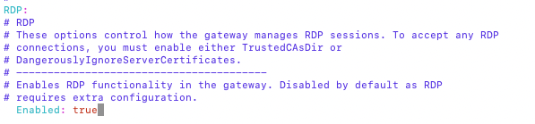

4.  You would normally install trusted CAs for the server certificates
    returned, but for this exercise uncomment the
    **DangerouslyIgnoreServerCertificates** option and change false to
    true to ignore any server certs.

    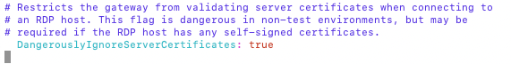

5.  Find the Session Capture section of the file

6.  Uncomment the following (no need to change the values): 
    **SessionLogFlushInterval**, 
    **SessionLogMaxBufferSize**, 
    **LogFileNameFormats** and the two lines below (keep spaces), 
    **SessionLogTempStorageDirectory** and 
    **LogDestinations** and the two lines below it

    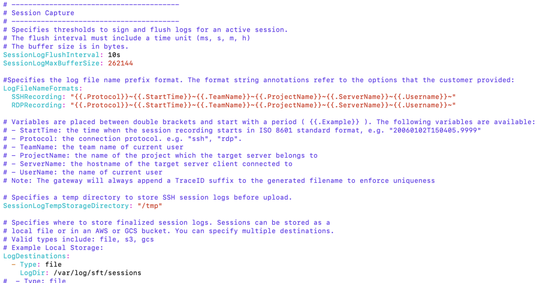

7.  Save the file and restart the gateway

    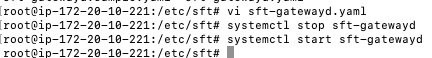

The gateway is now ready to route traffic and perform session recording.

### Select Gateway in Resource Group Projects

You associate gateways with resource groups, and can have different
gateways (or gateway sets) for different sets of servers. For this
exercise we only have one gateway and one set of servers to assign it
to.

1.  Go into **OPA** as a *resource administrator* and open the resource
    group you created for the servers earlier

2.  Open the Linux server project and go to the **<u>Settings</u>** tab

3.  Click the **<u>View</u>** link beside **Gateway Selector**

4.  Click the Edit to add a gateway selector

5.  Enter the label you gave your gateway earlier when you create the
    token. Note that it prompts for existing labels

    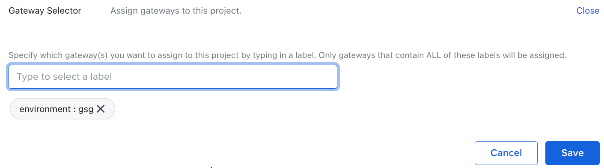

6.  Click the Save button to assign the gateway to the Linux servers
    project.

7.  Go back to the resource group and repeat the same steps for the
    Windows project

Note that unlike policies/rules, there is no concept of saving the
resource groups or projects. Changes are applied as made.

Now, when policies are set to force use of a gateway, and access the
servers in this resource group, the connection will be routed via that
gateway. Policy is independent of which resource groups manage the
servers - you can flag use of gateway routing in a policy and the policy
may apply to servers in different resource groups, each with different
gateways assigned.

### Create Server Access Policies with Gateway and Session Recording

We can now create policies to allow users to elevate to an admin with
their individual account but force the connection via a gateway and use
session recording.

1.  Log into **OPA** as a security administrator and go to **Policies**

2.  Select the Linux servers policy you created earlier

3.  On the **Policy Details** page, select **Actions &gt; Edit**

4.  Click **Add Rule &gt; Server Rule**

5.  Give the new rule a **Name** and **Description**

6.  Leave the **session type** as ***SSH session***

7.  **Select the resources by system generated label** as before and use
    the same label as before

8.  Select **Access resources by individual account** and
    <u>deselect</u> **Access resources by a vaulted account\**
    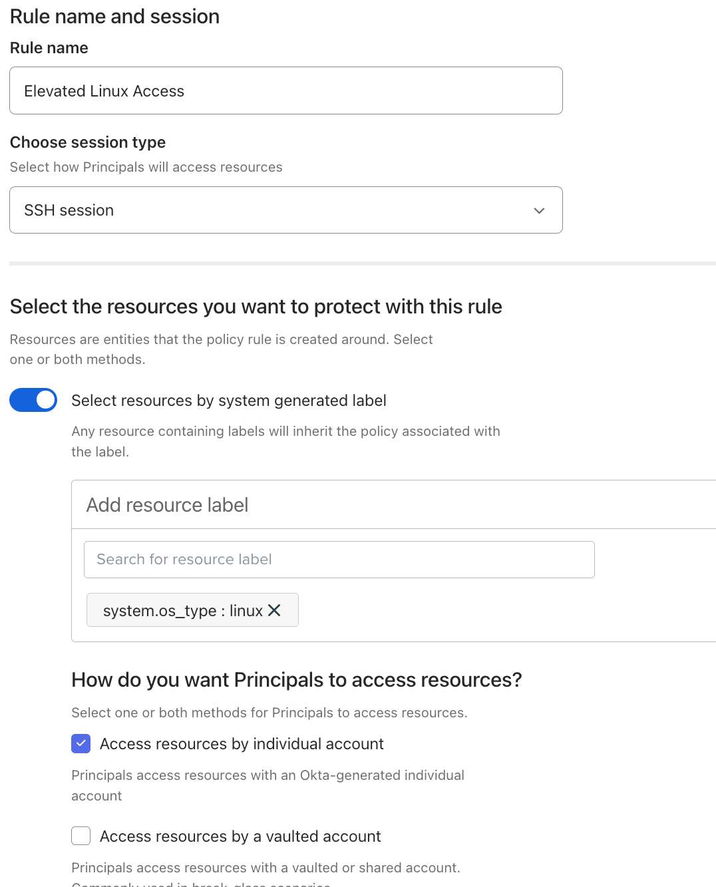

9.  Scroll down to the **Session recording** section and enable both
    **Enable traffic forwarding through gateways** and **Record session
    through gateways**. This will force traffic for this rule (i.e.
    elevated accounts) through the gateway and perform session
    recording.**\**
    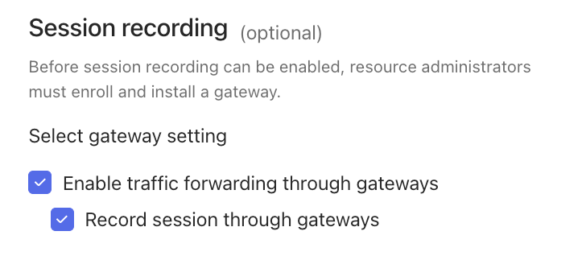

10. Scroll down to Privileged elevation for individual accounts and
    change the selection to Admin-level permissions

    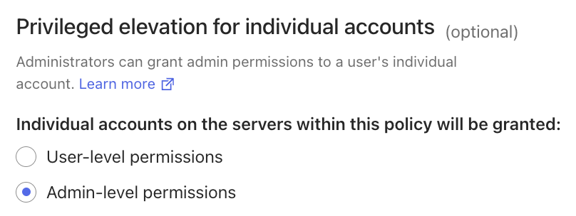

11. Save the rule and the policy. Notice that the policy shows two rules
    now, one with a Gateway conditional.

12. Go to the Windows server policy and repeat to create a similar rule
    (RDP not SSH) for elevated access with gateway and session
    recording. For this policy, also enable **Multifactor
    authentication**, select the **assurance level** (you may be
    restricted by the MFA in your Okta deployment) and
    **reauthentication frequency**.

    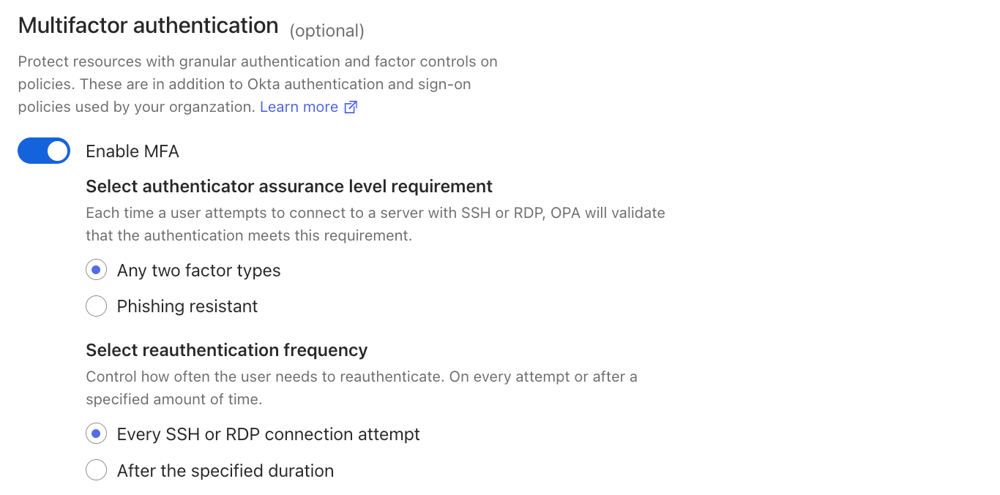

    In the example above it will allow any two factor types to be used
    (phishing resistance requires FIDO2(WebAuthn) or Okta Verify with
    FastPass). For the reauthentication frequency you can specify a
    duration before a reauthentication (on new connection) is required,
    or you can prompt for every connection.

13. Make sure you save the rule and save the policy

    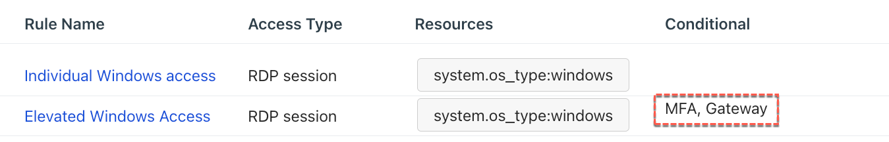

    You should see the new policy has two conditions, MFA and Gateway
    (the Conditional column doesn’t show Session Recording).

Note that you don’t need to re-publish the policies.

### Test Access with New Policies

Testing is the same as in the last use case.

1.  First, to test the Linux connection go to your command prompt and
    run the sft ssh &lt;server&gt; command as you did before. Unlike last
    time where the connection went through, the user is now presented
    with two options.

    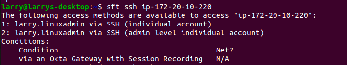

    There are now two user access methods, *individual account* (from
    the first Linux rule you created in the previous use case) and a new
    *admin level individual account* (from the latest policy). The
    second shows the Gateway + Session Recording condition we applied

2.  Select the new option (admin level individual account) to be
    connected to the server via SSH

    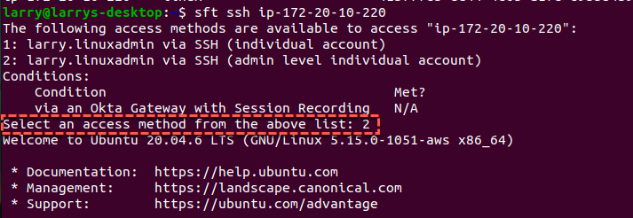

3.  Attempt to run a privileged command (like somethin requiring sudo).
    You should be allowed.

    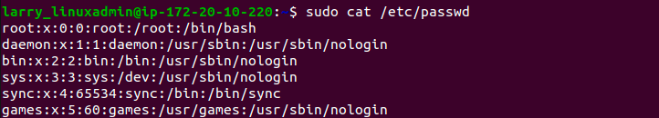

    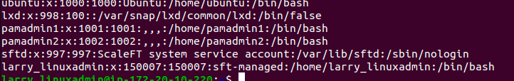

4.  Exit out of the session

You have now validated the new policy rule. Note that the user
(larry_linuxadmin) is being provisioned JIT to the server as part of the
connection process.

Next we will test Windows via the OPA user interface

5.  As a Windows sysadmin account defined in OPA and attached to the
    Windows policies, log into **Okta** and go to **OPA**.

6.  Click the **Connect** button for the Windows server

    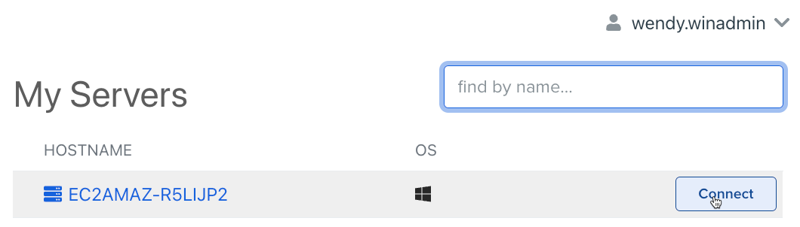You will see a RDP
    Session launch message

7.  **Approve** the Credential Request if prompted

8.  You will be presented with a Select Account dialog. Expand the list
    of accounts.

    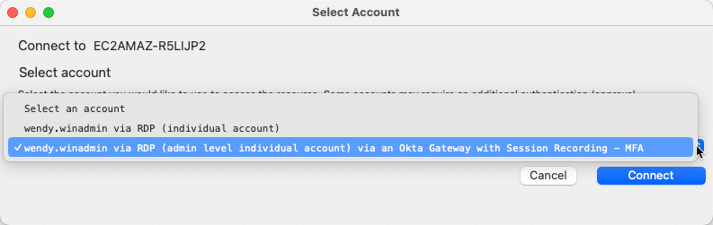

9.  Select the admin level individual account and click **Connect**

10. You should be taken back to Okta for the MFA prompt. For example

    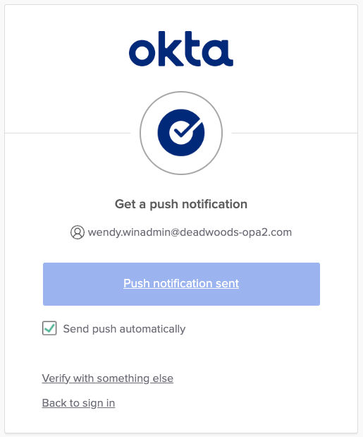

11. Respond to the MFA and your connection to the server should
    continue.

12. Check the Local Users and Groups (in Computer Management) to confirm
    that your user is a member of the local Administrators group.

    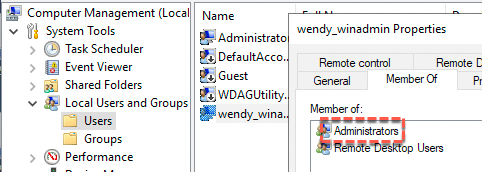

13. Exit out of the RDP session

You have confirmed that the new policy rules for admin level (elevated)
access are working. The last thing to check is that session recording
was performed on the Gateway.

### Confirm Session Capture

To confirm session capture:

1.  Log into the gateway server

2.  Review the **Session Capture** settings in
    /etc/sft/sft-gatewayd.yaml you set earlier

    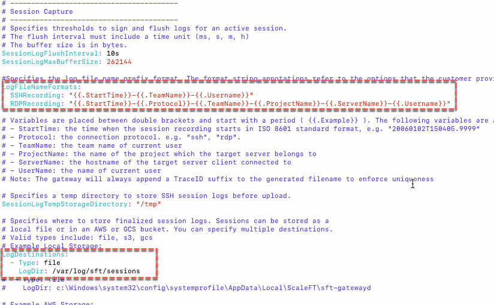

3.  Check the **LogDestinations** and **LogFileNameFormats** settings

4.  Go the the **LogDestination** folder and check for files there

5.  You should have two files there, one for the Linux session and one
    for the Windows session

6.  Exit the gateway

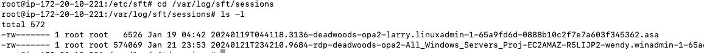

The two files have different naming standards, as per the
**LogFileNameFormats** setting. You can control that in the
sft-gatewayd.yaml file. Note that the Linux session capture file is much
smaller as text session recording uses a lot less space than Windows GUI
recording.

We will not process these files yet (it is covered later in this guide).

More information on session capture can be found in
[<u>https://help.okta.com/oie/en-us/content/topics/privileged-access/gateways/pam-session-capture.htm</u>](https://help.okta.com/oie/en-us/content/topics/privileged-access/gateways/pam-session-capture.htm).
