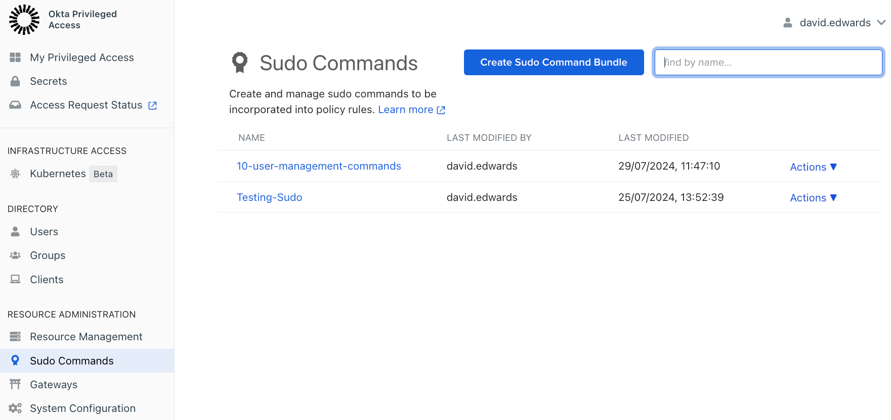
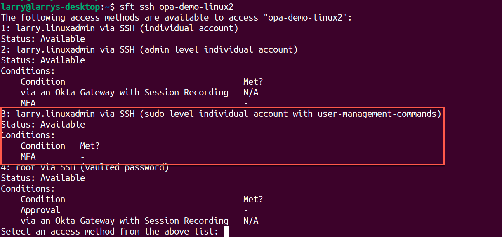
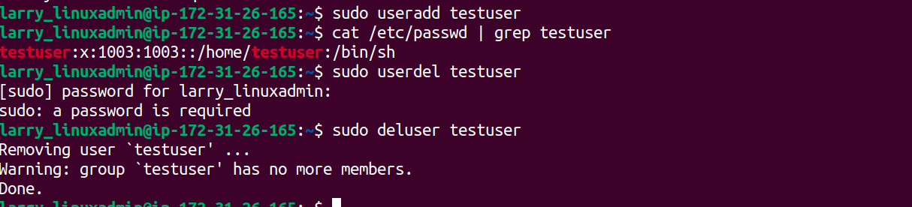

# Use of Sudo Commands with Individual Access

A new feature, Sudo Commands, was added to OPA in August 2024. It adds a
new resource type of Sudo Commands that can be defined and assigned to
policy rules.

This guide has not been updated to include steps to create Sudo Command
bundles and assign them to policy rules. However the following
information may be useful.

A command bundle can contain multiple Linux commands, and command
bundles can be reused across multiple policy rules.

Sudo Commands are assigned to policy rules and apply to individual
account server access (shared accounts already have levels of access
assigned). This means that there are now three options for individual
users:

- **individual account** (user-level access with no privileges),

- **admin level individual account** with super user privileges (i.e.
  can run any sudo command without a password), and

- The new **sudo level individual accounts** for one or more sudo
  command bundles.

Combining these options (and maybe also shared account access) can
provide for a spectrum of access levels into a Linux server, and you can
apply risks and mitigations (like MFA) to them. An example is shown
below with three levels of individual access and also access to the
shared root account.

When a user connects to the server with the sudo level individual
account option, they can run the commands defined in the sudo command
bundle but not any other commands. For example if the bundle allows
useradd and deluser, but not userdel, they would see the following.

The invalid userdel command is not allowed, so the default sudo policy
is prompting for a password (which isn’t available for the JIT
provisioned account) and they cannot run the command.

You could add some sudo policies to your environment to test, but we
haven’t detailed the steps here. You can read more about this function
at
[<u>https://help.okta.com/oie/en-us/content/topics/privileged-access/pam-sudo-commands.htm?cshid=csh-pam-sudo-commands</u>](https://help.okta.com/oie/en-us/content/topics/privileged-access/pam-sudo-commands.htm?cshid=csh-pam-sudo-commands).
