# Shared Account (Vaulted Password) Access Use Case

The third server access use case is the use of shared accounts with
vaulted passwords.

The following sections will walk through:

- Account discovery on the server and adding the accounts to the vault

- Setting policy to use the shared accounts, and

- Testing the policy

Note - if you want to use root to access servers via this approach, you
need to set **PermitRootLogin** in the /etc/ssh/sshd_config file on
Linux.

There have been some minor changes to the use of Shared (vaulted)
accounts since OPA went GA in Dec 2023. The most significant of these is
the ability to define shared accounts to support exclusive checkout.
This means that only one person can check them out at a time and they
won’t be checked in until the user closes their session, a timer expires
or an administrator manually checks the account back in.

We have not updated this guide to include this functionality, but you
may see it come up in the screens as you work through the following
sections.

For more information see
[<u>https://help.okta.com/oie/en-us/content/topics/privileged-access/pam-checkout-checkin.htm</u>](https://help.okta.com/oie/en-us/content/topics/privileged-access/pam-checkout-checkin.htm).

### Account Discovery and Adding Shared Accounts to the Vault

Before being able to use shared accounts in policy, they must be
discovered and added to the vault.

1.  As a *resource administrator*, log into **OPA** and go to your
    servers resource group

2.  Open the Linux servers project you created earlier and go to the
    **<u>Settings</u>** tab (where you set the enrollment tokens
    earlier)

    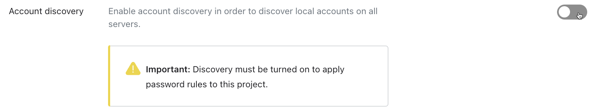

3.  Toggle on the **Account discovery** option

4.  Click **<u>View</u>** beside Password Settings to configure the
    settings and assign shared accounts

5.  Click the **Edit** button

6.  In the **Privileged accounts we will manage** section, enter in the
    Linux accounts you want to be added to the vault (e.g. root). Add
    each individually and **return/enter** after each on to have them
    added to the list (note there is no picklist, you have to type them
    in)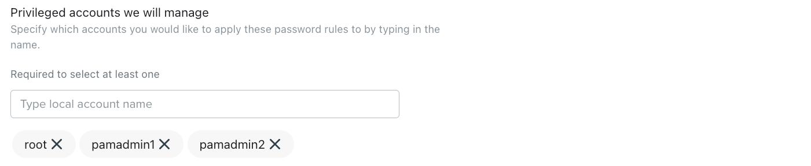

7.  You can modify the **Password rotation schedule** and **Password
    complexity** settings if you want, but it’s not important for this
    lab

8.  Click the **Save** button

9.  Go to the Local Accounts tab and look for the accounts you just
    added (it may take time to populate as the agent will run
    periodically)

    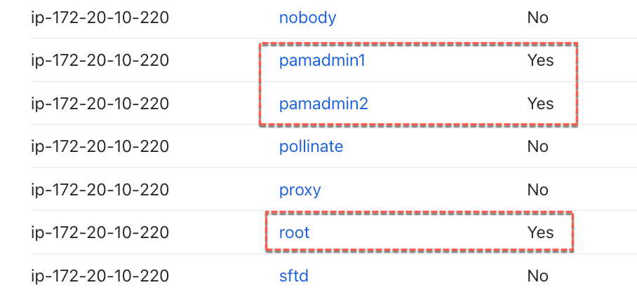

    They should show “Yes” in the Managed Rotation Summary column.

10. Refresh until you see results and a last rotated date/time

    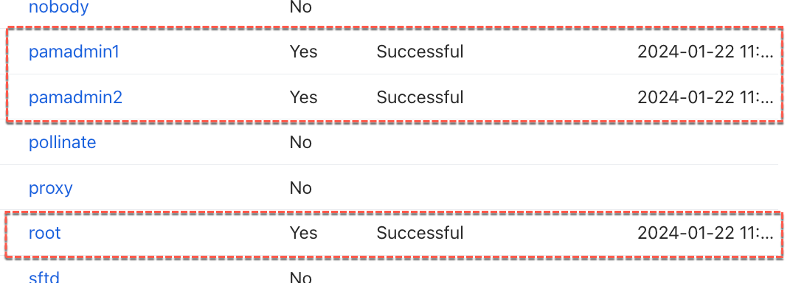

11. Click on the name of one of the managed accounts to see details of
    the rotation history. You will see the **next rotation** (based on
    the interval set in the settings), **last rotation**, **successful
    rotation** and **account brought under management** date/time (these
    should be the same as you’ve just brought it under management and
    that triggered the first rotation), and any failed rotations. This
    view can be very useful if a shared account is misbehaving.

12. Repeat the process for the Windows project in the same resource
    group to add Windows accounts (like Administrator) to the vault.

    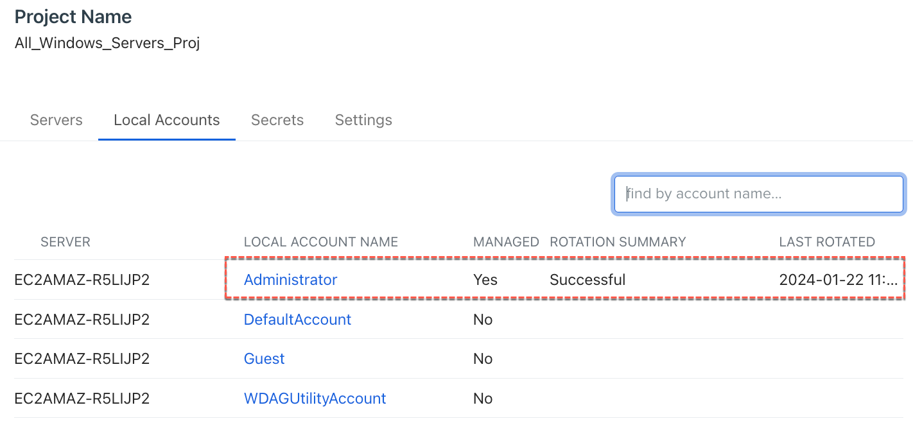

There are now shared accounts under management in the vault for both the
Linux server (in my case, root, pamadmin1 and pamadmin2) and Windows
server (Administrator). Next we need to build policy to leverage these
accounts.

### Policy to Allow Use of Shared Accounts

Policy to allow users to use the shared accounts is basically the same
as we’ve done for the previous use cases, but subtly different. There
are two ways to specify a shared account. We will use one way for the
Linux server policy rule and the other way for the Windows server policy
rule.

1.  As a *security administrator* login into **OPA** and select Policies
    under Security Administration

2.  Select the Linux policy from before, select **Actions &gt; Edit**

3.  Add a new **Server Rule**

4.  Give it a **Name** and ***SSH session*** for the **session type**

5.  Enable the **Select resources by system generated label** option

6.  Add a resource label like you did earlier (e.g.
    system.os_type:linux) and hit enter

7.  In the earlier labs we used the individual account option, but for
    this section we will leave the individual accounts option unchecked
    and the vaulted account option checked. In the Add local accounts
    section add in one of the shared account (like root) and hit enter
    after each one.

    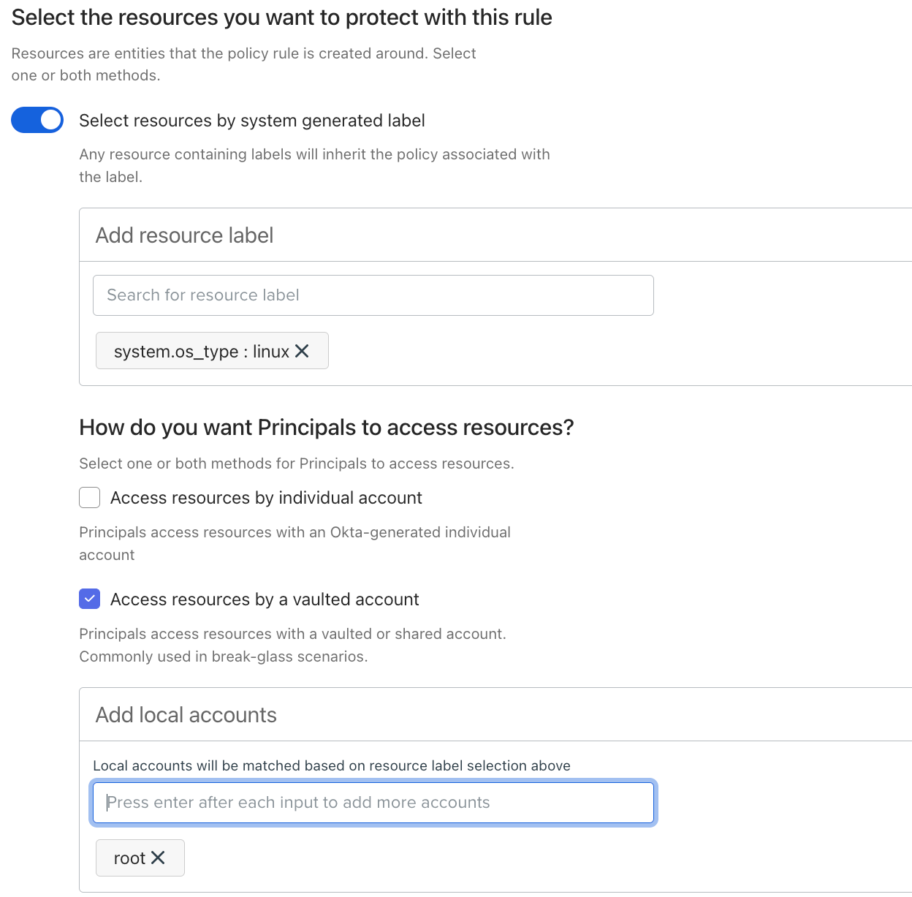

    This is specifying the accounts on all servers covered by that
    label. If there were multiple Linux servers covered by that label,
    then this policy would allow access to root on every one of those
    Linux servers.

8.  Enable the gateway and session recording as we did earlier

9.  Save the rule and save the policy

    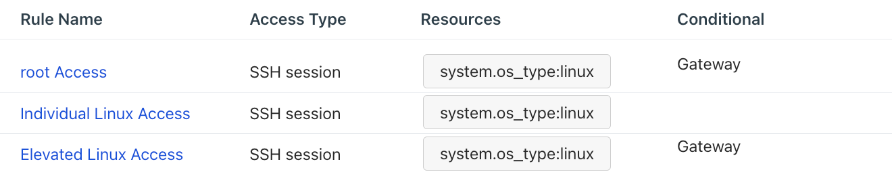

10. Go to your Windows server policy and edit it

11. Add a new **Server Rule**

12. Give it a **Name** and change it to an ***RDP session*** type

13. Toggle on the **Select resources by name** option

14. Select one of the Windows shared accounts

    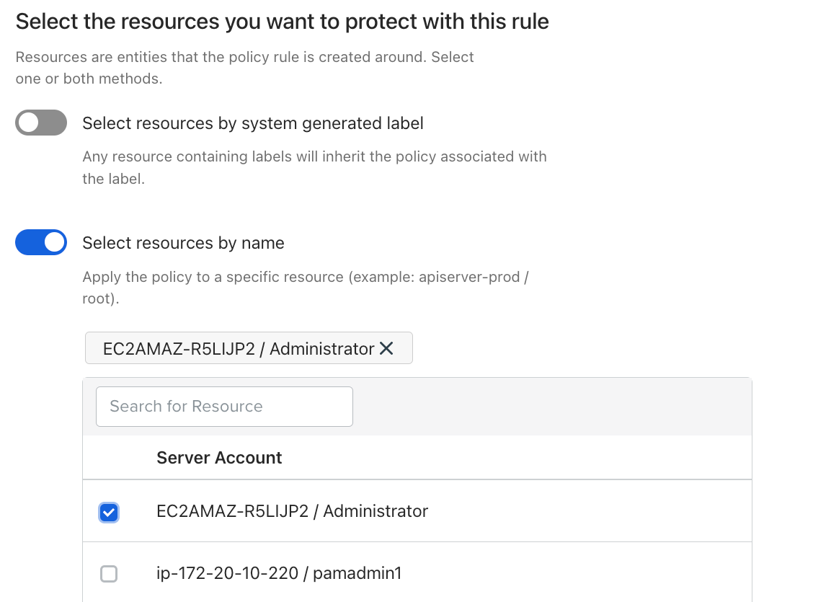

    Note that this option allows selecting specific shared accounts on
    individual servers, unlike the earlier option that allows the same
    account across all servers covered by the policy.

15. Enable the gateway and session recording as earlier

16. Save the rule and policy

You should now have three rules for the Windows policy. The rule list
does not show the resources when they are selected by name.

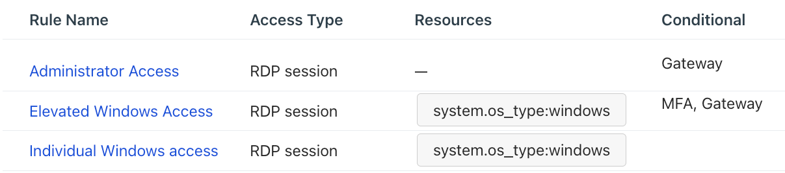We can now test these new rules.

### Testing the new Policy Rules

Testing follows the same flow as before.

1.  For Linux access go to the command line and run the sft ssh
    &lt;server&gt; command

2.  The user should be presented with three access methods, based on the
    three rules we have configured so far

    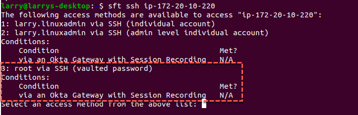

    The new access method shows accessing as root via SSH (vaulted
    password) with Gateway + Session Recording

3.  Select the new option to access the server as your shared account

    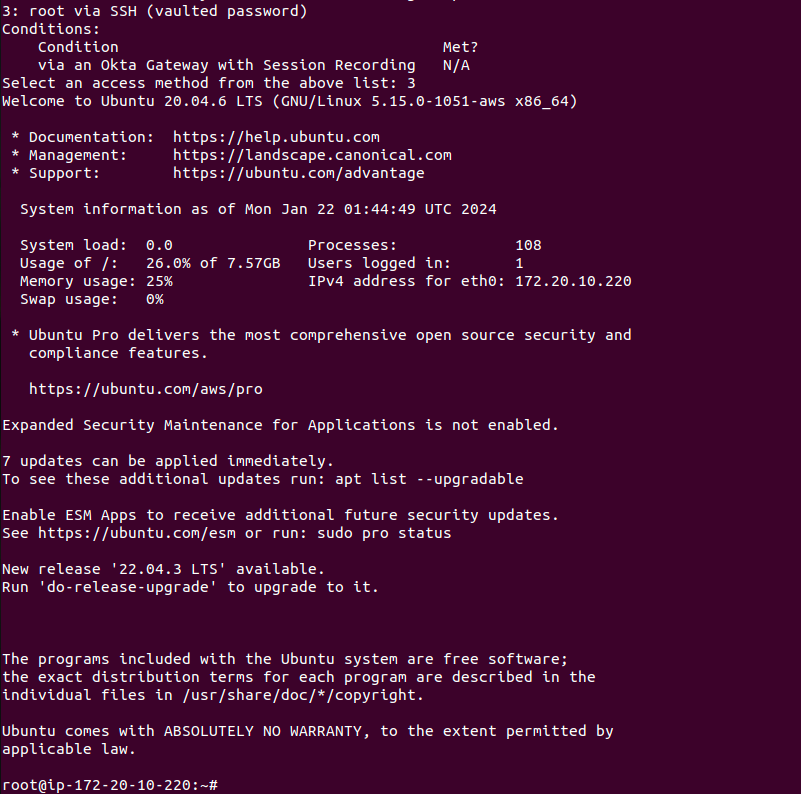

    The user has been logged in as the shared account (root in this
    case)

4.  Exit the server

5.  To test the Windows policy, as before login to **Okta** as a
    *Windows sysadmin* and go to **OPA**

6.  **Connect** to the Windows server and look at the **Select Account**
    options

    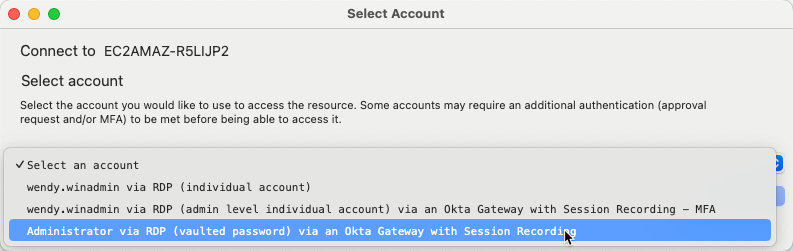

7.  Select the new option to use the shared account

8.  The user should connect to the Windows server as the shared account

    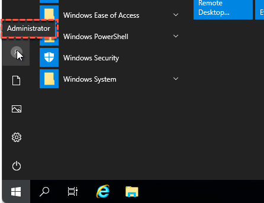

9.  Exit the server RDP session

This concludes the testing of the three access types for each of the
Linux and Windows servers. We have set three different rules in each of
two different policies (Linux and Windows) applied to different user
groups (Linux sysadmins and Windows sysadmins). We have applied some
conditions to support different levels of risk in accessing servers (one
more in the next section).

Note that we had all the relevant rules for each server in one policy.
You could have multiple policies with multiple rules applying to users
and OPA will evaluate the policy across all policies and rules to
determine what can be accessed and how. For example, with the scenario
about (separate policies for Linux and Windows) you might have a common
admin team across both, so both policies would be evaluated for anyone
in that common team.
