# Adding the Approval Requests Condition to Policies

You may have noticed in earlier sections when exploring the Server Rules
(and even Secret Rules) in Policies that there was an **Approval
request** option. This will allow for an access request to be applied to
any policy rule, where a flow will run requiring some sort of approval
(perhaps a user’s manager or the service owner). This is done using Okta
Access Requests and the integration built into OPA. More information on
the integration can be found at
[<u>https://iamse.blog/2023/10/19/okta-privileged-access-and-okta-access-requests/</u>](https://iamse.blog/2023/10/19/okta-privileged-access-and-okta-access-requests/).

We did not explore that above as it has additional configuration in a
new component. This section includes configuring an approval flow
(called a Request Type) in Access Requests. This is a different user
interface and has a lot of options that could be explored, but we will
keep this section to the minimum required to prove the use case. For
more information on Access Requests, see the Okta Identity Governance
(OIG) [<u>Access Requests product
documentation</u>](https://help.okta.com/en-us/Content/Topics/identity-governance/access-requests/ar-overview.htm)
and also the support [<u>product hub page for
OIG</u>](https://support.okta.com/help/s/product-hub/okta-identity-governance?language=en_US).
This page has a detailed Getting Started Guide that is structured as a
lab to familiarize you with the capabilities of OIG, including Access
Requests.

This section also does not include using the chat interfaces (Slack or
Microsoft Teams) with Access Requests. You could set up the integrations
with either and interact with requests via them (see the documentation)
but we will not cover that here.

### Create an Approval Flow (Request Type)

The initial setup steps earlier in this document confirmed that the
Access Requests platform was integrated with Okta and Okta Privileged
Access. It also added the main administrator to the team. This is the
minimum requirement to run through this use case. You could add other
teams/members and configure chat, but we won’t cover that.

We will just create a Request Type (approval flow) to use with
privileged server access.

To create a new Request Type:

1.  Sign into the **Okta dashboard** as your *administrator* user and
    select the **Okta Access Requests** tile.

2.  In the **Access Requests** portal, select **Access Requests** from
    the menu

3.  On the **Request Types** page, select the **Create Request Type**
    button

    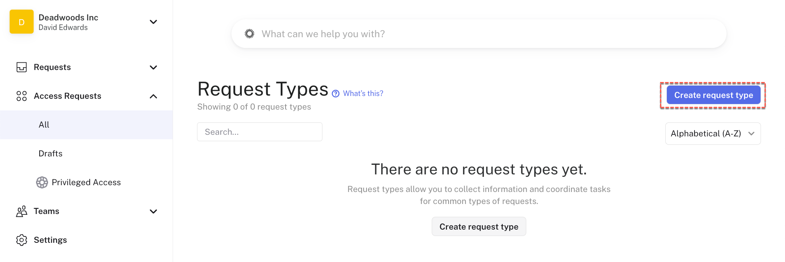

4.  For the new Request Type, give it a **Name** and **Description**,
    select the **Team** your administrator is in (there should only be
    one called “Privileged Access”) and set the **audience** to
    *Everyone at &lt;team name&gt;*

    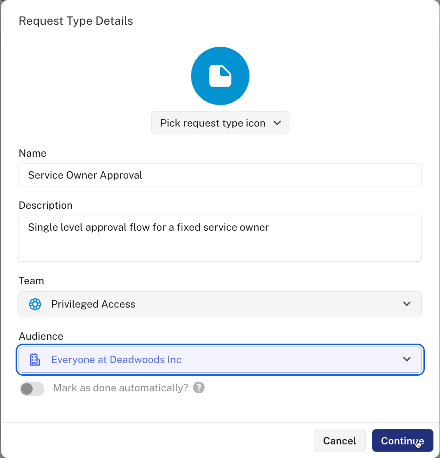

    Unlike normal access requests, these requests will never be called
    by users, only by the OPA client, so the audience doesn’t matter.
    You could assign the Okta group that you assign to the OPA app.

5.  Click **Continue**

There are five different types of steps that can be added to a flow. We
will only use **Approval** and **Action**. For details on the others,
see the OIG documentation listed above.

6.  Click the **Add to request type** beside the **Approval** title

7.  In the right-hand panel under Approval, enter the label (called
    **Text**) for the step, leave it as a *required task*, and leave the
    type as *Approval task*

8.  Select the drop down list under **Assigned to**. 
    There are multiple options available, such as Requester (the person
    requesting access), Requester’s manager (from the manager
    relationship in Okta), A member of… (a team), A specific user… (in
    Access Requests), An Okta group…, or Okta group owner(s). 
    For this simple scenario, select *A specific user…* and assign it to
    the administrator (i.e. You).

9.  Ignore the **Due date**

10. Go to the bottom of the page and select the **Action** button and
    click **Okta Privileged Access**.

    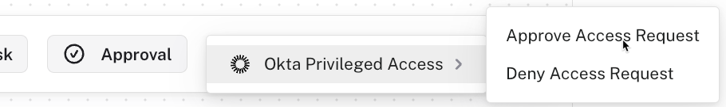

11. Select **Approve Access Request** to add the next step

12. In the right-hand panel under Action, enter the label (called
    **Text**) for the step, leave it as *a required task*, and leave the
    type as is.

13. Enable the **Run automatically** option (which will set the
    **Assigned to** to *Okta*)

14. Go to the **Logic** tab above the Action title

15. Select **Only show this task if** from the pulldown menu

16. Under the **Field or task** pulldown select the name (Text) of the
    approval step you created earlier (7.).

17. Under the next pulldown change **is completed** to **is approved**
    (notice that this indents the step in the main panel and shows the
    conditional logic “Show if &lt;approval name&gt; is Approved”)

    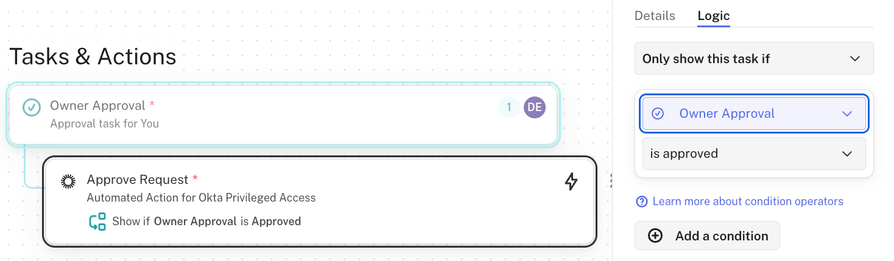

18. Go to the bottom of the page and select the **Action** button and
    click **Okta Privileged Access** again.

19. Select **Deny Access Request** to add the next step (not approve)

20. In the right-hand panel under Action, enter the label (called
    **Text**) for the step, leave it as *a required task*, and leave the
    type as is.

21. Enable the **Run automatically** option (which will set the
    **Assigned to** to *Okta*)

22. Go to the **Logic** tab above the Action title

23. Select **Only show this task if** from the pulldown menu

24. Under the **Field or task** pulldown select the name (Text) of the
    Approval step you created earlier (7.).

25. Under the next pulldown change **is completed** to **is denied**

26. Go to the top left of the page and select the pencil icon beside the
    name

27. Go the bottom of the **Request Type Details** dialog and enable the
    **Mark as done automatically** option

28. Click **Continue**

29. Back on the main page, click the **Publish** button

The Request Type is now ready to be used with server access. The flow is
fairly straightforward - it requires an approval and the result
(approved/denied) is returned back to OPA for display when the user goes
to access a server. We will see this when we run the scenario.

An example Request Type using the steps outlined above is shown below.

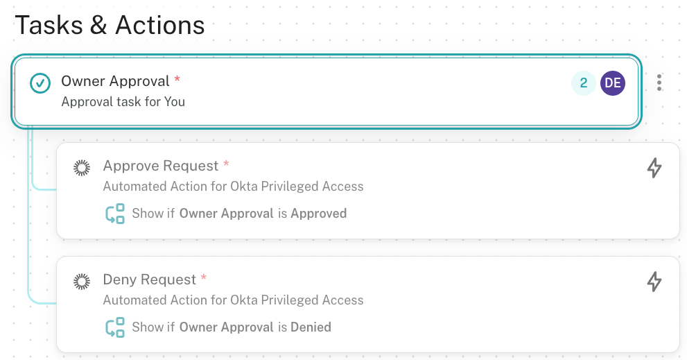Next we will assign it to policy.

### Applying Approval Requests to Policy Rules

With the approval request (request type) defined in Okta Access
Requests, we can now assign it to some policy rules.

1.  As a *security administrator* log into **OPA** and got to
    **Policies**

2.  Open the Linux policy from earlier, select **Actions &gt; Edit**, and
    open the shared account rule you created in the last section

3.  Scroll down to the **Approval requests** section and toggle on the
    **Enable approval requests** option

4.  In the expanded section, expand the **Select approval request type**
    and select the Request Type you created above

    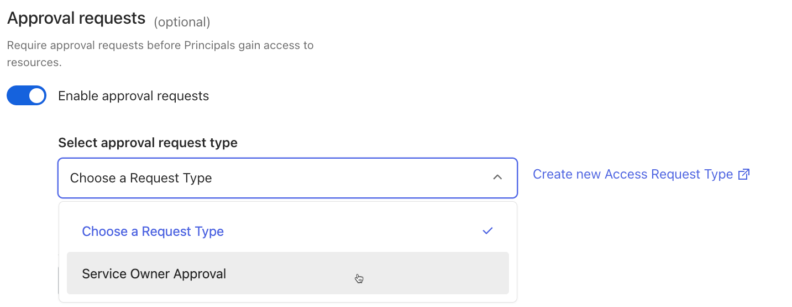

5.  The time setting is between the request being approved and the user
    returning to access the server. You can leave it as the default 15
    minutes.

6.  Save the rule and save the policy

    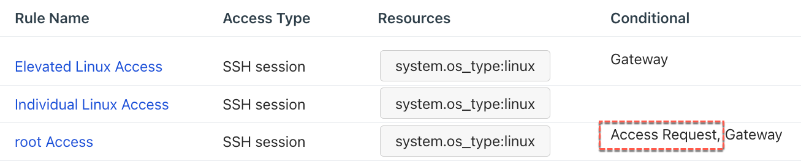

7.  Repeat the process for the shared account rule in the Windows
    policy

    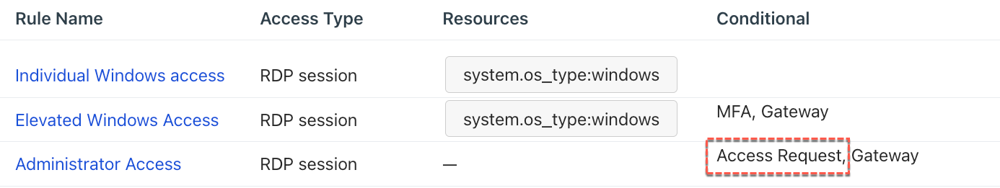

With the request type assigned to the policies, we can now test.

### Testing the New Approval Requests Condition

Testing follows the same initial flow as earlier.

1.  As a Linux sysadmin access a command line and run the sft ssh
    &lt;server&gt; command

    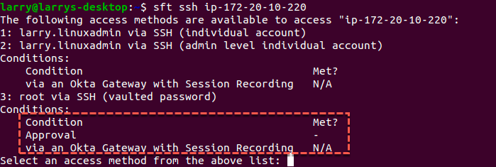

    Note the new Approval condition on the shared user access method. It
    hasn’t been met yet (i.e. approval has not been granted).

2.  Select the access method with the approval

    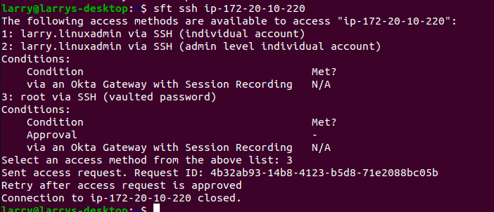

    As indicated the request has been raised in the access request
    system and the OPA client request has been closed.

3.  As the *administrator* in Access Requests, go into **Okta** and then
    **Okta Access Requests**

4.  The default view should be **Inbox** under **Requests**. If not, go
    there

    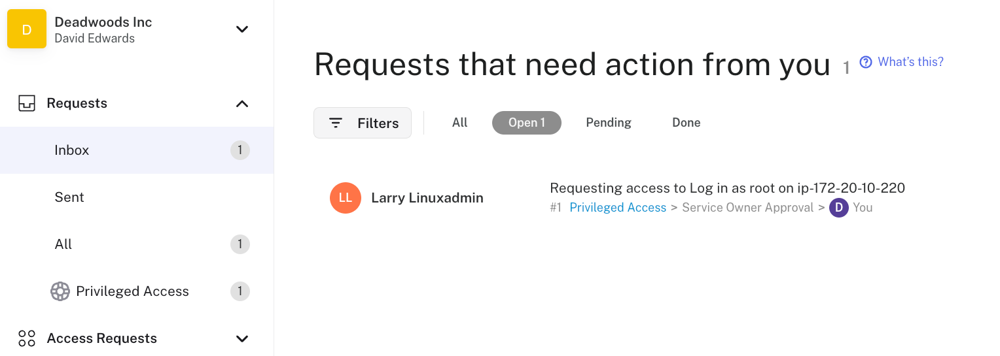

5.  Select the request that corresponds to the request you just raised
    as your Linux sysadmin (there should only be one request there)

    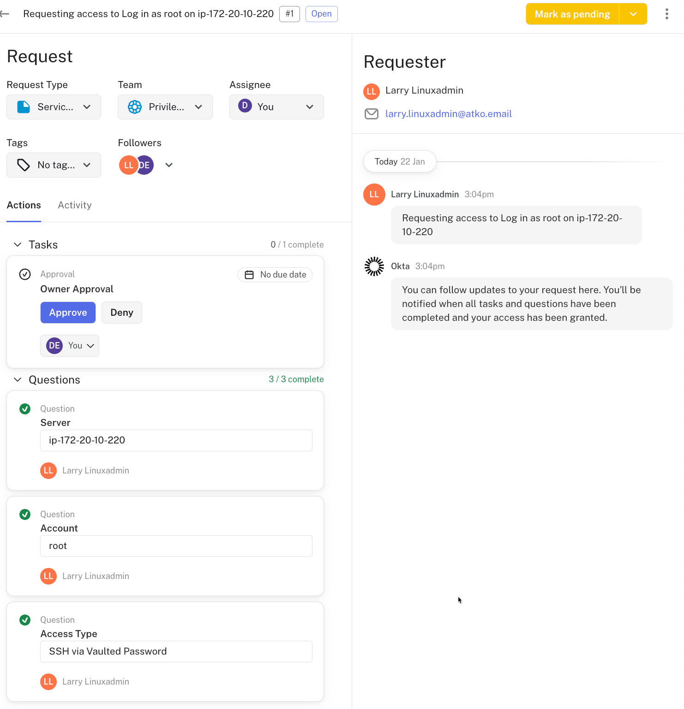

    There is a lot of information on this page (see the OIG
    documentation for details), but it shows the request title
    (“Requesting access …”), the information supplied by OPA (server,
    account and access type) and the approval step.

6.  Click **Approve** in the Approval section. The Tasks list will
    update to show the approved action run (telling OPA that this
    request is approved). Note you can also click on the Activity tab to
    see the flow of activities.

7.  Return to the command line as the Linux system administrator and
    rerun the sft ssh &lt;server&gt; command

    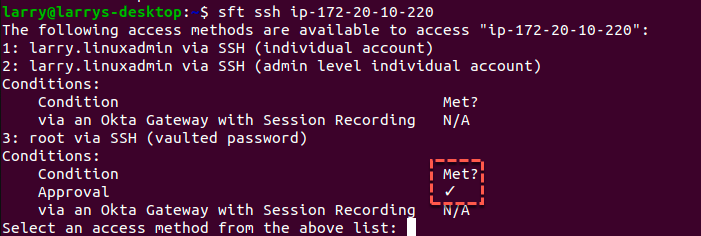

    Note that the Approval condition is now met (the tick).

8.  Select the option to connect to the server

9.  As the Windows sysadmin, log into **Okta** and go to **OPA**

10. Select **Connect** beside the Windows server

11. Expand the Select Account list to see the approval condition on the
    shared account

    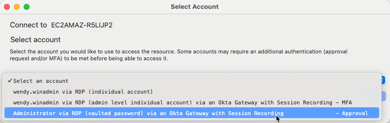

12. Select the account and click the **Request Approval** button

    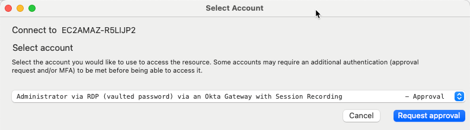

13. If you see a **Complete Approval Request** dialog, click **Got it**
    to close it.

    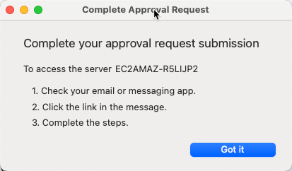

14. As the *administrator* in Access Requests, return **Okta Access
    Requests** and repeat the steps above to approve the flow

15. As the Windows sysadmin, repeat the steps to Connect in the OPA UI

    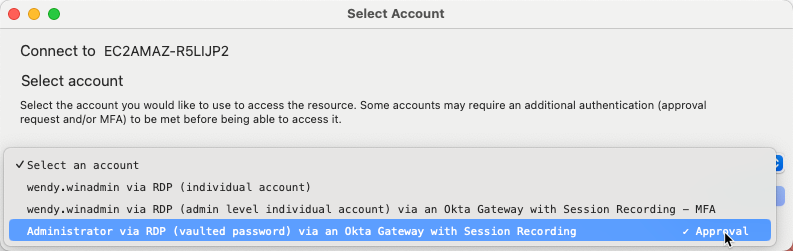

    This time the Approval is ticked

16. Continue to the server

This completes testing of the Approval Request condition on Policy Rules
and is the last section in the Exploring Infrastructure (Server) Access
Use Cases.
