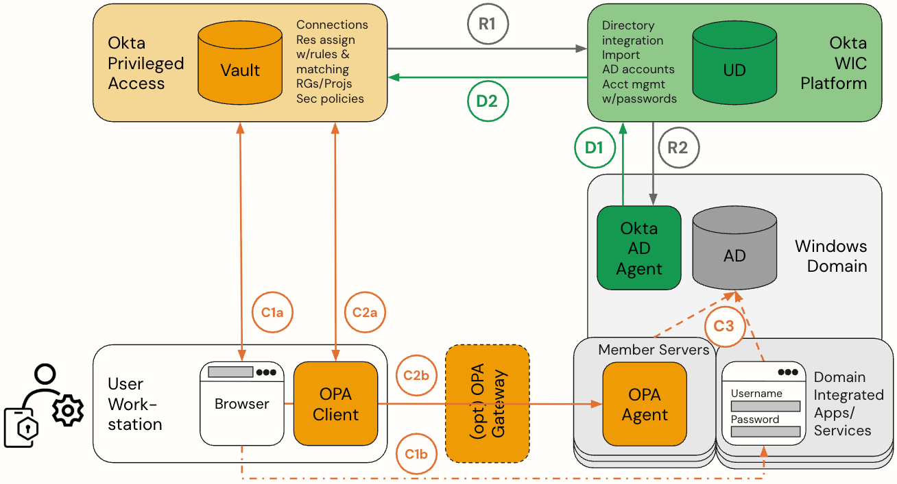

# Introduction to AD Integration

This section provides context to the use cases for the Active Directory
(AD) Integration feature of Okta Privileged Access (OPA).

### Overview of the AD Integration Components and Flows

The following diagram shows how the new components interact with OPA.

The solution involves:

- The **Okta Privileged Access** cloud tenant (“Team”) with the Vault,
  resources, policies and other configuration items,

- The **Okta Workforce Identity** tenant (org) with Universal Directory
  and directory integration,

- An **AD Domain**, with the **Okta AD Agent** deployed to integrate
  with Active Directory (this could be on the DC or ideally a member
  server),

- A user’s workstation running a web browser to access the various cloud
  services, optionally with the **OPA client** (“sft”), and

- One or more member servers in the AD domain (with the OPA Agent
  (“sftd”) deployed and enrolled) and/or any AD integrated apps, with
  domain authentication.

There are three flows used with the integration - Discovery (D),
Rotation (R) and Credential use (C).

The **Discovery** process is to discover accounts in the AD domain.
These may be shared accounts where multiple users may need to use them
for administrative purposes (such as database accounts), or individual
admin accounts where they are tied to an individual user for
administrative purposes (sometimes called secondary accounts). The
latter will normally have some naming standard to tie them to the
individual (for example if the ordinary user is
[<u>john.smith@myco.com</u>](mailto:john.smith@myco.com), then the admin
account might be
[<u>john.smith-Admin@myco.com</u>](mailto:john.smith-Admin@myco.com)).
Users may have one or more individual admin accounts.

The process for discovery is:

- (D1) As part of the normal AD Agent import process, these shared or
  individual admin accounts will be imported into Okta.

- (D2) There is a background sync process between Okta and OPA where
  these shared and individual admin accounts will be sync’d across to
  OPA. The resource groups and policies will dictate which accounts are
  managed in the vault (and thus have password rotated) and how they can
  be accessed.

The **Rotation** process is part of OPA taking ownership of an account
by changing the password and pushing that new password to the target
system, in this case AD. The process is:

- (R1) Either on a check in of a credential or on a schedule, OPA will
  change the password of a managed account. It will then sync this new
  password with Okta.

- (R2) Okta will use the directory integration via the AD Agent to apply
  that new password to the account in AD.

Rotation can also occur when an AD account is checked-in (by the user,
admin or when the check-out time expires) or on a schedule.

When a user needs to use one of the shared or their individual admin
account, they have two options - they can check out the credentials
(username/password) to copy’n’paste them into a login prompt (like an
AD-authenticated service) or use them to RDP to a member server.

The steps are similar:

- (C1) credentials are retrieved from the vault:

  - (C1a) The OPA WebUI will present the credentials to be revealed

  - (C1b) The OPA Client retrieves the credentials to be used to connect
    to a server

- (C2) credentials are used to access a service:

  - (C2a) The user copies the credentials to paste into the relevant
    login prompt

  - (C2b) The client injects the credentials on the users behalf when
    connecting to the OPA Agent on the member server

- (C3) credentials are authenticated against AD

The above, specifically steps C1/C2 are subject to policies defined in
OPA.

All of this interaction with OPA (and the earlier discovery and rotation
steps) is logged into the Okta System Log. If AD credentials are being
used to RDP to a server, then session recording could be used with the
OPA Gateway. But if the credentials are being checked-out and used
outside of OPA, there is no session recording available.

### OPA Admins, Resources and Policies with the New Feature

The integration leverages existing constructs in OPA: admin roles apply
as they do for administration in OPA; resource groups and projects are
used for AD accounts (with some unique settings in projects); and
policies and rules apply to accessing the AD accounts. We will not drill
into these, but cover them as needed in the lab section.

There are two significant new constructs: **Connections** and **Resource
assignment** (account mapping).

A connection is OPAs representation of an AD domain. It largely mirrors
the Directory Integration in Okta. It provides connection attributes for
that AD connection (although the direct domain integration is provided
between Okta and the AD Agent). It also provides an object that the
accounts can be associated with (similar to how OPA defines a SaaS app).

The resource assignment is used when AD accounts are imported from the
AD Agent via Okta. Account rules are created to define what accounts are
to be managed and how. They could be for individual accounts or shared
accounts. They define the AD OUs to map and the OPA resource group and
project to assign the accounts to. Settings within each rule can define
the frequency of running the rules, and how to match accounts for
individual accounts. You may want to match based on username, first &
last name, display name or email address.

The rule processing may find an exact match between an Okta user and the
AD individual admin account. But it may also find duplicates, no matches
or partial matches. In these cases, an administrator may need to
manually assign the Okta user for an individual account. There is a
matching screen provided for this.

These will be explored in the lab sections.
