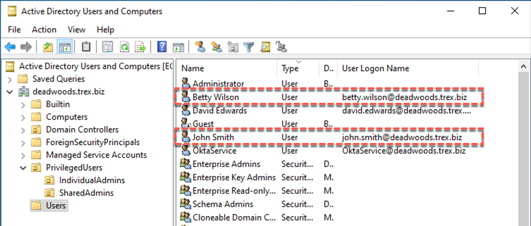
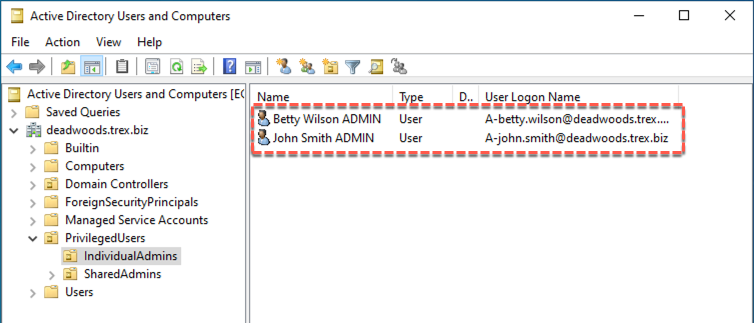
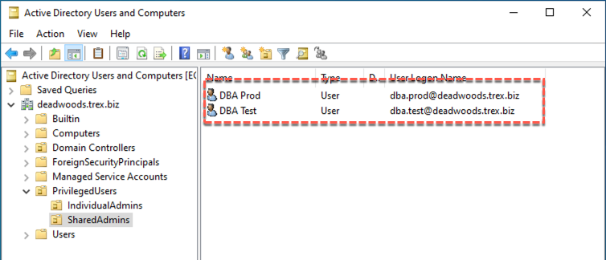
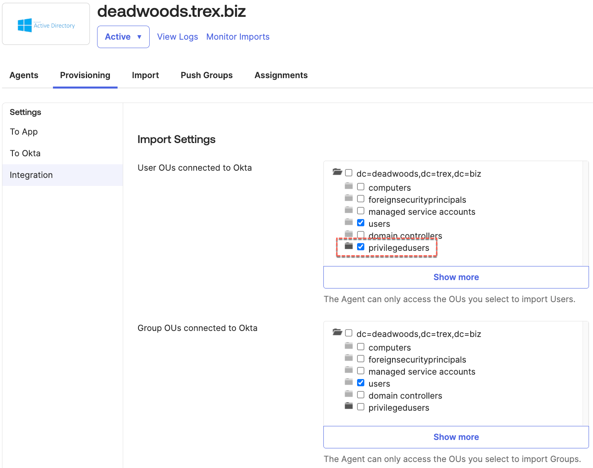

# Okta Environment Preparation

Prior to running the use cases, there are some Okta checks and setup
required. This section walks through this. This is in addition to the
standard set up requirements for OPA covered earlier, although you may
see some duplication.

The entire flow to configure the integration is covered in [<u>Get
started with Active Directory
accounts</u>](https://help.okta.com/en-us/content/topics/privileged-access/pam-ad-accounts-setup.htm);
it walks through all the steps covered in this section and the first
part of the lab.

Okta should have enabled the Okta Privileged Access product (SKU) and
any required feature flags. If you encounter issues walking through the
setup or you are not seeing what is expected, check with your Okta
account team that the product has been enabled.

### Before You Begin

Before you configure and test the AD integration feature you will need
the following:

- Admin access to Okta and OPA

- Users and associated groups in the Okta org to test with (you may want
  to create new users and groups if your Okta org is being used for
  other purposes)

- If they need to use RDP, make sure the individual admin/shared
  accounts can RDP

- For any users who will use the individual admin accounts or shared
  accounts, you should have some form of MFA on those Okta accounts

- An AD domain connected to Okta with a working AD Agent, with one or
  more member servers in the domain

- OPA configuration, including group(s) for resource/policy admin and
  policy membership (i.e. who can use the AD accounts)

### IMPORTANT Note on Okta, the AD Agent and OPA AD Integration

***\*\*Review the following information before proceeding. Failure to do
so may result in unexpected results and unusable AD admin
accounts.\*\****

Earlier in this chapter we described the architecture of the integration
and how an existing AD Agent and Okta Directory integration can be used
if it is already working. For most customers this integration can be
extended to include privileged accounts without any issues.

However, some customers leverage two features of the AD Agent to Okta
integration, scheduled import and automatic adoption. These are
described in [<u>Configure Active Directory import and account
settings,</u>](https://help.okta.com/en-us/content/topics/directory/ad-agent-configure-import.htm)
in steps 7-10.

With these options you can schedule imports with or without automatic
adoption. This means you could run the import periodically but not
create new Okta users, or automatically create new Okta users if they
don’t match an existing Okta user. You can also auto-create them just in
time (JIT) when a user authenticates through Okta.

Why is this a problem for the OPA AD Integration? Because there is a
risk that if the OPA AD Integration sequence shown in [<u>Get started
with Active Directory
accounts</u>](https://help.okta.com/en-us/content/topics/privileged-access/pam-ad-accounts-setup.htm)
isn’t followed in the right order, privileged accounts in the special OU
may get imported and have Okta users created for them, rather than them
being assigned to OPA for use there. It is important to follow the
sequence shown in the docs and below. If in doubt, it would be advisable
to turn off automatic adoption or even the scheduled import in the
Directory Integration Provisioning section.

There has been a recent update to the product to support accounts that
are also Okta users.

### AD Configuration in Okta

Prior to running this step, check the [<u>Requirements and
Limitation</u>](https://help.okta.com/en-us/content/topics/privileged-access/pam-ad-requirements.htm)
section in the product docs.

To test the AD Integration functionality in OPA, you will need a working
AD domain. The screenshots in this chapter have come from different
systems, including ***deadwoods.trex.bix*** and ***opademo.local***.

This domain should have some test users you can use with a separate OU
configured for the privileged accounts that will be used with OPA. The
example system has a ***PrivilegedUsers*** OU with two OUs in it - one
***IndividualAdmins*** for individual admin (or secondary) accounts and
one for ***SharedAdmins***. The individual admins are mapped to their
main user via the naming standard of A-&lt;user login name), so if the
main users is
[<u>betty.wilson@deadwoods.trex.biz</u>](mailto:betty.wilson@deadwoods-trex.biz),
then their admin account will be
[<u>A-betty.wilson@deadwoods.trex.biz</u>](mailto:A-betty.wilson@deadwoods.trex.biz).
There are two shared admin accounts.

An AD Agent must be deployed to the domain (DC or ideally a member
server) and integrated with your Okta org. Details of how to do this can
be found in the [<u>Active Directory
integration</u>](https://help.okta.com/oie/en-us/content/topics/directory/ad-agent-main.htm)
help docs. You will probably already have it configured, but should
consider the following:

- The text above talks about having unique OUs for the privileged
  accounts used in OPA vs. the regular accounts used in Okta. This was a
  requirement for the early release of this feature, but now you can
  identify privileged accounts via queries (as long as you have a way to
  uniquely identify them).

- The AD Directory Integration must include the OU(s) for the privileged
  accounts (do not do this yet).

- You do not need to have Provisioning enabled for the AD Directory
  Integration.

- Any AD Directory import must NOT create or map Okta accounts from
  those privileged OU(s).

### AD Users Assigned to the OPA Application in Okta

Where you are using individual admin accounts, you will configure
matching rules between the user and their individual admin account. For
example,
[<u>john.smith@deadwoods.trex.biz</u>](mailto:john.smith@deadwoods.trex.biz)
will be matched to
[<u>A-john.smith@deadwoods.trex.biz</u>](mailto:A-john.smith@deadwoods.trex.biz).

The user, in this case
[<u>john.smith@deadwoods.trex.biz</u>](mailto:john.smith@deadwoods.trex.biz),
must be a user in Okta and assigned to the Okta Privileged Access
application in Okta.
