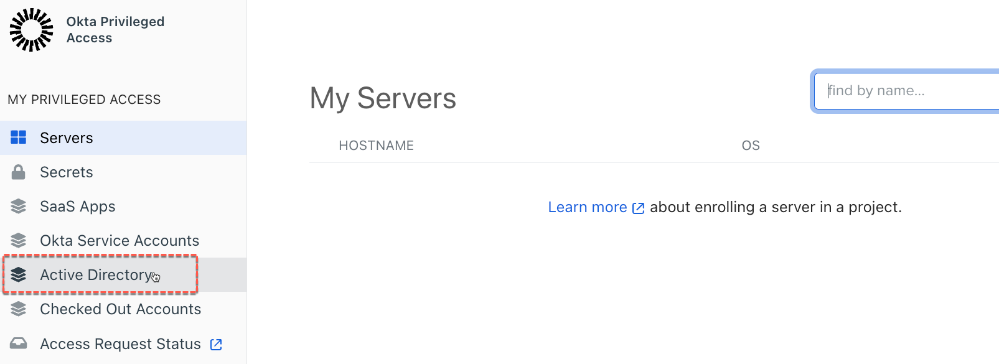
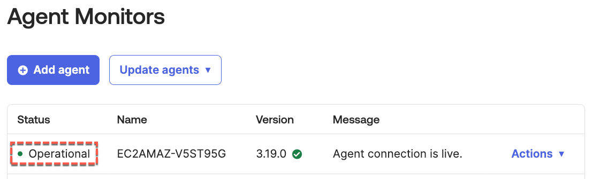

# Confirm Pre-reqs Prior to Configuring Integration

This section provides more detail on the above setup requirements for
the labs to follow.

### Confirm OPA is Configured

In this section we confirm that OPA is configured.

To do this:

1.  Log into the **Okta Dashboard** as your administrator.

2.  Click on the **Okta Privileged Access** tile to connect to OPA.

3.  Go to **DIRECTORY &gt; Groups** and confirm that you have groups
    assigned to the three user roles (PAM Administrator, Resource
    Administrator, Security Administrator)

4.  Look at the items under the **MY PRIVILEGED ACCESS** menu item and
    confirm there is an **Active Directory** item (this confirms the
    feature flag for the AD integration is enabled)

If these steps are successful, your OPA environment is configured and
ready for the steps to integrate your AD.

Note that in a production deployment you would separate the groups for
different admin roles in OPA. However for testing purposes it may be
easier to have a group of administrators across all three roles. In the
steps below, the one administrator is used. If you want to have separate
administrators, you will need to log into Okta and OPA with the
different users for different configuration tasks.

### Confirm Okta AD Integration is Configured and Active

In this section we confirm that the Okta AD Integration is configured
and active.

To do this:

5.  Log into the **Okta Dashboard** as your administrator and click on
    the **Admin** button to go to the Admin Console

6.  Go to **Directory &gt; Directory Integrations** and click on the entry
    for your AD Domain

7.  Select the **<u>Agents</u>** tab and confirm your agent is in an
    active state

    

    If the agent isn’t in an operational state you will need to resolve
    any issues before attempting the lab.

This confirms that the AD integration is working and ready for the lab.

### Confirm You Can Log into a Member Server or Other Service

You should have at least one member server in the domain, or some other
AD integrated app/service such as IT Tools, Business Applications, etc.

Test you can log into the member server or app/service with one of the
AD accounts (any AD account will do, we just need to confirm that the
member server can authenticate to AD).

Your environment should be ready to configure and test the integration.

The remaining sections of this document look at the integration
configuration and testing. There are a number of steps to configure the
integration for one of the member servers, and then test connecting to
it with a shared account and an individual admin account.

The steps we are following in this section are based on the [<u>Get
started with Active Directory
accounts</u>](https://help.okta.com/en-us/content/topics/privileged-access/pam-ad-accounts-setup.htm)
section and subsections in the product documentation. You should always
refer back to it for any changes as they may be more up-to-date than
this document.

The lab steps do not cover [<u>Manual account
assignment</u>](https://help.okta.com/en-us/content/topics/privileged-access/pam-ad-manual-assignment.htm).
Refer to the docs for more information.
