# Configure the OPA AD Integration

In this section we walk through the configuration of the AD Integration,
including the connection, the account assignment rules, and sync’ing of
accounts from Okta to OPA. This mirrors the steps in the **Set up AD
Accounts** section in the [<u>Get started with Active Directory
accounts</u>](https://help.okta.com/en-us/content/topics/privileged-access/pam-ad-accounts-setup.htm)
page. There appears duplication from above as this guide is trying to
follow the flow of the product documentation. The subheadings list Step
n - to show the step in the documentation.

### Step 1 - Install the AD Agent

We have assumed you already have a working AD Agent and the steps above
should have validated that. If not you will need to install it as per
the [<u>Install the Okta Active Directory
agent</u>](https://help.okta.com/en-us/content/topics/directory/ad-agent-new-integration.htm)
page in the documentation.

### Step 2 - Grant Okta AD Agent Password Management Permissions

The account running the AD Agent will need additional permissions
assigned to allow the password rotation function to work. The steps are
detailed in [<u>Grant Okta Active Directory (AD) agent password
management
permissions</u>](https://help.okta.com/en-us/content/topics/privileged-access/pam-ad-setup-ad-agent.htm).
Note that there are two sections on this page:

- The first (**Grant Okta AD agent permissions to reset passwords**) is
  required for all accounts in AD,

- The second (**Grant Okta AD Agent permissions to reset passwords for
  protected accounts**) is required for any accounts that are
  [<u>protected accounts or members of protected account
  groups</u>](https://learn.microsoft.com/en-us/windows-server/identity/ad-ds/plan/security-best-practices/appendix-c--protected-accounts-and-groups-in-active-directory)
  (like Domain Admins).

1.  Follow the steps to assign these permissions to the account. If you
    have protected accounts you need to do both sets of steps.

### Step 3 - Create Resource Group(s) and Project(s) for AD Accounts

Within OPA you will need somewhere to put the AD admin accounts -
Projects within Resource Groups. You could reuse an existing Resource
Group + Project or set up one specifically for the AD admin accounts.

In this case we will create a new Resource Group + Project for the AD
accounts.

2.  As a Resource Administrator, create a new **Resource Group** in the
    OPA Dashboard, as you have done in the past for other resource types
    in OPA (see [<u>Resource
    Groups</u>](https://help.okta.com/en-us/content/topics/privileged-access/pam-resource-groups.htm)
    for more details)

3.  Create a new **Project** in the Resource Group, as you have done in
    the past (see
    [<u>Projects</u>](https://help.okta.com/en-us/content/topics/privileged-access/pam-projects.htm)
    for more details).

Creating resource groups and projects was covered in detail in earlier
labs, in the [<u>Exploring Secrets
Management</u>](#exploring-secrets-management) chapter and [<u>Exploring
Infrastructure (Server)
Access</u>](#exploring-infrastructure-server-access) chapter.

### Step 4 - Configure Project Settings

As with the other Resource Types in OPA, the AD accounts have unique
settings that may need to be configured.

For the Active Directory Accounts resource type, this includes:

- The password complexity rules for when OPA will rotate the AD account
  passwords,

- The password rotation schedule, for automatic rotation of passwords
  (passwords will also be rotated when first imported and on each check
  in), and

- The checkout settings, such as which accounts to enable exclusive
  checkout for and the checkout duration.

To manage these settings:

4.  Go into the new **Project**, select ***Active Directory Accounts***
    from the **Resource Type** dropdown, and go to the
    **<u>Settings</u>** tab.

    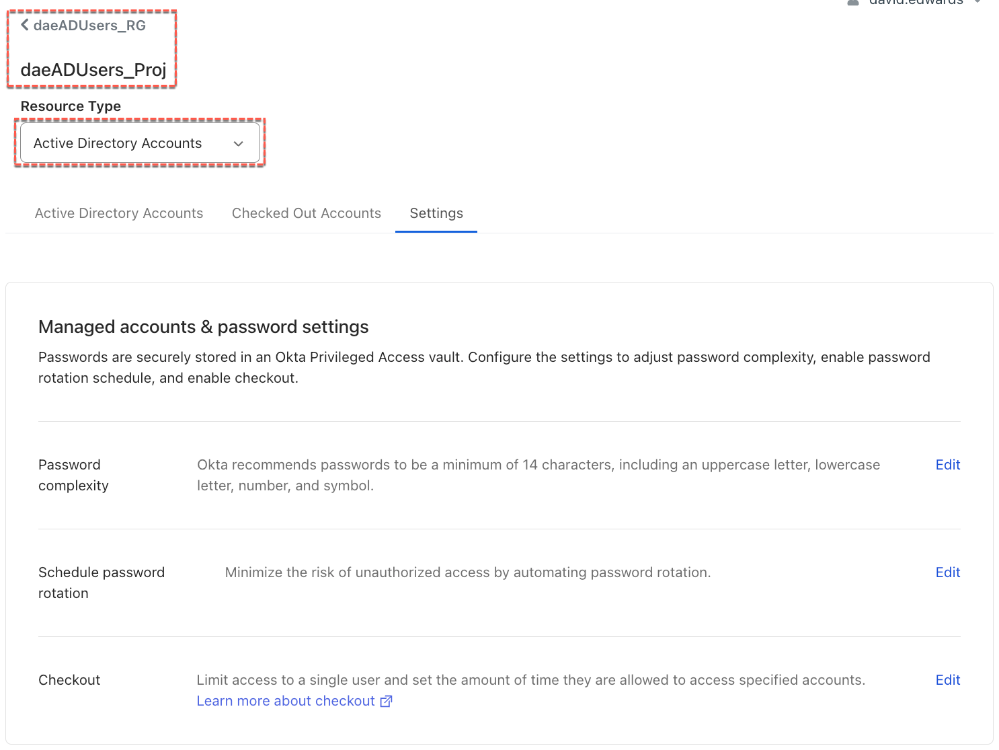

5.  Here you could set the password complexity to match that in AD. In
    this case, leave the **Password complexity** and **Checkout**
    settings. Set a time in the **Schedule password rotation** section
    and **Save** (we recommend 30 days).

Now that we have a location to store the AD accounts from Okta, we can
go through the steps to pull those accounts into OPA.

### Step 5 - Activate AD Domains in OPA

OPA needs to know which AD Directory integrations it will work with. You
might have multiple directory integrations in Okta, but not need all of
them in OPA. A connection defines the ones OPA will work with. You would
set up a connection for each AD that OPA needs to work with.

This step is covered in [<u>Set up Active Directory
domains</u>](https://help.okta.com/en-us/content/topics/privileged-access/pam-ad-domain-activate.htm).

To configure a connection:

6.  In the OPA Dashboard as a resource administrator, go to **RESOURCE
    ADMINISTRATION &gt; Connections**

7.  If you have properly configured the AD Agent in Okta, your domain
    should show here (there may be a delay between activating it in Okta
    and it appearing in the list of Active Directory domains). Your
    domain should show as DISCONNECTED.

    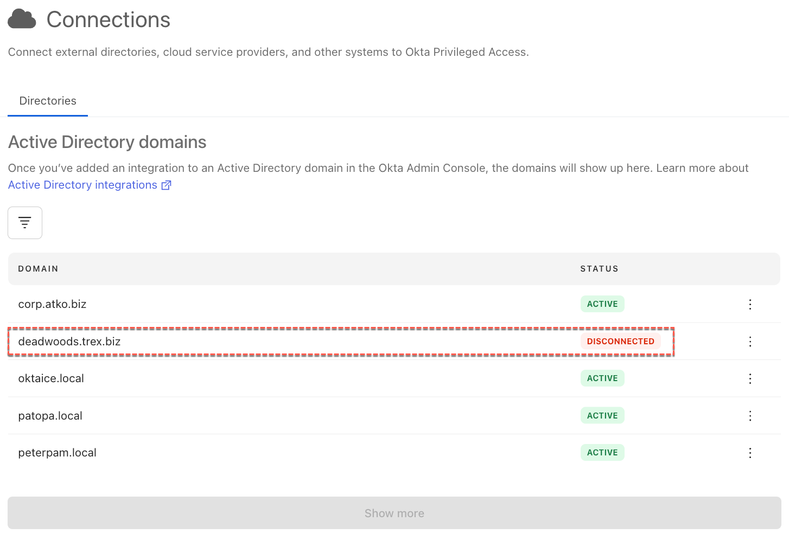

8.  Select the actions menu (three vertical dots to the right) and click
    **Activate**

    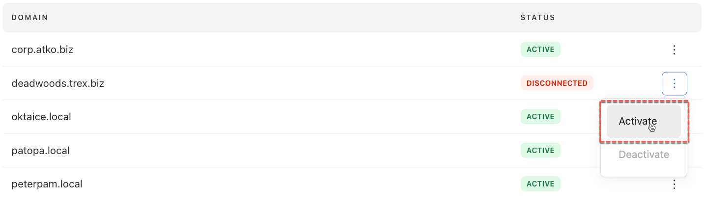

9.  On the confirmation dialog, click **Activate domain**

10. You will see a confirmation message in the bottom right of the
    screen. If you refresh the screen the domain should show as ACTIVE.

    

The Connections page is only used to enable/disable the connections. We
will define the integrations with assignment rules next.

### Step 6 - Set up Assignment Rules in OPA

Account assignment rules are used to define which AD admin accounts are
vaulted and where those accounts live (Resource Group + Project). See
the [<u>Active Directory account
rules</u>](https://help.okta.com/en-us/content/topics/privileged-access/pam-ad-account-rules.htm)
help page.

We will create two account rules, one for individual admin accounts and
one for shared accounts.

10. In the OPA Dashboard, go to **RESOURCE ADMINISTRATION &gt; Resource
    assignment**. This is the same page we use for managing SaaS/Okta
    accounts.

11. Go to the **<u>Active Directory</u>** tab

12. Click on your AD domain

    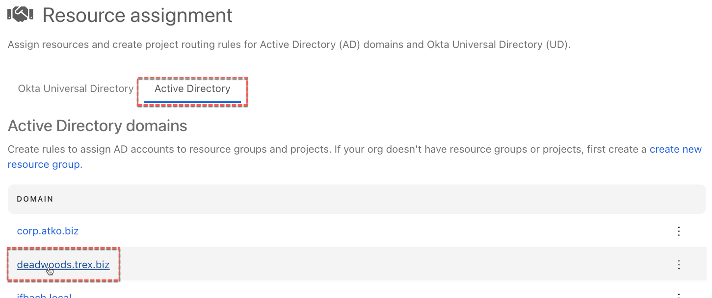

    When you open the domain for the first time, you will see that only
    Shared account rules can be set. To set Individual account rules,
    you need to configure settings.

    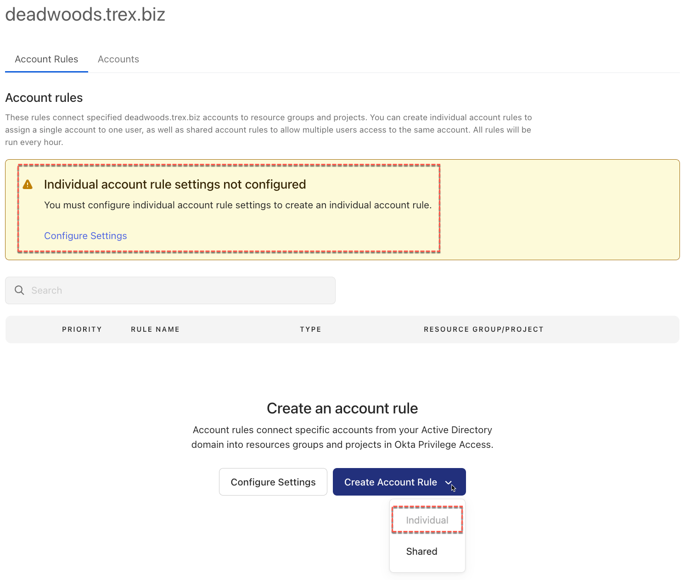

13. Click either the **<u>Configure Settings</u>** link in the yellow
    box or the **Configure Settings** button. (Note, if you ever need to
    come back to the settings, there is a **Rule Settings** button on
    this page).

14. You need to define how OPA will match individual admin accounts, and
    this page is where you define that pattern matching. In the example
    we’re using we have individual admin accounts flagged with a “A-”
    prefix (i.e.
    [<u>john.smith@deadwoods.trex.biz</u>](mailto:john.smith@deadwoods.trex.biz)
    has an individual admin account
    [<u>A-john.smith@deadwoods.trex.biz</u>](mailto:A-john.smith@deadwoods.trex.biz)).
    In the **Individual account rule settings** page, define the key
    matching criteria (in this case the Account name) and the prefix
    (you could also specify a suffix).

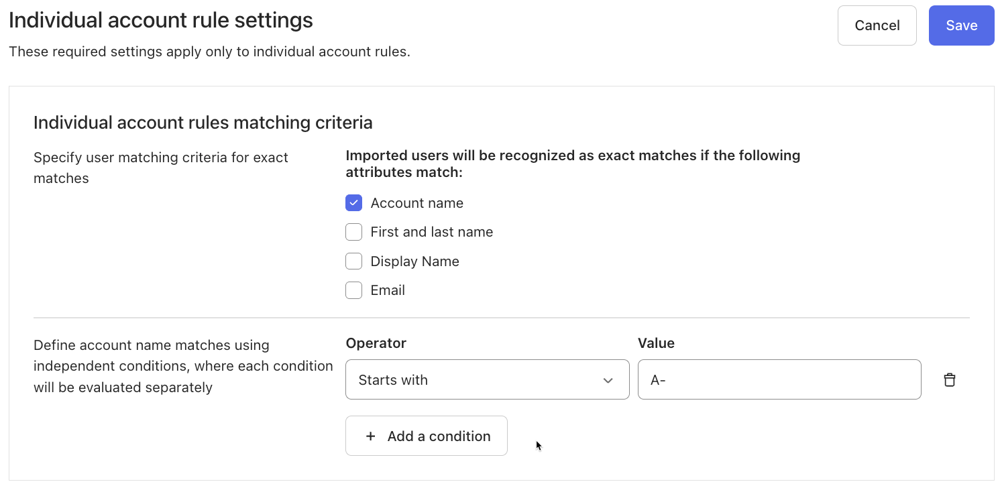

15. Click the **Save** button to save the rule

16. You can now create an individual account rule. Click the down arrow
    on the **Create Account Rule** button and select **Individual**.

    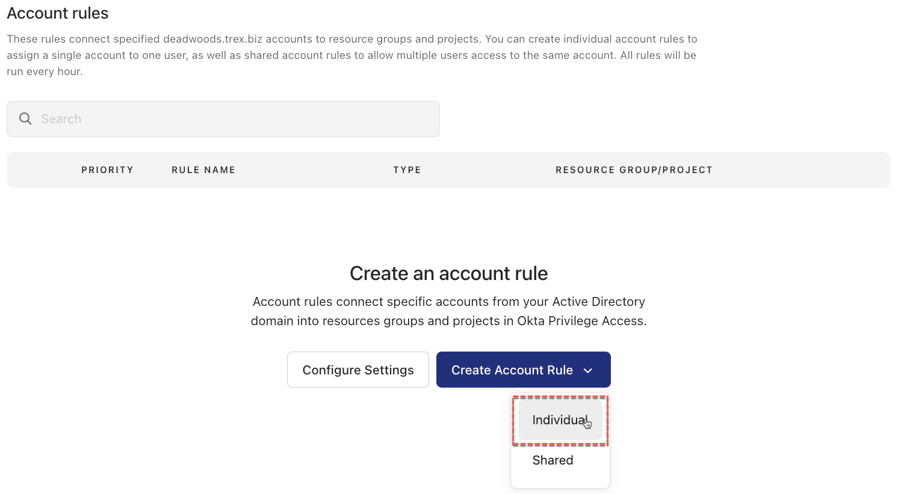

17. On the Create account rule page, give the rule a **Name**, select
    the **Resource Group** and **Project**, and define the **Org unit**
    you want to draw the accounts from. If you’re not sure of the
    Distinguished Name format go to the AD Directory Provisioning
    Integration view in Okta.

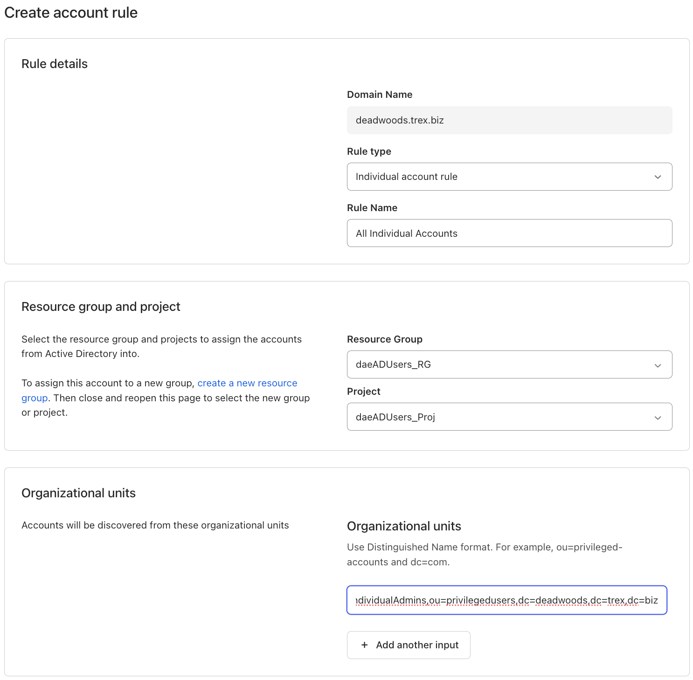

If you’re not sure of the Distinguished Name of your OUs, see [<u>How
To Determine the DN of an OU in
AD</u>](#how-to-determine-the-dn-of-an-ou-in-ad) of this document
which walks you through the steps to do so.

As of Feb 2026, this page (for Individual and Shared rules) has had
some features added and others rearranged. See the product docs for
detailes of the new features.

18. Click the **Save** button to save the rule.

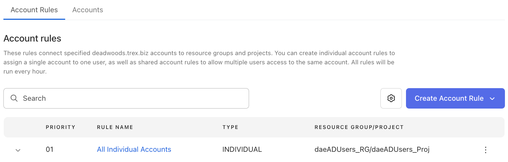

19. Click the down arrow on the **Create Account Rule** button and
    select **Shared** to create a rule for the shared admin accounts.

20. Fill in the page. It’s basically the same as the individual account
    rule.

    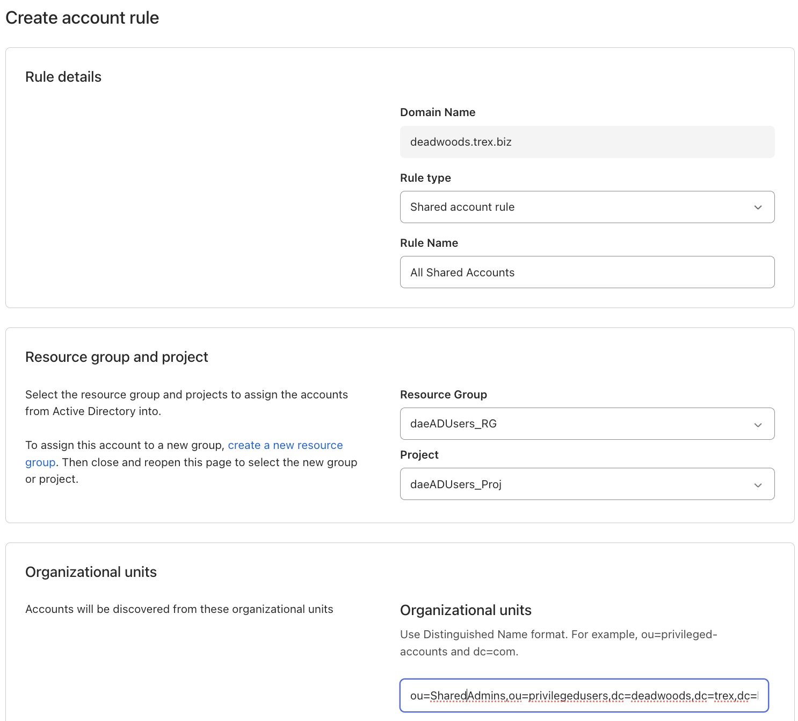

21. Click the **Save** button to save the rule.

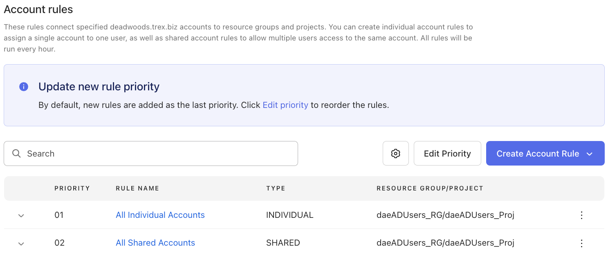

Note that you can also modify the rule priority, but we won’t do that.

You should now have two rules, one for the individual admin accounts and
one for the shared admin accounts. In the example above, the source of
accounts is the same OU (ou=privilegedusers…, but different OUs under
it) and they are going to the same Resource Group + Project, so you
could use one rule.

### Step 7 - Extend AD Agent Scope to Include New Privileged Acct OU

We have now configured OPA to recognise the AD domain and pull accounts
from it into the appropriate Resource Group and Project. But at this
point the Directory Integration for that domain In Okta, does not know
about the new privileged account OU in AD.

To fix this:

22. As an administrator go into the Okta Admin Console, go to
    **Directory &gt; Directory Integrations**

23. Select (click on) the AD domain that you specified in the OPA
    configuration above

24. Select the **<u>Provisioning</u>** tab and select **Settings &gt;
    Integration**

25. In the **Import Settings**, **User OUs connected to Okta**, enable
    the new privileged users OU

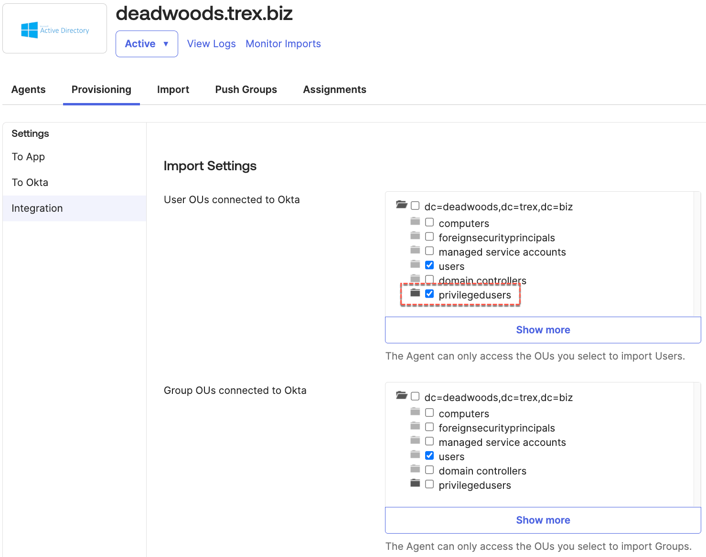

26. Click the **Save** button

We need to run an import to Okta is aware of the new OU and the accounts
in it:

27. Select the **<u>Import</u>** tab

28. Use the **Import Now** button to run an import and confirm it was
    successful. It is ok if there were no changes to existing users and
    groups. If you added new users to test the OPA integration, then
    they should show up in the number of users and groups scanned. As
    mentioned above **<u>DO NOT</u>** assign the shared and personal
    admin accounts to Okta accounts (they will be removed from the
    import view in a future change).

The synchronisation between Okta and OPA for the AD accounts occurs on a
schedule (every hour). The product docs do not mention forcing a
synchronisation at this point and you could wait for the sync to occur,
but in our case we will force it.

29. Go back to the **Resource assignment** view in the OPA UI

30. Click the actions menu for your domain (three vertical dots) and
    click the **Synchronise app users** option.

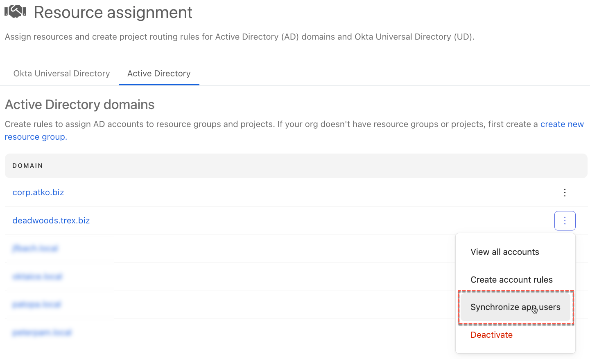

You will see a confirmation message in the bottom right of the
screen. 

The synchronisation is a background process and may take a few
minutes.

31. Again select the actions menu and click the **View all accounts**
    option. You will be taken to the Accounts tab for the domain (you
    could have also clicked on the domain name and then gone to the
    **<u>Accounts</u>** tab).

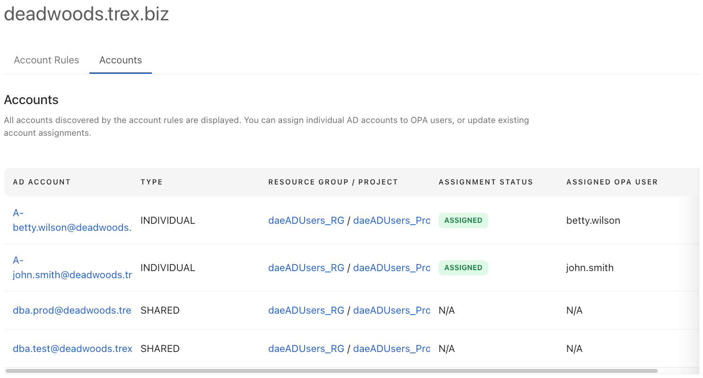

32. Check that you have all the expected accounts. In the example above,
    it has found the four accounts from the AD OU and put them in the
    correct Resource Group + Project, and also assigned the two
    individual admin accounts to the users OPA account.

    If you find that they weren’t assigned ((NO ASSIGNMENT in the
    status, and nothing in the Assigned OPA User column), you can check
    that the assignment rules are configured, but also that the actual
    users (the individuals, not their individual admin account) are
    assigned to the OPA app in Okta. If you need to modify either, you
    can rerun the synchronize operation.

You now have your individual and shared admin accounts from AD in OPA.

As with SaaS Service Accounts, once you have configured and run the
Resource assignments, you can see the AD accounts in the Resource Group
and Project.

33. Go to **Resource Management** and open your Resource Group you
    assigned the AD users to.

34. Open the Project and select ***Active Directory Accounts*** from the
    **Resource Type** pulldown list.

    If you have just run the sync and accounts have just been stored in
    the vault, then the STATUS will show ROTATING.

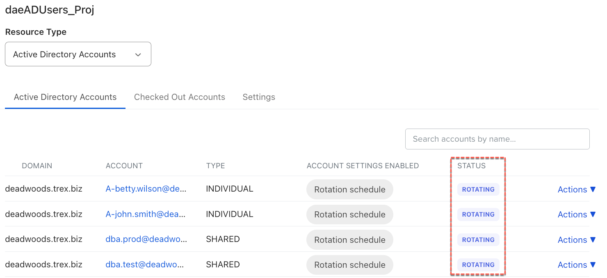

If the rotation has completed, the STATUS will show ROTATED.

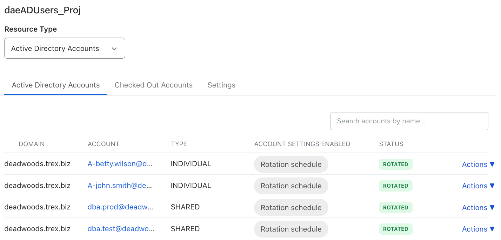

If there has been issues with the initial rotation, you will see a
ROTATION FAILED status.

35. Open one of the accounts (click the ACCOUNT name) and view the
    **Details** and **Rotation** history and schedule.

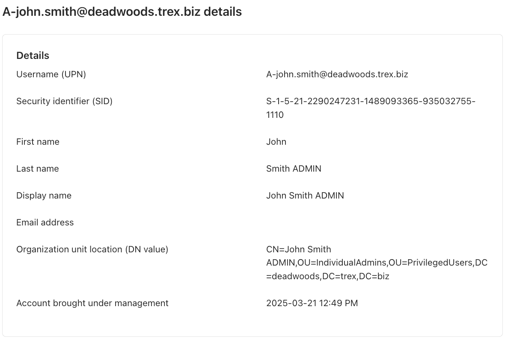

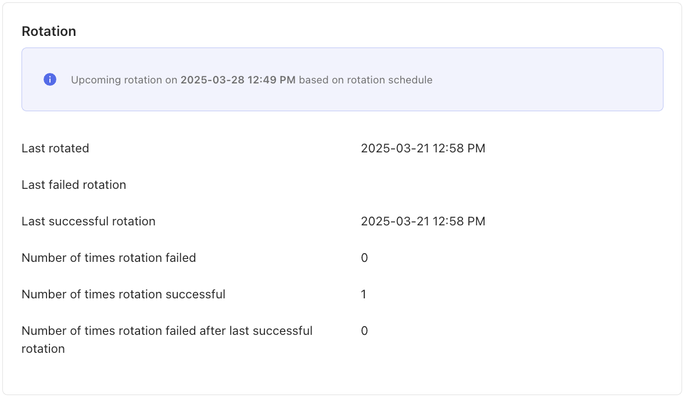

This shows that the AD accounts are being managed as resources like any
other resources in OPA. In the example above, it is an individual admin
account, but you do not see what user it is connected to.

It is worthwhile checking the Okta System Log for the events that were
generated for actions in OPA. There are pam.\*\*\* events generated from
the AD configuration and integration we walked through above.

When you updated the Resource Assignment rule(s) you would see events
like the following:

When a password for an AD account is rotated in OPA, you will see both
OPA (pam.\*\*\*) events and Okta events showing the update/provision to
AD.

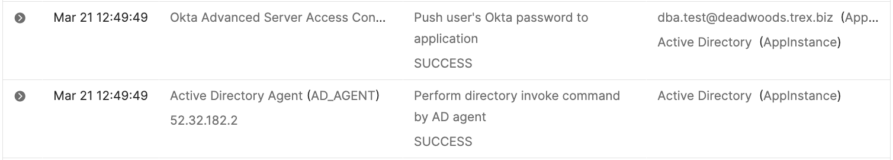

You will see other events and they can be very useful in debugging
issues with configuration or password rotation.

### Step 8 - Set up Policy in OPA

This is step 8. In the **Set up AD accounts** section of [<u>Get started
with Active Directory
accounts</u>](https://help.okta.com/en-us/content/topics/privileged-access/pam-ad-accounts-setup.htm).
We will do this in the following sections for each of the shared
accounts and individual admin accounts.

### Step 9 - Add Rules to Grant Access to AD Accounts

This is step 9. In the **Set up AD accounts** section of [<u>Get started
with Active Directory
accounts</u>](https://help.okta.com/en-us/content/topics/privileged-access/pam-ad-accounts-setup.htm).
We will do this in the following sections for each of the shared
accounts and individual admin accounts.

We are now ready to test the shared and individual admin AD accounts in
OPA.
