# Configure and Test Shared Account Checkout

Now that we have AD admin accounts in OPA as resources, we can define
policy to allow use of them and test this. We will split the next
sections into three: one covering checking out the shared accounts; one
covering checkoing out the individual admin accounts; and one covering
use of AD accounts for RDP connections. If you have done other labs in
this guide a lot will be familiar.

For this first scenario we are looking at shared accounts, i.e. accounts
in AD that are shared across multiple users. These tend to be high
privilege accounts and should have tighter controls applied to them. In
this case we will add the need for JIT access approval prior to being
able to view the credentials. We will start with a simple scenario then
add in check out/in with password rotation.

This is covered in the [<u>Security
policy</u>](https://help.okta.com/en-us/content/topics/privileged-access/pam-policy.htm)
pages in the help docs, which have been expanded to include the Active
Directory accounts.

### Create An Approval Flow

We will use an approval request (access request) condition on the shared
account access policy. For this you will need a Request Type defined in
the Access Requests system. We won’t walk through the steps for this in
this guide, but you can see the product documentation and blogs for
examples or look at the earlier chapters in this guide that include
access requests.

The sample flow we will use is a simple one-level of approver (nominally
the “Service Owner”) set to a specific user to show the mechanism.

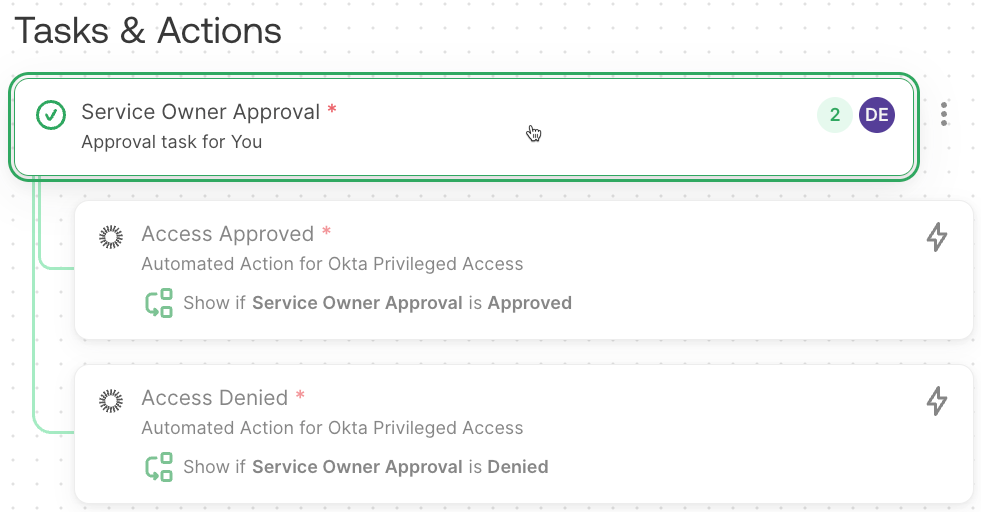

Make sure any users who will need to request access to the AD accounts
are assigned to the Access Requests app. In our case we have assigned
the **Everyone** group to Access Requests, but you might want to use the
user group that you will assign to the OPA policies.

### Configure Policy and Rule for a Shared Account

First we create a Policy for the access. Remember that policies are
mapped to user groups, so if you want different accesses for different
policies (e.g. different AD accounts, different controls on using those
accounts) you will need different policies. In this example we will
create a single policy assigned to a single user group (using an AD
group).

To do this:

1.  In the **Okta Dashboard** as an admin who can see/manage
    applications, open the OPA application and confirm your user group
    is assigned as a Push Group.

    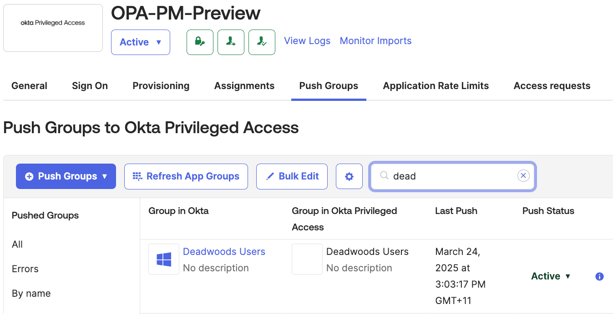

    In this case we are using an AD group (Deadwoods Users) but it could
    be any other group in Okta.

2.  In the OPA dashboard, as an admin who has rights to see groups,
    confirm the group is in OPA.

    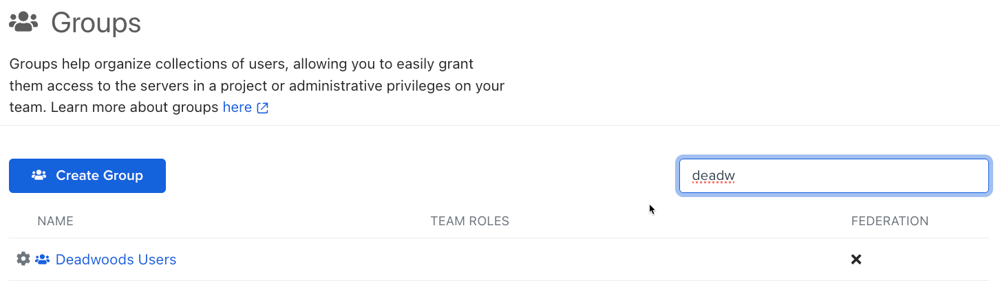

3.  In the OPA dashboard, as an admin who has rights to manage policy,
    got to **SECURITY ADMINISTRATION &gt; Policy**.

4.  Click the **Create Policy** button and select **Default**.

    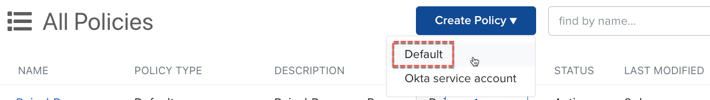

5.  Give the new policy a **Name**, **Description** (optional), decide
    if you want to let it access resources in any **Resource group** or
    a specific one, and assign your user group as a **principal**.

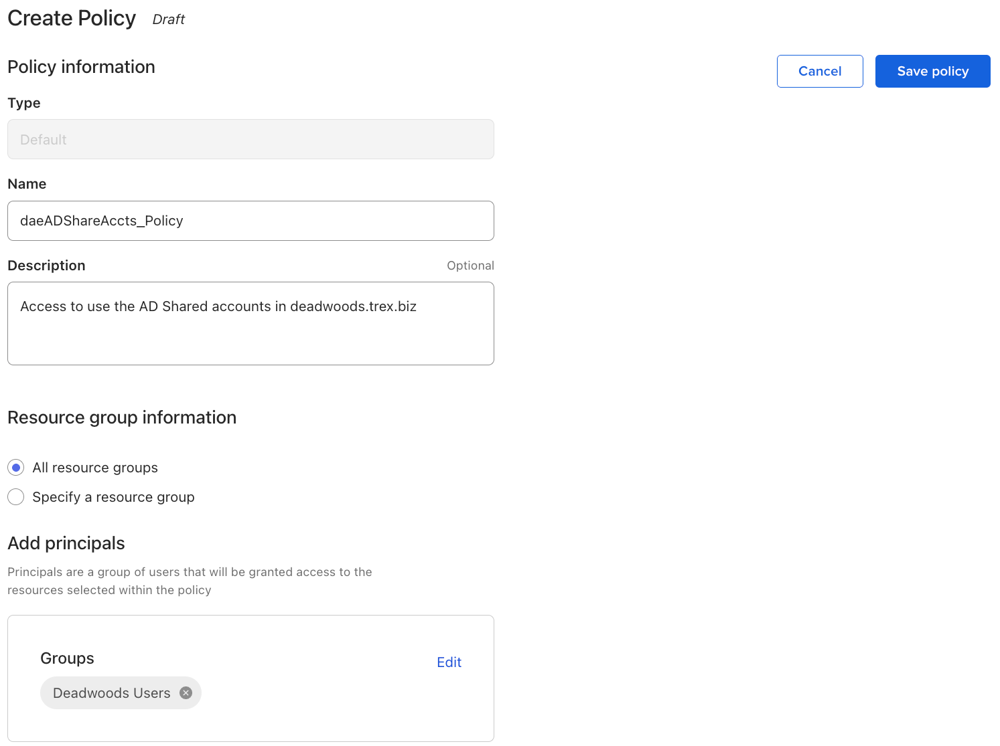

6.  Click the **Add Rule** button and select ***Active Directory Account
    Rule*** from the pulldown list.

    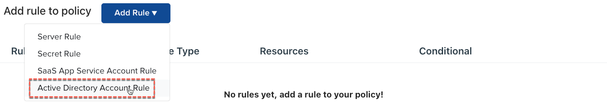

7.  Give the new rule a **name** and select that you want this rule to
    protect **shared accounts**.

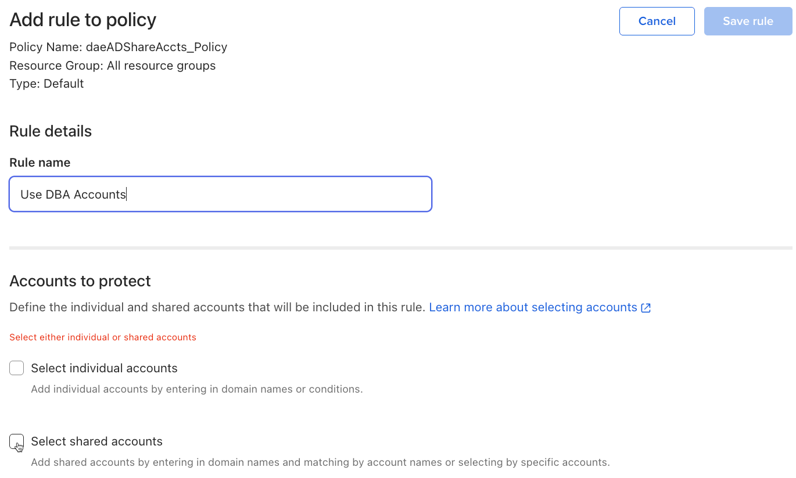

8.  When you select shared accounts the view will change to allow
    definition of the AD accounts this policy will apply to. You can
    select names that span multiple domains (e.g. you have a standard
    DBA account defined in different AD domains) or select individual
    accounts.

    In this case select one or more of the shared accounts from your
    domain.

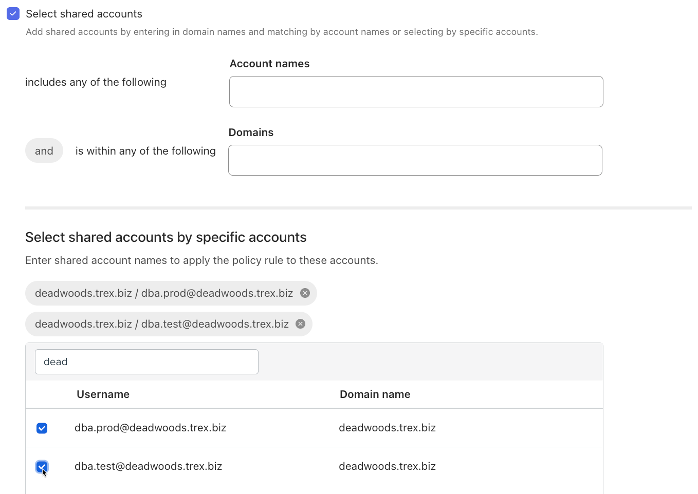

9.  Scroll down to the Permissions for accounts section and select the
    **Reveal** option.

    There are also Rotate Password and RDP Session options. We will not
    look at the Rotate Password option in this guide (it allows a user
    in the principal group to trigger a rotation) and the RDP option is
    covered in a later lab.

10. Continue down the Add Rule page and see that there are conditions
    that can be applied. They are 1) **Approval requests**, 2)
    **Multifactor authentication** and 3) **Maximum Checkout time**.
    These are the same as for other resource types in OPA and we won’t
    go into more detail.

    In this case click the Enable approval requests, and select the
    **approval request Type** you created above. You can leave the
    approval time as is or change it to suit.

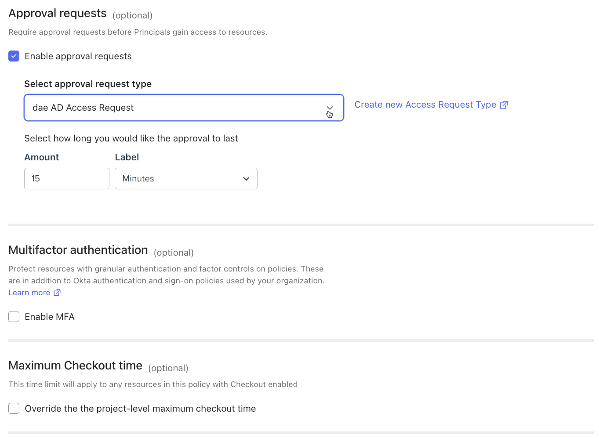

11. Go back to the top of the page and click the **Save rule** button

12. On the policy page, check the rule and conditionals then click the
    **Save policy** button

    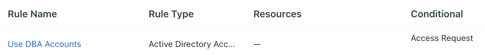

13. Enable the **Publish Policy** option

    

14. Click the **Publish Policy** button on the confirmation dialog

The policy and rule(s) are now live and ready for testing.

### Reveal Shared Account

To test the policy you need to use an Okta account that is in the group
you assigned to the policy above. You will also need to have the access
request approver be able to access the Access Requests function to
review and approve the request.

Steps:

14. As your test user, sign into the **Okta Dashboard** and click in the
    **Okta Privileged Access** tile

15. Go to the **Active Directory** menu item under **MY PRIVILEGED
    ACCESS**. You should see the domain there. If you don’t see anything
    your directory configurations in OPA may not be correct (but they
    should be correct if you were able to sync and assign AD users).

    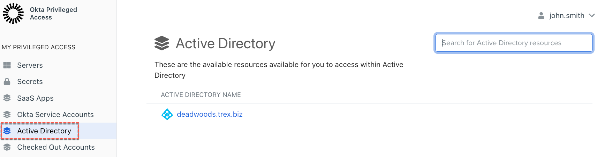

16. Click on the domain name and you should see your shared accounts
    listed. If you don’t see accounts or all the accounts you expected,
    check your policy rules (if you were able to assign the accounts the
    rule, there’s no issue with the AD accounts in the resource group /
    project, just the policy rule). Also, you should check you enabled
    the policy.

    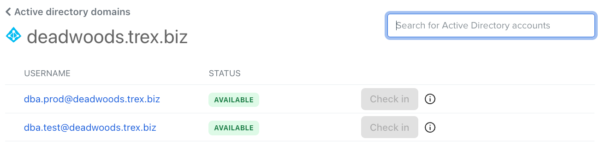

Note that later UIs have a Show credentials button on this page if
policy allows reveal wihout additional controls (like access request).
We will ignore this for now and go into the the account.

17. Select (click) one of the shared accounts. It should show a single
    Access Method with the account being AVAILABLE. Note that it should
    also show Access Request and Show, meaning you need to run to be
    approved to reveal the credentials. If you do not see these, revisit
    your policy rule.

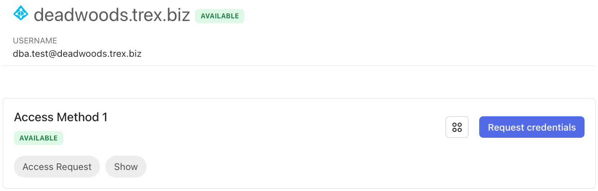

This view has been expanded with recent updates and will separate out
CONDITIONS (like Access Request) and PERMISSIONS (like Show). It will
also show detailed information about the account from Active
Directory.

18. Click the **View details** button to see more information.

    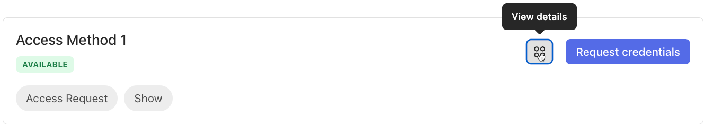

    The details in this access method shows it’s a Shared account type,
    with checkout not required, and access request status of NOT MET
    (yet).

19. Click back in the main page to close the View details page, then
    click the **Request credentials** button. You will get a
    notification that a request has been raised.

We will now switch over to the access reviewer, the person you defined
as the Approver in the Request Type you set up earlier. They would have
received an email saying there was a new request to review.

20. As the person you assigned as the Request Type approver, log into
    the **Okta Dashboard** and click the **Access Requests** tile. You
    should see a Request sitting in the Inbox for this user.

    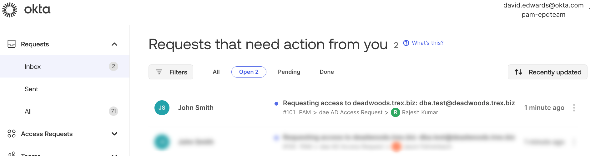

21. Click into the request. If you have worked with Access Requests (in
    OPA or OIG) before this view will be familiar. We won’t go into
    details.

    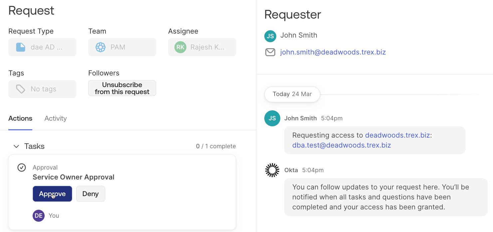

22. Click the **Approve** button.

23. Exit out **Access Requests**

We have finished with the approval review and now return to the user
connecting to the account.

24. Return to the user trying to access the AD account in their **OPA
    Dashboard**

25. Refresh the Access Methods page to see that the Request credentials
    button has changed to a **Show credentials** button. If you use the
    View details button you would see that the access request status is
    now MET.

    Click on the **Show credentials** button.

    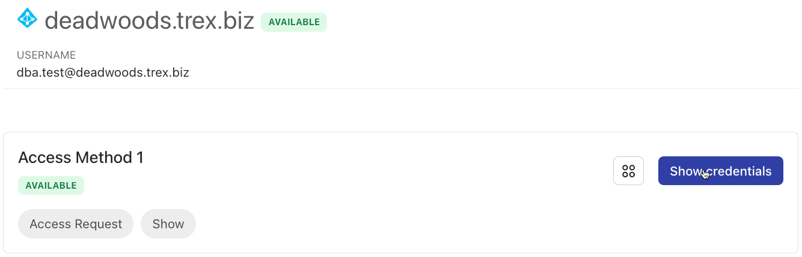

<!-- -->

26. The AD credentials are revealed and can be copied and pasted into
    whatever Windows login prompt. In this case we are using **Windows
    App** to RDP in. If this account is set up correctly in AD, you
    should be able to sign in.

    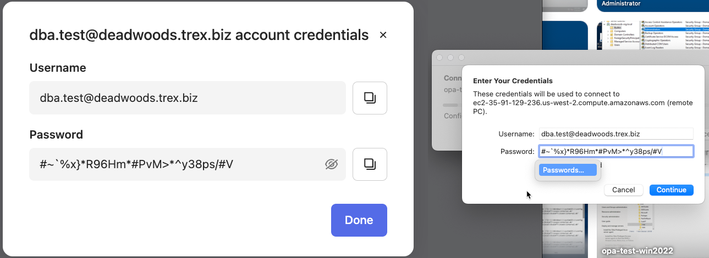

    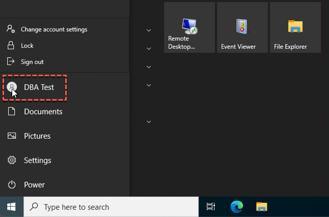

27. Click **Done** in the OPA credentials screen

This ends the steps to reveal and use AD shared account credentials. If
you look at the Okta System Log, you will see that there is an event for
“(PAM) reveal password for a service account”.

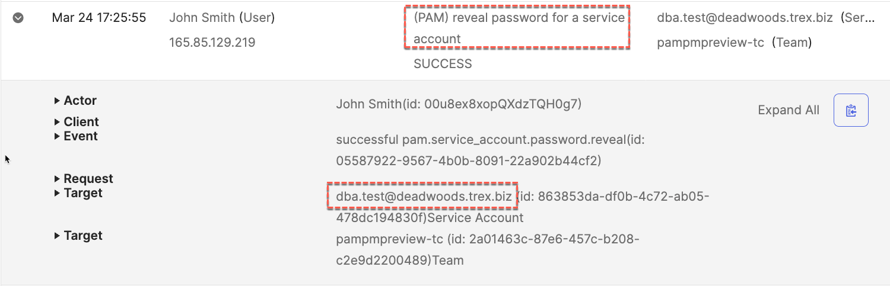

This is the simplest mechanism to allow users to reveal AD shared
account credentials. However it’s not the most secure as multiple people
could reveal the password and there is no check in to trigger a password
rotation (other than the scheduled one). We will change that by applying
Checkout in the next section.

### Enable and Test Checkout for the Shared Accounts

To enable checkout you need to do the following steps:

28. As a resource administrator go in the **OPA Dashboard** and go back
    into the Resource Group and Project you set up earlier

29. In the Project select ***Active Directory Accounts*** from the
    **Resource Type** pulldown

30. Go to the **<u>Settings</u>** tab

31. Find the **Checkout** item and click the **<u>Edit</u>** link

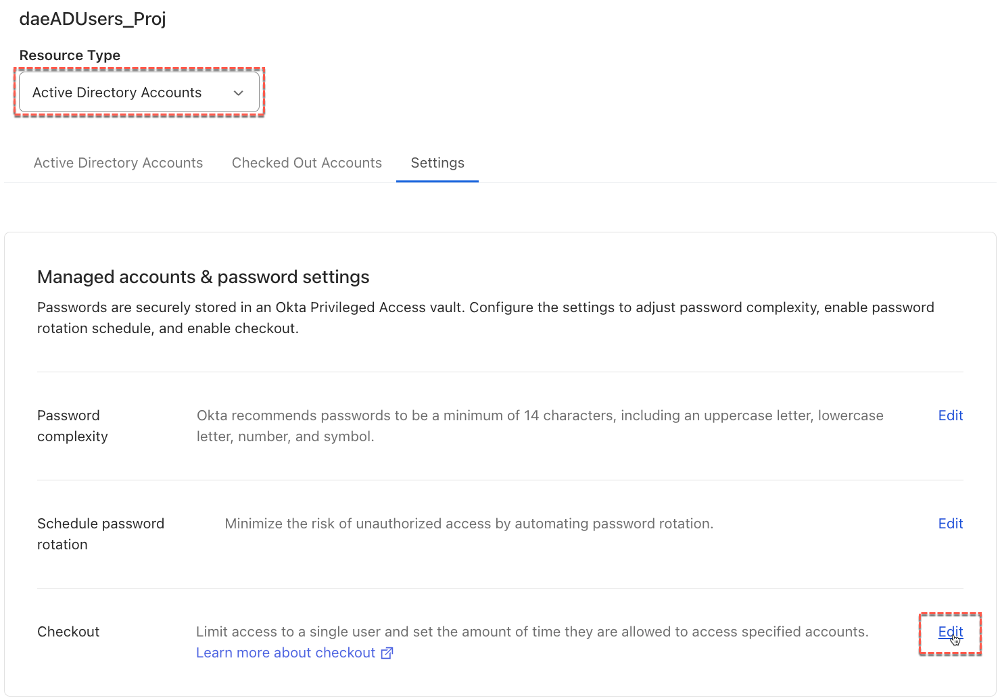

32. Select the **Enable Checkout for** option. You can select all, a
    named set or an exclusion set. We will leave it as **All**. Change
    the (default) **maximum checkout time** to a more realistic ***2
    Hours***.

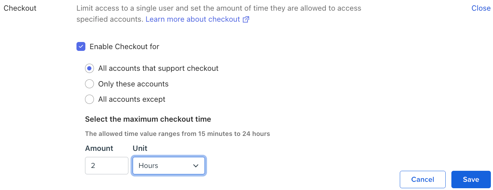

You can override the maximum checkout time in a policy rule.

33. Click the **Save** button.

We can now repeat the user steps above and show the difference.

34. Repeat the steps shown above ([<u>Reveal Shared
    Account</u>](#reveal-shared-account)) up to the point where you are
    seeing the Access Method for the account.

    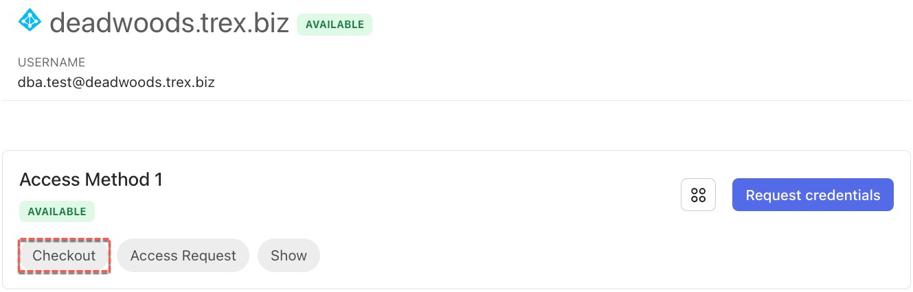

    Notice that now it has Checkout listed alongside Access Request and
    Show. This means that exclusive checkout is applied (as will
    password rotation on check in).

35. Click the **Request credentials** button, and as before go through
    the approval process.

36. When the request is approved, return to the Access Methods screen
    and refresh. Click the **Show credentials** button.

    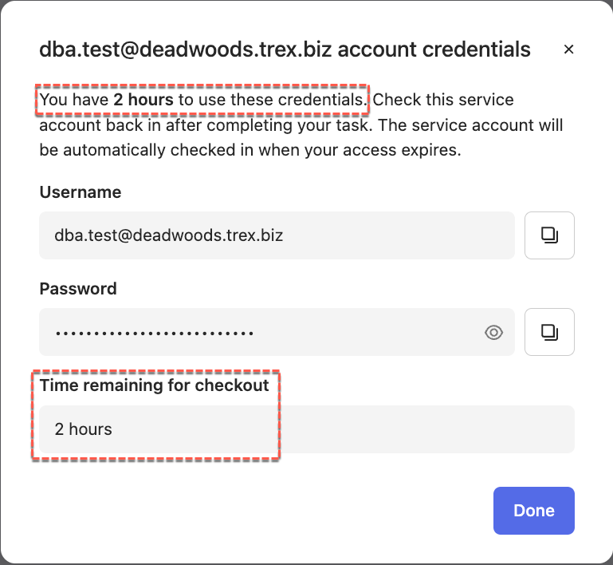

Note that there is now an additional field highlighting that there is
a time limit on using the credentials (2 hours, the default).

37\. Click the **Done** button. That the account is now showing as
CHECKED OUT.

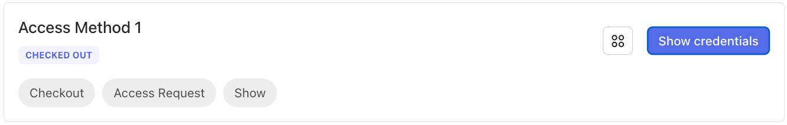

No one else can use this account when it is in the Checked Out state.
Next we will look at the check in process.

### Check Account In

There are three ways a shared AD account can be checked in:

- The user checks it in (we will look at this)

- An administrator checks it in (we will look at this), or

- The checkout timer expires.

Any of these will trigger a password rotation.

Let’s look at the user check in mechanism.

38. As the user in the OPA Dashboard, click on the **Checked Out
    Accounts** menu item.

    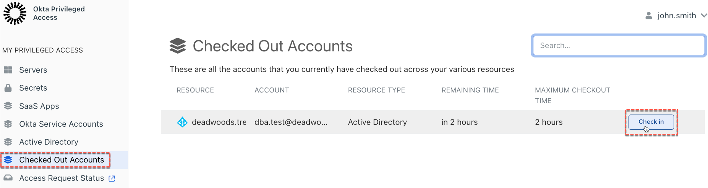

39. Click the **Check In** button beside that checked-out account.

    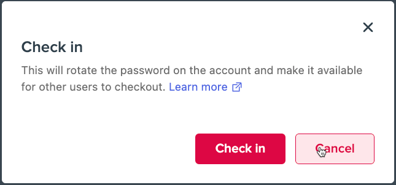

40. Click the **Cancel** button (so we can see it from the admin side).

This is the user mechanism to manually check in an account. Now lets
look at the admin mechanism.

41. As a resource administrator, go to the Resource Group and Project as
    earlier. Select the AD account resource type and go to the
    **<u>Checked Out Accounts</u>** tab.

    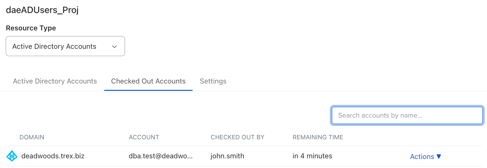

42. Click the **Actions** pulldown and select **Force check in**.

43. On the popup dialog click the **Force check in** button.

    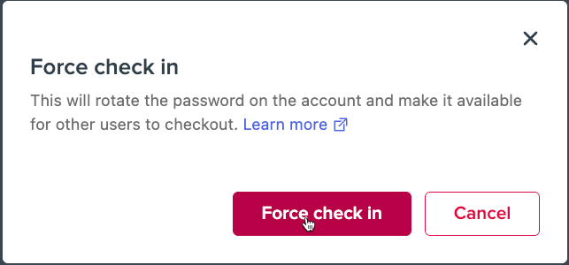

    The account should soon disappear from the Checked Out Accounts
    view. It may show up under the **<u>Active Directory Accounts</u>**
    list as ROTATING.

This completes the check in and password rotation process.

If you look at the Okta System Log you will see a series of events to
show what has occurred:

- Resource check in (Checkin) operation starts

- Password rotation is kicked off for the account

- Password rotation (from OPA’s perspective) is finished (DEFERRED shows
  that the downstream process is still running, SUCCESS shows that the
  downstream process has completed)

- The AD Agent applies the new password to the account in AD

- Resource check in operation completes

The following is an example of the full sequence of events (newest to
oldest).

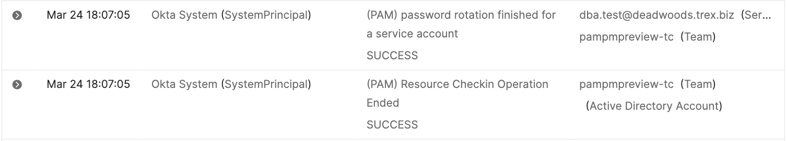

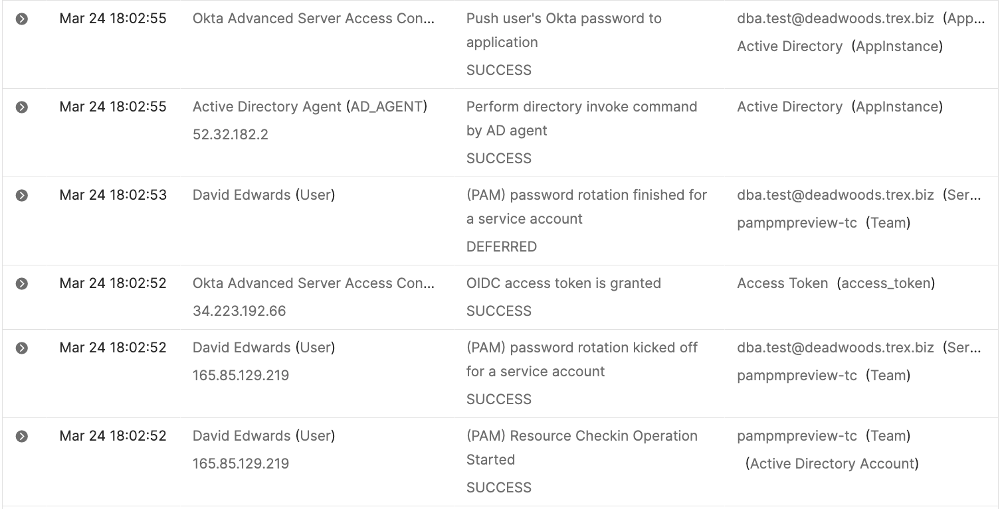

As we saw earlier, this is showing events from both OPA (which is
driving the check in and password rotation) and Okta (which is applying
the new password to the account in AD via the agent).

This completes the shared account use case.
