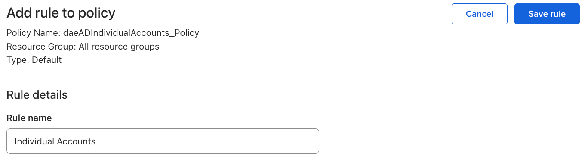
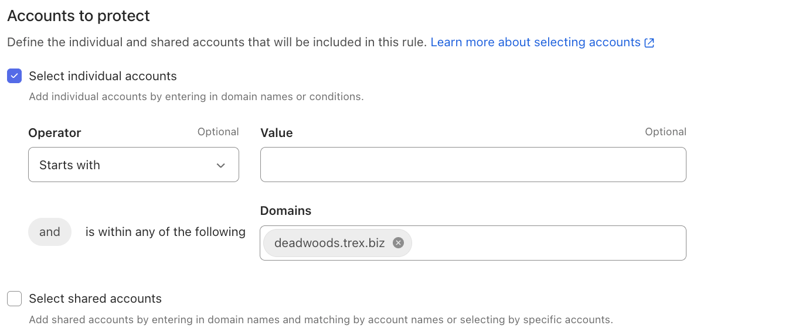
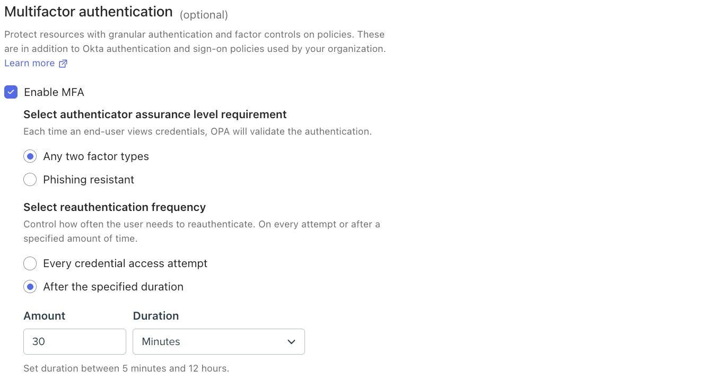
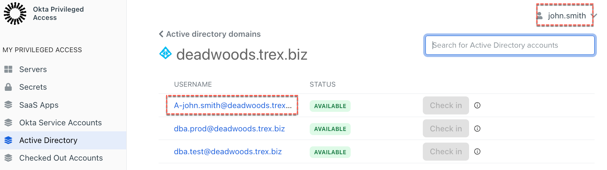
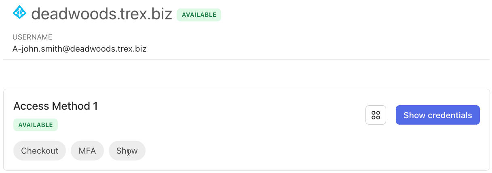
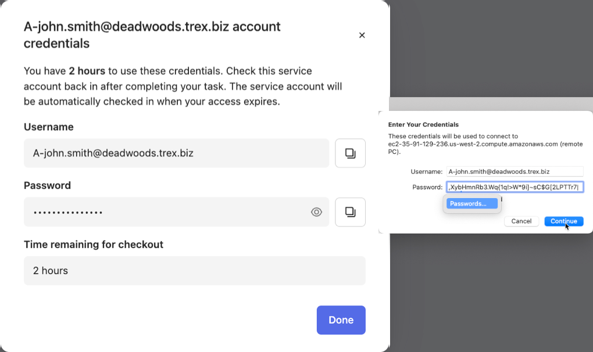
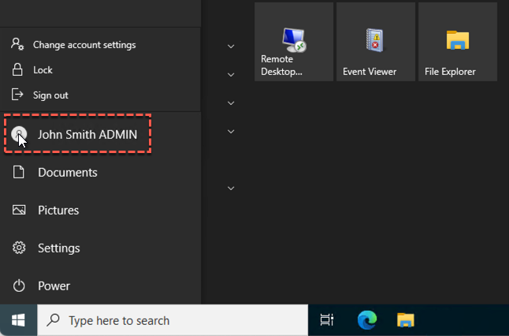
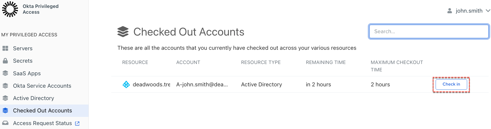
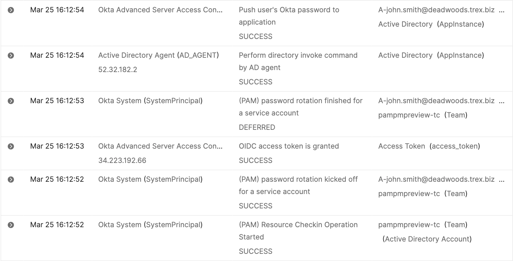

# Configure and Test Individual Admin Account Checkout

In the previous sections we looked at configuring and testing shared
admin accounts in AD. In the following sections we will extend this to
individual admin accounts. The steps are basically the same with some
minor variations. We will keep the descriptions brief where they are a
repeat of earlier steps and only dwell on the differences.

As these are individual admin accounts, the risk of use is lower, so we
will only apply MFA as a control on accessing them.

### Configure Policy and Rule for an Individual Admin Account

We will create a new policy and rule for the individual admin accounts.

1.  As before, with a security admin account in OPA, create a new
    **default Policy** for the individual admin accounts in your domain,
    give it a name, description and assign the user group as principals
    (as you did earlier).

2.  Add a new **Active Directory Account Rule** and give it a name

3.  Enable the **Select individual accounts** option. You do not need to
    select Operator/Value, but do need to specify the **Domain**.

4.  Enable the **Enable MFA** option. You can leave the default values
    (“Any two factor types” and “After the specified duration” of 30
    mins).

Your policy rule should look similar to the following.

You should **not** have Approval requests enabled.

For checkout, recall that we enabled checkout in the Project for the
AD accounts. This project holds both the shared accounts (the dba
accounts in this example) and the individual admin accounts. You could
enable an override of the Maximum Checkout time but we won’t bother.

5.  As before, **Save rule**, **Save policy** and **Publish Policy**.

We can now test the policy.

### Use Individual Admin Account

The steps to test this are basically the same as before.

6.  As one of your users who has an individual admin account, log into
    the **Okta Dashboard**, select the **Okta Privileged Access** tile,
    and go to **MY PRIVILEGED ACCESS &gt; Active Directory**.

7.  Select the AD domain and look at the accounts. You should see the
    shared accounts from earlier plus this user's individual admin
    account.

    

    If you do not see the individual admin account for this user, check
    that they have an individual admin account in OPA, that the
    assignment rules are correct, and that the new policy was enabled
    (published).

8.  Select the individual admin account. The access method view is
    similar to before, but in this case it is flagged as needing MFA.

    

    If you don’t see MFA under the access method, go back and check your
    policy rule.

9.  Click **Show credentials** and go through the MFA processing.

10. You will see the credential view page and can copy and paste into
    your Windows login prompt.

    

11. Confirm that the user you’re logged in as is the individual admin
    account.

    

If the user logged in successfully with their individual admin account,
then your configuration is working as expected.

As before you can wait for the checkout time to expire, or force check
in.

As before you can also look at the Okta System Log entries, for example:

This concludes the lab steps around individual admin accounts. The next
section will look at using AD credentials with RDP for server access
(via the WebUI and the OPA Client and Server).
