# Configure and Test RDP with AD Credentials

The third use case we will explore is using the AD credentials to RDP to
a domain-joined server. This is basically the same as the RDP use cases
in the [<u>Exploring Infrastructure (Server)
Access</u>](#exploring-infrastructure-server-access) chapter above,
using shared accounts stored in the OPA vault.

It doesn’t matter whether you use an individual admin account or a
shared account for this lab. We will show the WebUI server access flow,
but it is the same for CLI server access.

You don’t need to route traffic through the OPA Gateway to run this lab.
However in production you probably would allow for traffic proxying and
session recording. For the lab we will assume it’s a direct connection
from OPA Client machine to AD Member server.

We will walk through this, but as much of the content has been covered
in this and the previous chapters, we will keep the descriptions short.
Please refer back to the relevant sections earlier in this document for
more detail.

### Confirm AD Users in OPA

If you have performed the previous labs in this chapter, you will have
AD accounts in OPA (both individual admin accounts and shared accounts).

If you do not, go back and perform the earlier labs before attempting
this lab.

### Install OPA Agent on a Member Server

To use RDP to a server you will need an **OPA Client** on the users
workstation (which you would have done for the earlier server access
labs) and the **OPA Agent** on a server that is a member of the AD
domain:

1.  Follow the steps in [<u>Install the Okta Privileged Access server
    agent on
    Windows</u>](https://help.okta.com/en-us/content/topics/privileged-access/tool-setup/pam-sftd-windows.htm)
    to install the agent.

2.  Ensure you have the network configured to allow OPA traffic to that
    server (e.g. port 4421 open)

3.  If you want a separate **Project** or **Resource Group**, create
    them as you did earlier.

4.  Enrol the agent as per the steps in [<u>Server
    Enrollment</u>](https://help.okta.com/en-us/content/topics/privileged-access/server-agent/pam-enroll-a-server.htm)

You should have a Resource Group and Project with your member server
enrolled. For this example we have reused an existing Resource Group
and added a new Project for the member servers.

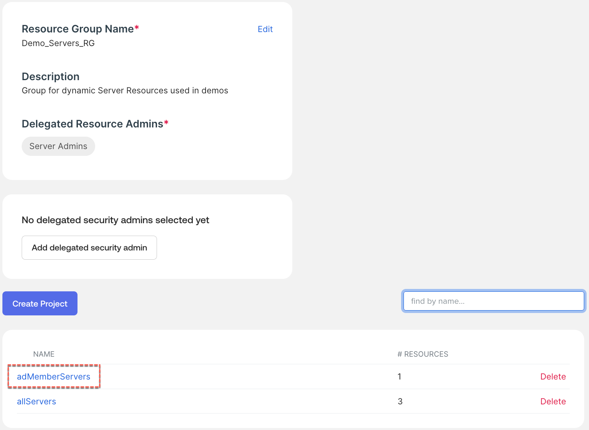

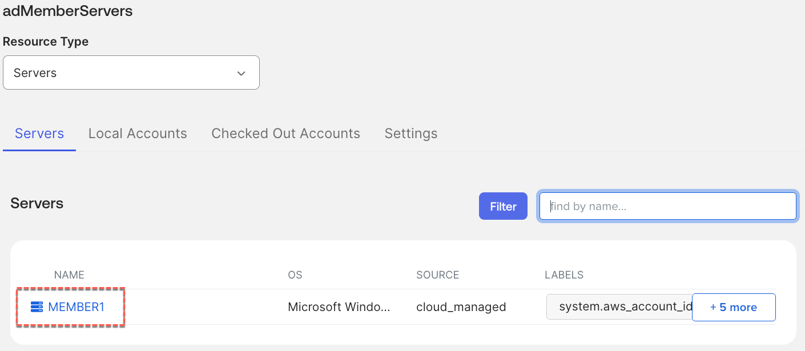

We can now create policy to allow AD accounts to connect to this server.

### Create RDP Policy

We next need to create a policy to allow a user to select one of the AD
accounts to connect to the member server. There are some different UI
sections for this compared to the previous two labs where we were
enabling check-out for the accounts.

To create a policy:

5.  Create a new **Default** Policy in the **OPA Admin Console**

6.  Set the **Policy Information** (**Name** & **Description**), leave
    the **Resource groups** as default, and select a group for the
    **Principals**.

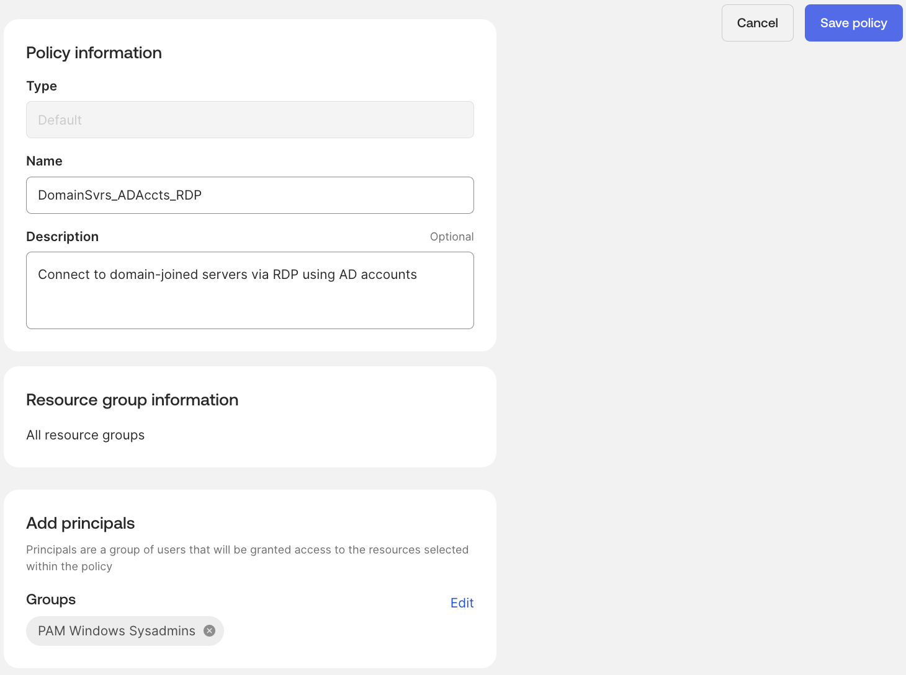

7.  Click the **Add Rule** button to create a new rule and select the
    **Active Directory Account Rule** option.

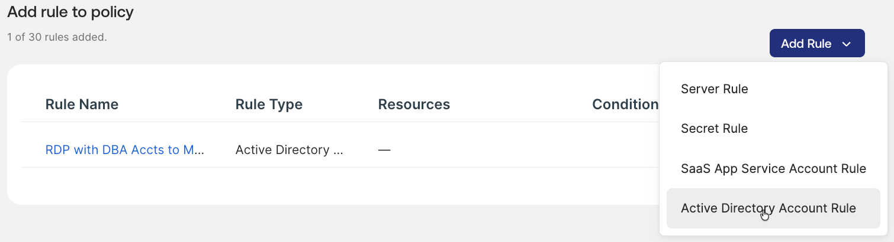

8.  Give it a **Name** and select the **Server RDP session** option for
    session type.

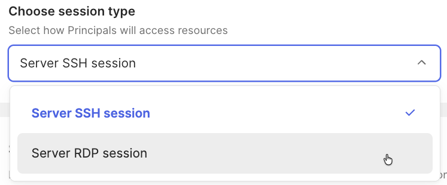

9.  Look at the Accounts to protect section. There are three checkbox
    options. The first is **Select individual accounts**. Click it.

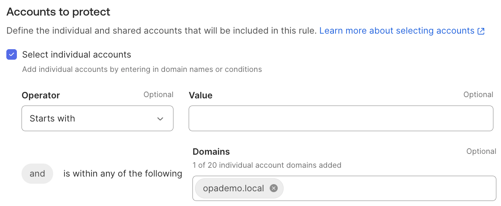

This option allows the policy to be for the individual admin accounts.
You can specify sets of individual admin accounts by using the
**Operator** and **Value** fields. But we will leave it blank to allow
all users to use their individual admin accounts.

10. Specify your AD domain in the **Domains** field.

11. Click on the **Select shared accounts by matching names** option.

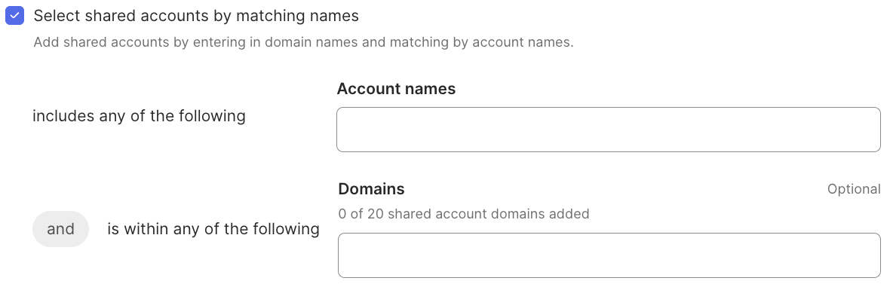

This is similar to the first option. It allows you to specify a list
of names in the **Account names** field (or leave it blank for all) in
specific **Domains**.

12. Unselect this option.

13. Click on the **Select shard accounts by specific account names**
    option.

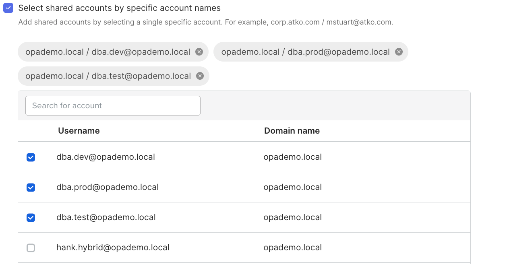

This allows you to pick a set of names across any domains you have in
OPA.

14. Unselect this option. You should only have the **Select individual
    accounts** option configured.

15. Scroll down to the **Permissions for accounts** section. There is
    the Reveal option we used earlier. There is also a new Rotate
    Password option to all of principals of this policy to force a
    rotation. Third is the one we want.

16. Select the **RDP Session** option. This will expose the **Servers to
    protect** section.

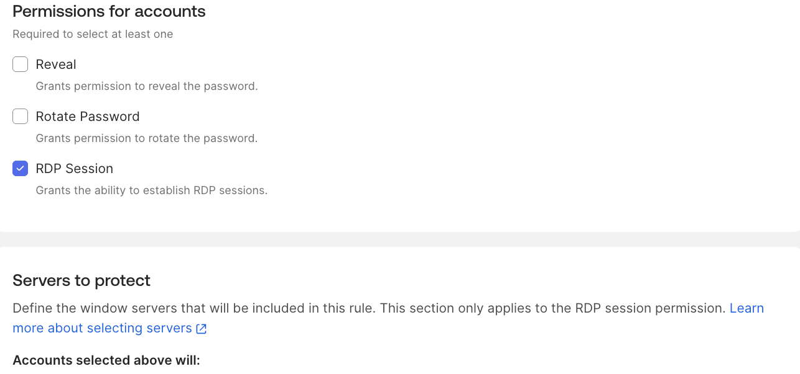

There are three options for the AD accounts to connect with:

- add them to the local “Remote Desktop Users” group if they are not
already in the group
- add them to the local “Administrators” group if the need local admin
rights on the server
- not be added to any group (assuming they already have AD groups
granting access)

17. Leave the option to **Not be added to any local groups**.

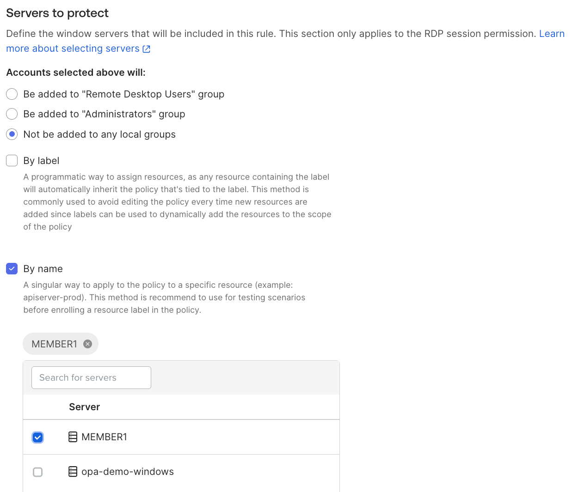

As we saw in the server access labs earlier, there are two ways to
specify the server(s) in the policy - by a label (like OS type) or by
name.

18. Select **By name** and select your member server.

19. You could turn on any of **Session recording**, **Approval
    requests**, **Multifactor authentication** or **Maximum Checkout
    time**. We will not use them in the example.

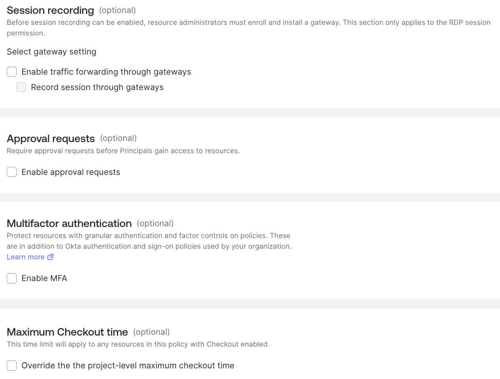

20. Save the rule and save the policy.

### Testing the New Policy to Connect to a Member Server

Testing the new policy is as was covered for RDP access in earlier labs.

21. Log into the **Okta Dashboard** as a user that is in the AD domain
    (and has a individual admin account mapped to them in OPA).

22. Go to **Okta Privileged Access** and look at the **Servers**
    presented. It should include the member server you specified in the
    policy.

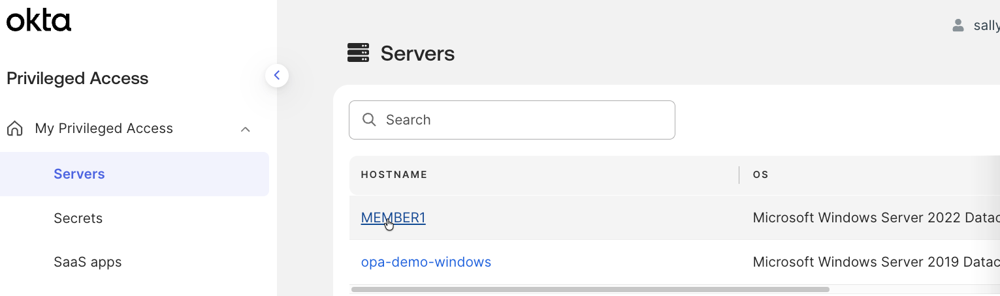

23. Select the member server.

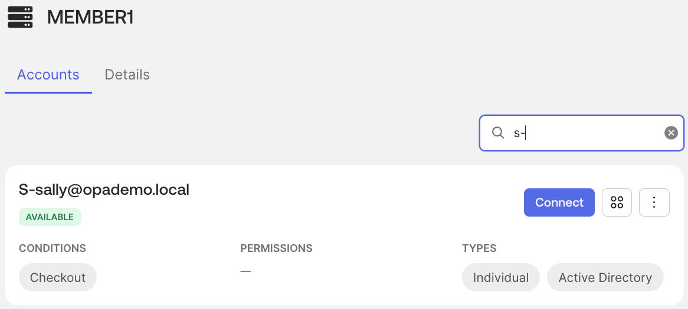

You are presented with the list of access methods. If you only have
the one policy rule configured you will only see a single access
method for the individual admin account.

Note that it shows this is an Individual AD account.

24. Click the **Connect** button. As there is no MFA or Access Request
    associated with the policy, you should see the RDP client start up
    and log you in as the individual admin account.

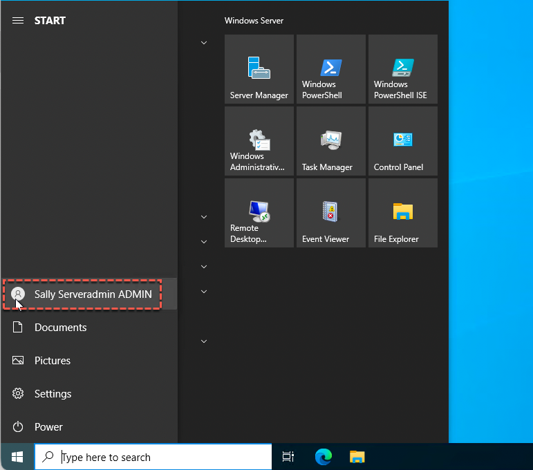

This proves that the OPA Client has injected the users individual admin
account password into the RDP connection without the user seeing that
password.

This has proven the RDP conneciton with AD accounts use case.
