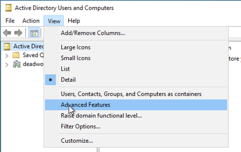
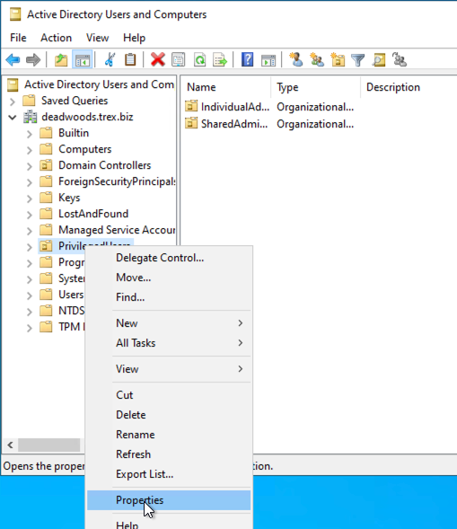
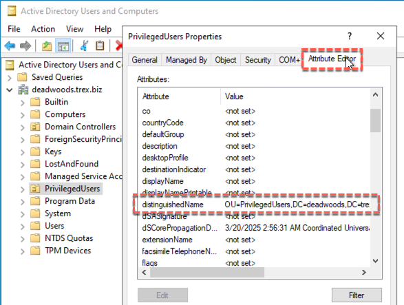
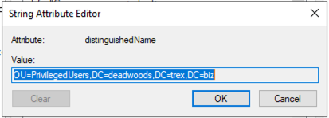

# How To Determine the DN of an OU in AD

This section has been included if you need to be able to determine the
distinguished name (DN) of an organizational unit (OU) in Micorosoft
Active Directory (AD).

This is an aid to the initial AD integration setup we covered at the
start of this chapter. If you have configured the integration and run
through the labs, you don’t need to used this section.

If you don’t know the Distinguished Name of an OU you can follow these
steps to find it:

1.  Log into your **AD Domain Controller** as an administrator.

2.  Launch **Active Directory Users and Computers** (**Start &gt; Windows
    Administration Tools**)

3.  Click **View &gt; Advanced Features** (to enable it)

    

4.  Right-click your OU and click **Properties 
    \**
    **\**

5.  Click the **Attribute Editor** tab

6.  Scroll down to the ***distinguishedName*** attribute

7.  Double-click it to open it in a new dialog

    

8.  Copy the **Value** (and use it in OPA).

That’s all you need to find the DNs to use in OPA. Repeat for each DN
containing privileged AD accounts you want to include.
