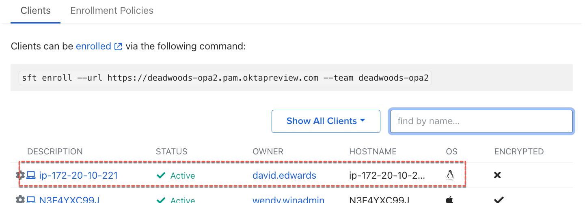
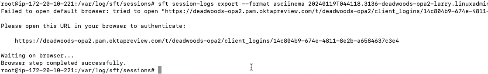
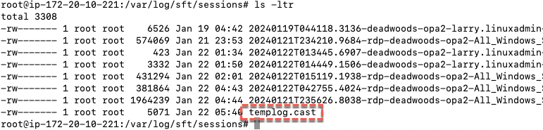
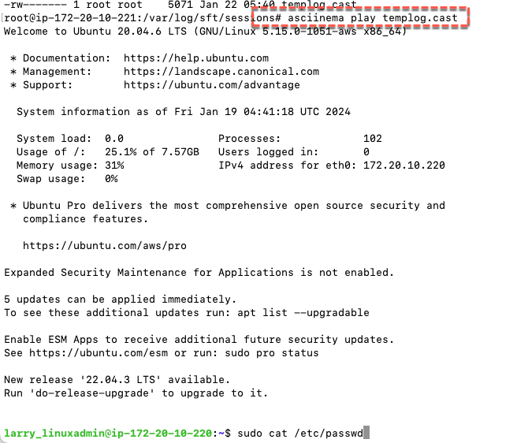
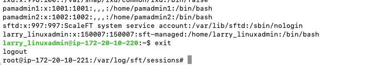
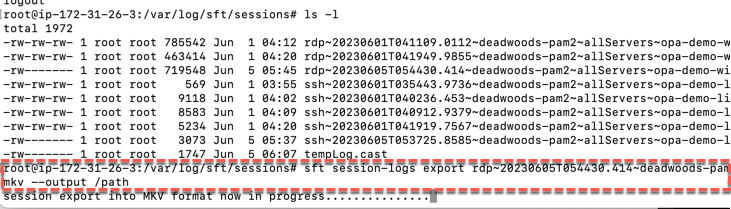

# Viewing Session Recordings

In some of the server access labs earlier, you configured Session
recording (or capture) when using administrator accounts. In those labs
you checked that the session capture logs were on the gateway, but did
not do anything with them. In this section we will process the logs.

### Notes on Processing and Viewing the Recorded Sessions

The files produced in the session recording mechanism are raw files that
are encrypted. They can only be accessed by the OPA client. The methods
of extracting the files for playback are detailed in the product
documentation
[<u>https://help.okta.com/oie/en-us/content/topics/privileged-access/gateways/pam-gateway-view-session-logs.htm</u>](https://help.okta.com/oie/en-us/content/topics/privileged-access/gateways/pam-gateway-view-session-logs.htm)

The following considerations need to be applied:

- The session capture mechanism stores the recording in log files in a
  binary .asa format that cannot be viewed

- RDP session logs can be converted to a .mkv format using the OPA RDP
  Session transcoder, which is only available for Ubuntu (22.04 and
  20.04) or RHEL (8 or 9) systems, and then viewed by any app that
  supports .mkv files

- SSH session logs can be exported by the OPA client into asciinema
  format and viewed using the asciinema command

Thus for SSH session recordings you have three options:

- Install the OPA client on the gateway, convert the .asa files there,
  and view them there and view them there with the asciinema command

- Install the OPA client on the gateway, convert the .asa files there,
  ship them to another server that has the asciiinema command and view
  them there

- Ship the .asa files to a client machine that also has asciinema,
  export them there and view using the asciiname command there

For RDP files the options are a bit more limited as the RDP Session
transcoder must be run on a Linux system, but playback requires a GUI
(either a GDM on the Gateway Linux server or on another server). Note
that there is no native software on MacOS to view .mkv files, you will
need to install something like VLC media player.

We will walk through both SSG & RDP export and playback in the following
sections.

### Install Additional Components on the Gateway Server

We will process the .asa files on the gateway for this exercise, so
there are some additional components that must be installed there.

1.  Following the instructions in the earlier section **Client
    Installation and Enrollment**, install and enroll the ***client***
    on the gateway. You will need to enroll the client as before, but as
    there is no browser, you need to copy the URL provided and paste it
    into a browser.

    

2.  Follow the instructions in
    [<u>https://help.okta.com/oie/en-us/content/topics/privileged-access/gateways/pam-rdp-transcoder.htm</u>](https://help.okta.com/oie/en-us/content/topics/privileged-access/gateways/pam-rdp-transcoder.htm)
    to install the RDP Transcoder. Note that you only need to run the
    last step (e.g. for Ubuntu, sudo apt-get install
    scaleft-rdp-transcoder) as the others were done for the gateway and
    agent

3.  Install asciinema (sudo apt-get install asciinema)

### Exporting and Viewing a SSH Session Recording

We will extract and view the recording on the gateway using the steps
shown on
[<u>https://help.okta.com/oie/en-us/content/topics/privileged-access/gateways/pam-gateway-view-session-logs.htm</u>](https://help.okta.com/oie/en-us/content/topics/privileged-access/gateways/pam-gateway-view-session-logs.htm)
under the **Review SSH session logs** heading.

1.  Connect to the gateway as before and go to the session recording log
    file directory (it may be easier to do this as root or to sudo su)

2.  Identify the ssh recording you want to extract

3.  Run the sft session-logs export command as per the example in the
    docs to produce the .cast file in asciinema format. You will be
    prompted to authenticate this client. Assuming there is no GUI with
    the browser on the gateway, copy and paste the presented URL into a
    browser to validate the client access.

    

4.  Once authenticated, the command should complete and export the
    logs.

    

5.  Run the asciinema play command to see the recording. You should see
    the commands played back with the same delays as entered

    

    

In this case it is repeating a single session from earlier where the
user connected to the server as their individual account but elevated to
administrator, which allowed him to run a sudo command.

This proves the SSH session recording worked and you can export and play
back the recording.

### Exporting and Viewing a RDP Session Recording

Similar to above we will export and view an RDP session recording using
the steps shown on
[<u>https://help.okta.com/oie/en-us/content/topics/privileged-access/gateways/pam-gateway-view-session-logs.htm</u>](https://help.okta.com/oie/en-us/content/topics/privileged-access/gateways/pam-gateway-view-session-logs.htm)
under the **Review RDP session logs** heading.

In this case we will export the .asa file to a .mkv file on the gateway.
For this to work both the OPA client and the OPA RDP Session transcoder
must be installed on the gateway itself.

Then:

1.  Connect to the gateway as before and go to the session recording log
    file directory (it may be easier to do this as root or to sudo su)

2.  Identify the rdp recording you want to extract

3.  Run the sft session-logs export command as per the example in the
    docs to produce the .mkv file. Note that this may take some time
    based on the specs of your gateway server.

4.  The example will put the converted file in the directory you specify
    in —output, e.g. /path.

5.  Copy the exported file to somewhere that can run the .mkv file (like
    a laptop) and view the file.

You should be able to see the actions performed on that Windows server
via the RDP session.

That completes the testing for this use case.
