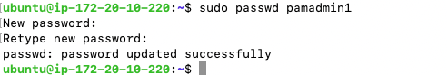
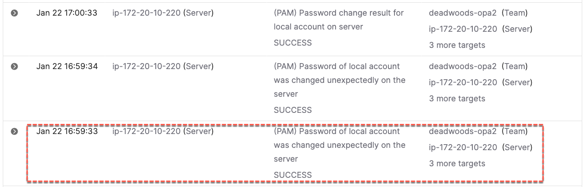
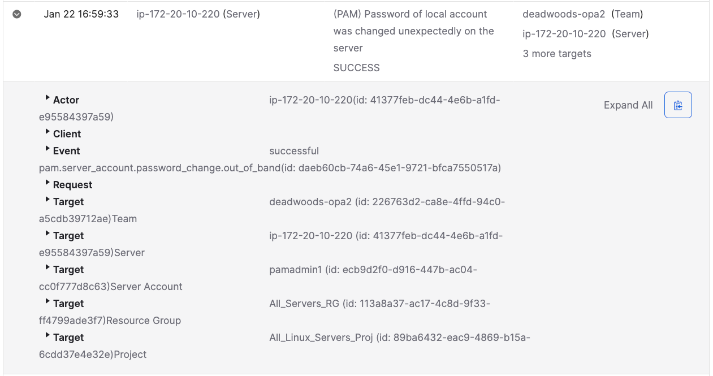

# Monitoring for Tampered Passwords

Earlier in this guide we configured account discovery and brought
discovered accounts under management. When a managed account is put into
the OPA vault the password of that account is rotated and the new
password pushed to the server. From this point on, only OPA knows the
password and it is never visible.

But what about someone outside of OPA tempering with the password?
Perhaps an administrative account has been left outside of OPA for
break-glass scenarios and someone has used it to reset the password of
one of the accounts OPA is managing in its vault?

OPA has this scenario covered. The agent will periodically check to see
if any managed account passwords have been tampered and if so, it will
tell OPA to rotate the password again and OPA will write an event to the
Okta System Log.

We will walk through this.

1.  As a *system administrator* go onto one of the managed servers and
    reset the password of one of the accounts you have managed in OPA

    

2.  As a *PAM Administrator* or *Resource Administrator* go into the
    **Okta Privileged Access UI**

3.  Go to **Resource Management**, select the Resource Group and go to
    the relevant Project for the server/account just changed

4.  Open the Project and go to the **Local Account** tab

5.  Select the account whose password has been changed above

6.  Look at the rotation times. You should see a recent successful
    rotation that is outside of the normal rotation schedule (you may
    need to wait a few minutes until the agent cycles through it’s
    check)

7.  As an Okta administrator, go into the **System Log** under
    **Reports** and find the event corresponding to the corrected
    password.

    

8.  Expand the event to see the details

    

    Note that the Target information includes the Team, Server, Server
    Account, Resource Group and Project which may be useful for
    investigation.

This event could be routed to a SIEM for reporting of suspicious
activity - if these accounts are supposed to be exclusively managed and
accessed via OPA then having someone modify that account warrants
further investigation.

In the next use case we will explore events in the system log in more
detail.
