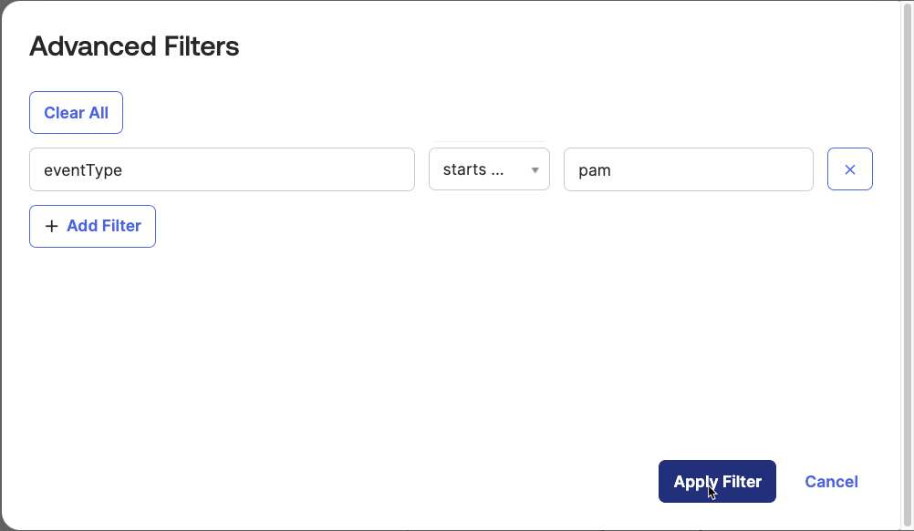
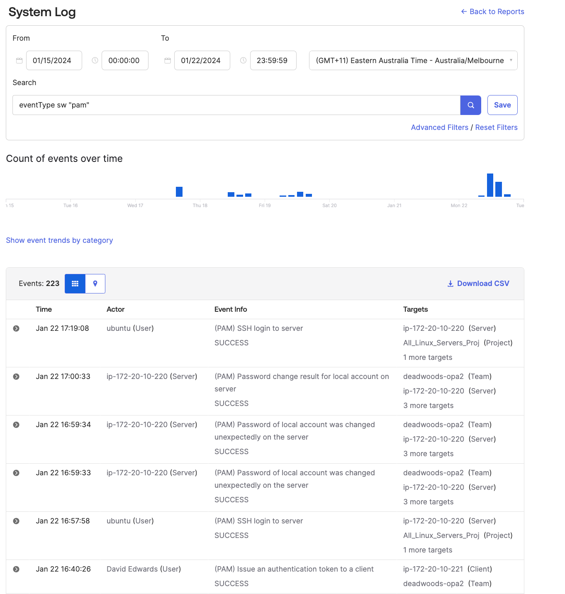
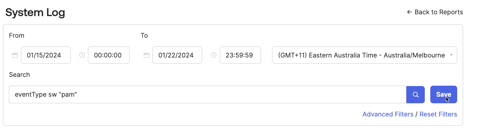
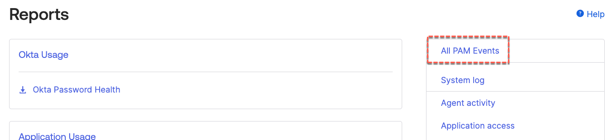

# OPA System Log Events and Custom Reporting

As you have been performing the earlier lab steps, a lot of activity
will have been written to the Okta System Log. It doesn’t matter if
you’ve only done the Secrets labs or the Server Access labs, you will
have events you can explore.

### Explore OPA Events in the System Log

1.  As an Okta administrator, go into the **System Log** under
    **Reports** (as you did in the previous lab)

2.  You will probably have lots of non-PAM events in the system log. Go
    to the top of the page and click on the **Advanced Filters** link.

3.  As all OPA events start with “pam” create a filter for “eventType
    starts with pam”

    

4.  Click Apply Filter to see only the OPA events

    

5.  Expand any of the OPA events to see additional information.

The Target fields are of most use as they will usually contain the team,
server, account, resource group and project. Sometimes the actor will be
the system the agent is running on (Server), the user who initiated the
request or the account that was assumed in the connection (User).

### Create a Custom Report

You can easily create a custom report based on the advanced filter you
are using.

1.  From within the system log with your advanced filter, click the Save
    button to the right of the filter

    

2.  Give the new report a **Name** and click **Save as new**

3.  Go to the **Reports &gt; Reports** menu item. The new report will be
    in the quick access on the right

    

4.  Click the report title and you are taken to the System Log with that
    filter applied

This shows how you can set up reports to quickly access commonly viewed
events. You could have multiple reports set up for quick access.
