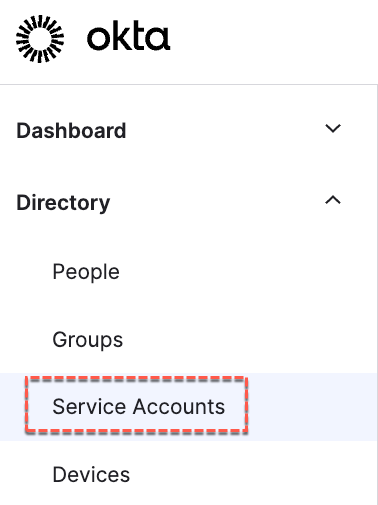
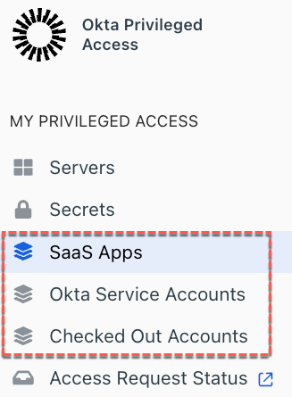

# Pre-Reqs for the Okta / SaaS Service Acct Use Cases

You will need to have the Okta WIC and OPA environment configured as
above, with the OPA app configured in Okta, users and groups pushed to
OPA, and roles assigned in OPA to the users/groups. We will set up any
resource/policy objects needed in OPA.

The service account functionality must be enabled in both Okta WIC and
OPA. To confirm it is enabled in Okta WIC, go into the Admin UI and
check for **Service Accounts** under the **Directory** menu item.

Similarly in OPA, you should see three new menu items under MY
PRIVILEGED ACCESS for SaaS Apps, Okta Service Accounts and Checked Out
Accounts.

There is one more pre-req required. To use the integrated SaaS service
accounts (with active password management) you will need one of the
supported OIN apps integrated with your Okta WIC tenant. Currently these
are: Salesforce, O365, Google Workspace, ServiceNow UD, Zendesk (as at
Nov 2024). They need to be configured for provisioning but do not need
the “provisioning to app” options enabled. See the product docs. For the
BYO (manual) SaaS app use case you will need an app in Okta, but it
doesn’t need to have SCIM provisioning enabled (it doesn’t really need
to be connected to a real application - it can be a dummy app).
