# Managing Okta Service Accounts

The first use case we will explore is the management of Okta Service
Accounts in OPA. These are users in Okta that would normally have an
admin role assigned and needs to be accessed by other Okta users. These
users may be set up in Okta to generate API tokens or used with some
older agent integrations.

The following sections will walk through:

1.  Creating a service account in Okta,

2.  Creating a resource group and project in OPA for the new account

3.  Assigning the service account to the project

4.  Creating a policy and rule to access the service account, and

5.  Testing accessing the account

### Create a Service Account in Okta

You could use an existing user in Okta, but we will create a new user
and assign it to an admin role:

1.  Log into Okta as an administrative user and create a new user.
    Activate the user with a password (it doesn’t matter what as it will
    be reset later on)

    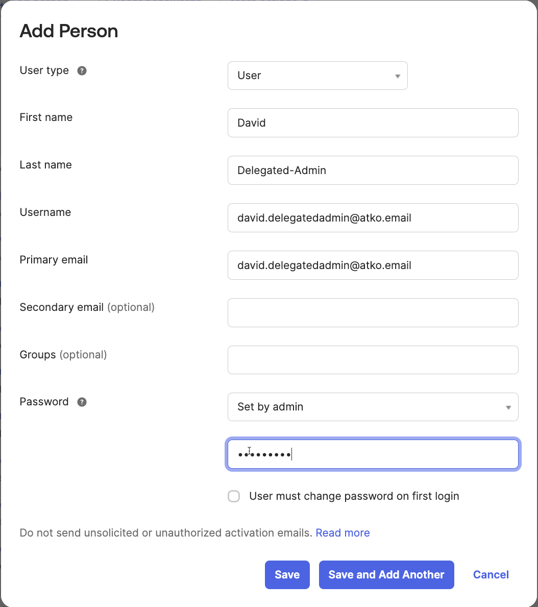

2.  Assign this new user to an administrative role. It doesn’t matter
    which role, just so you can log into the admin console and see the
    user has admin rights later on.

    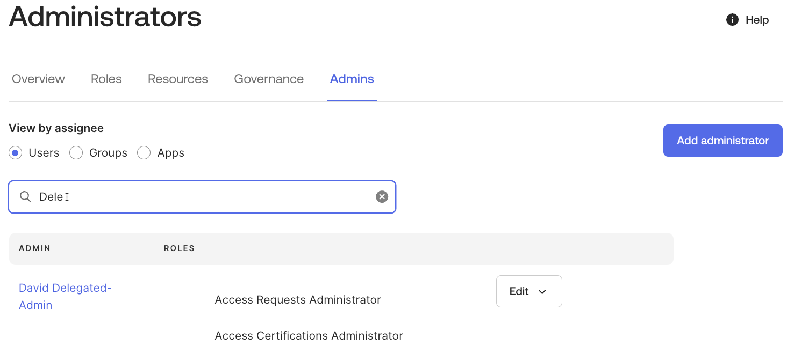

3.  Go back into the User and select **More Actions** &gt; **Manage with
    Privileged Access**

    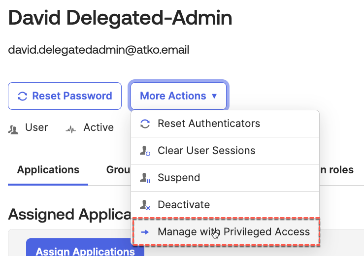

4.  On the **Manage as a service account** dialog, give the new service
    account a **name** and **description** (note that it has already set
    the username and email address of the associated Okta user). Click
    the **Manage** button to save the changes.

    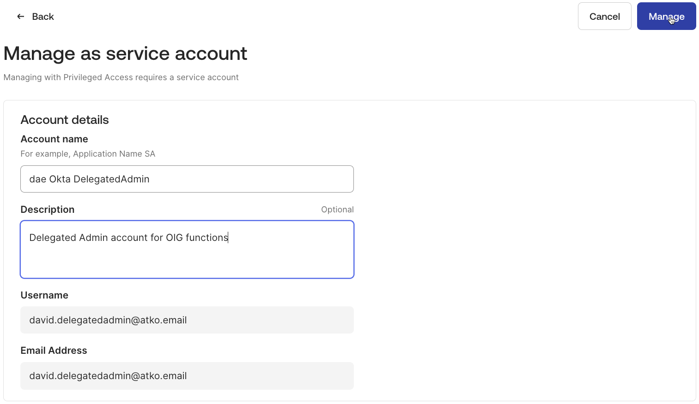

5.  You will be presented with a message saying **Account managed by
    Privileged Access**. Click the **<u>Service Accounts</u>** link.

    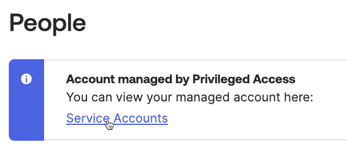

6.  You should see your new service account listed on the Service
    accounts page. The account will be in an UNSECURED status meaning it
    has not been assigned in OPA yet.

    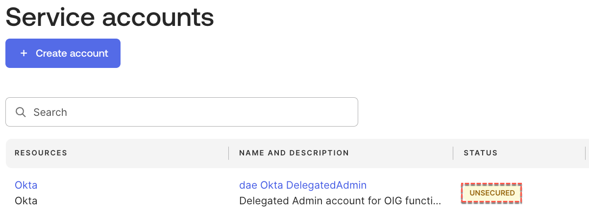

This is all that needs to be done in Okta WIC. In the background there
is some synchronization with OPA where this new account will be put into
a holding area waiting to be assigned to a project.

### Create a Resource Group and Project in OPA

Once an account is defined as a Service Account in Okta it will be
sync’d to OPA. To be able to use the account, it must be assigned to a
project in a resource group, and then have a policy assigned.

Prior to assigning the service account to a project, you need to think
about your resource group and project structure. Once an account is
assigned to a project it cannot be reassigned. For this example we will
create a new resource group and project for the Okta accounts.

The steps to create the Resource Group and Project are basically the
same as covered earlier in this guide:

1.  Create a new Resource Group under **RESOURCE ADMINISTRATION &gt;
    Resource Management**.

    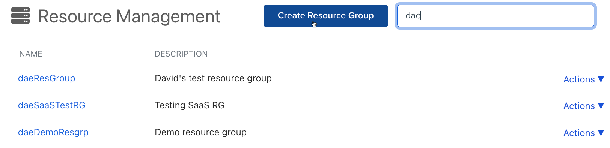

2.  Give it a **Name**, **Description** (optionally) and assign a
    **Delegated Resource Admin** group (note that this is required).
    Then click **Save**.

3.  Create a new Project and give it a Name.

4.  On the new project page, select **Okta Service Accounts** from the
    **Resource Type** dropdown.

    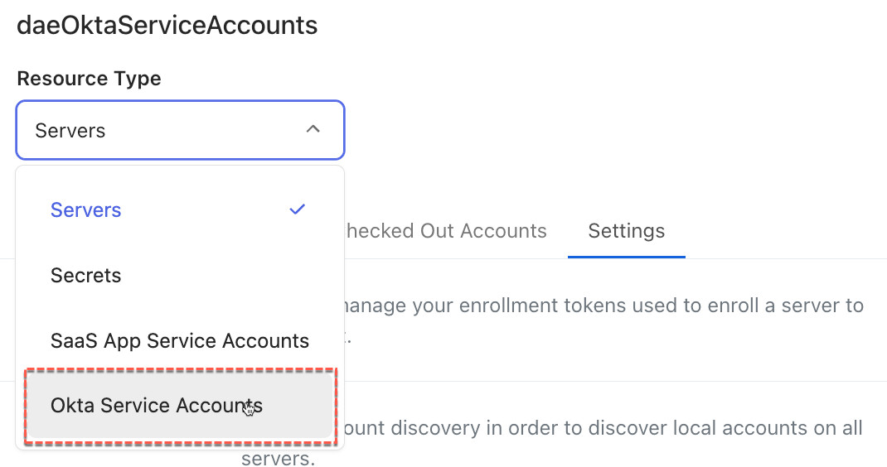

5.  For the Okta Service Accounts type, there will be no accounts (yet,
    we will do this next). Nor will there be any Checked Out Accounts.

    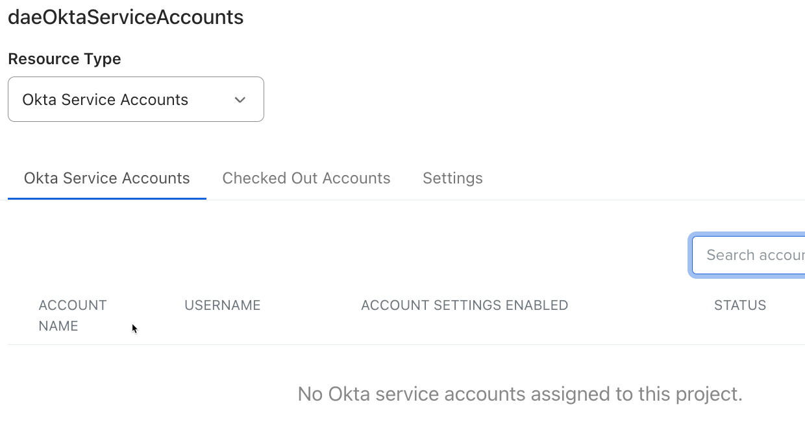

6.  Go to the **<u>Settings</u>** tab.

    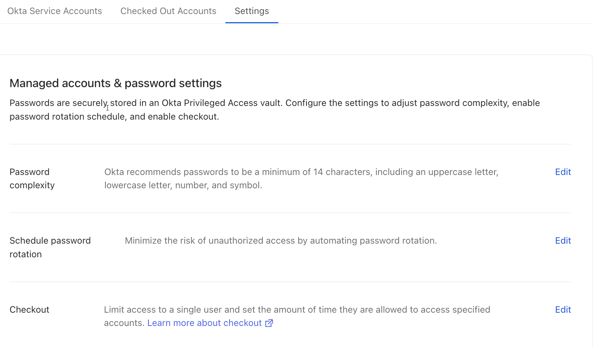

    The **Password complexity** and **Schedule password rotation**
    settings are the same for managing shared accounts on servers.

The **Checkout** settings are the same as for the checkout options for
secrets. See earlier in this guide and the relevant documentation for
details of this.

7.  Edit the **Schedule password rotation** settings and enable it for
    all accounts. Leave the default interval. **Save** the changes.

    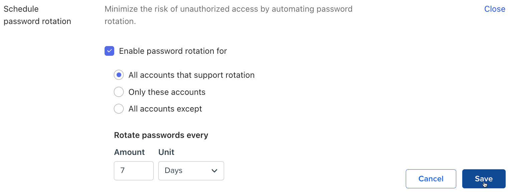

8.  Edit the Checkout settings and enable it for all accounts. Leave the
    default interval. Save the changes.

    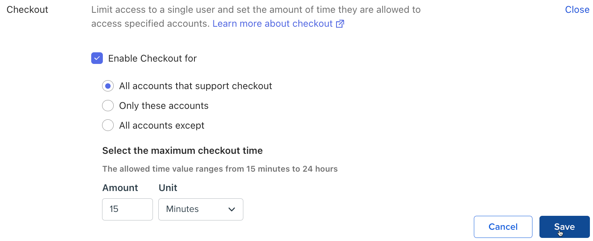

This is all we need to do for the resource group and project.

### Assign the Service Account to the Project

Next, we need to assign our new Okta service account to the project we
just created:

1.  Go to **RESOURCE ADMINISTRATION &gt; Resource Assignment** (this is a
    new menu item for this feature). This is the holding area for
    unassigned service accounts.

2.  You should see your new Okta service account and click the **Assign
    account** button.

    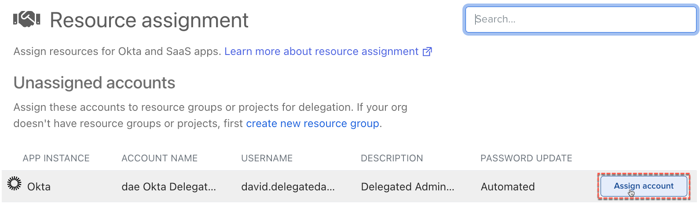

3.  On the **Irrevocable account assignment** dialog, take note of the
    “***Assignment is permanent***” message. Select the resource group
    you created earlier from the **Resource group** dropdown list, then
    select the project from the **Project** dropdown list.

    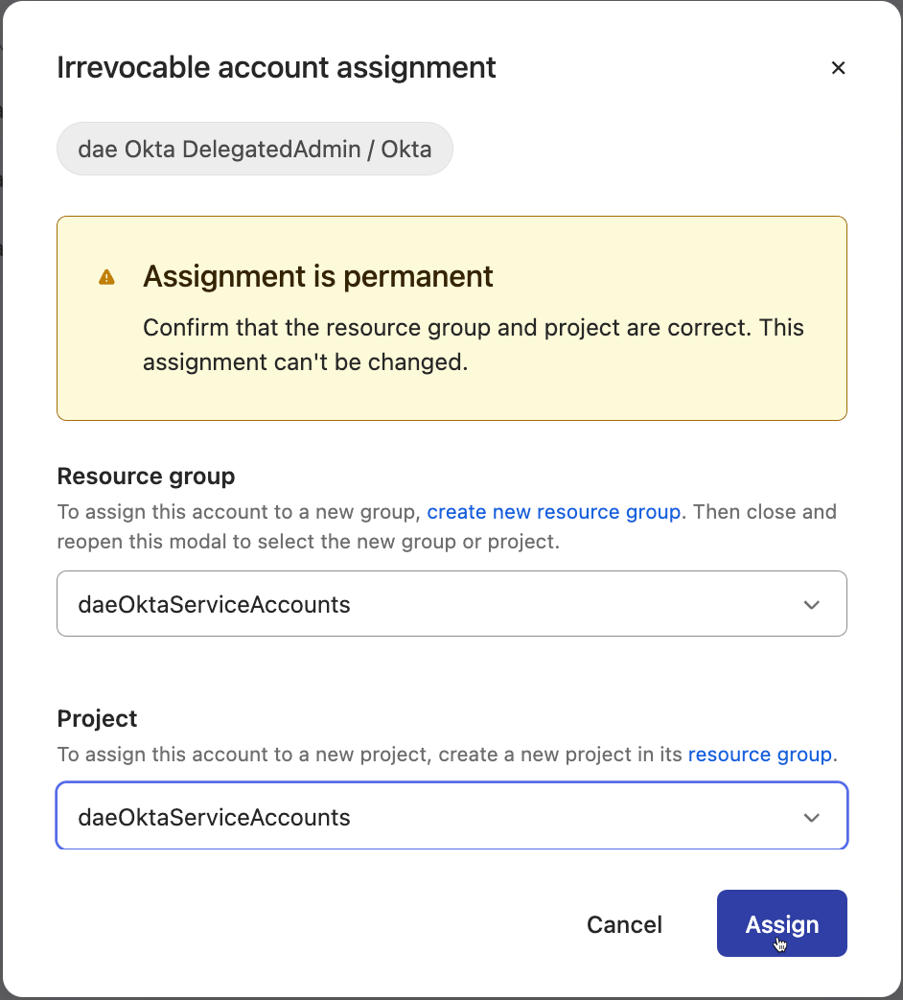

4.  Click the **Assign** button to assign the account to the project.

5.  When the dialog closes you should see that your new account has been
    removed from the **Unassigned accounts** list.

6.  Go back into the resource group and project and confirm the account
    now shows up. If you don’t see anything, check you’ve selected
    **Okta Service Accounts** from the **Resource Type** dropdown.

    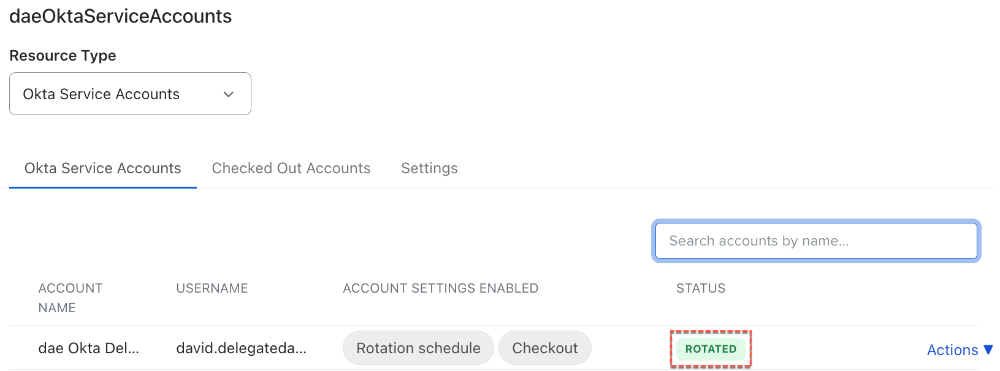

    Note that the two settings we enabled are shown against the account.
    Also it has a status of ROTATED meaning the password for the account
    has been rotated and sync’d back to Okta.

7.  Try accessing your Okta org with the account and the password you
    originally set. It should fail.

8.  Go back into Okta as your admin account and check the **Service
    accounts** list. The account should show a status of NO ISSUES,
    meaning the account has been assigned in OPA and the password
    rotated and passed back to Okta.

    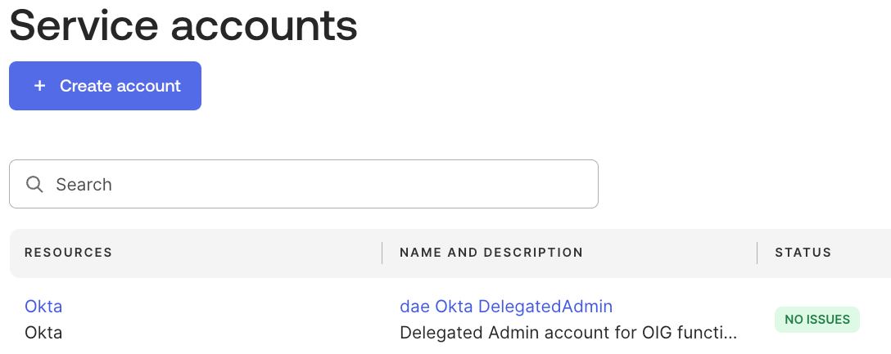

9.  Check the Okta system log for an event corresponding to the password
    rotation.

    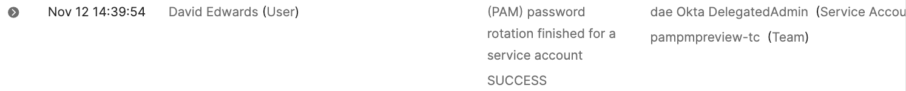

### Create a Policy and Rule for the Service Account

Now that the account is being managed by OPA, we need to set up a
Security Policy and Rule to allow users to access it. This is similar to
earlier exercises setting up policies and rules:

1.  In the OPA UI, go to **SECURITY ADMINISTRATION &gt; Policies** and
    click the **Create Policy** button. Note that this is now a pulldown
    list.

    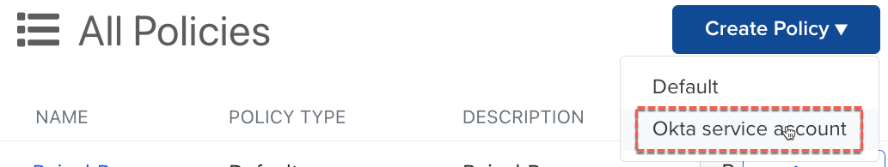

2.  Select the **Okta service account** option.

3.  Give the new (Draft) policy a **Name** and **Description**..

    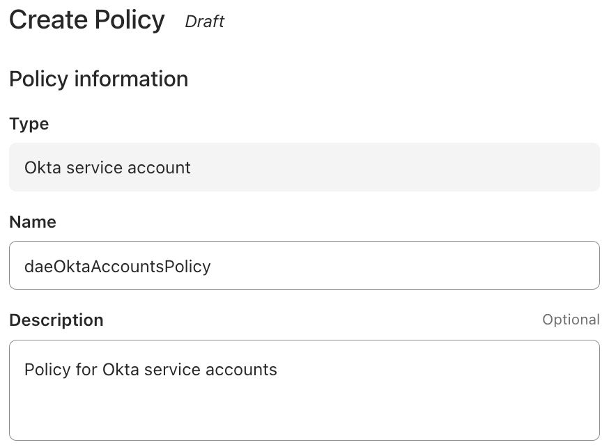

4.  Select whether it will apply to all resource groups or specific ones
    and assign a **principals** group.

    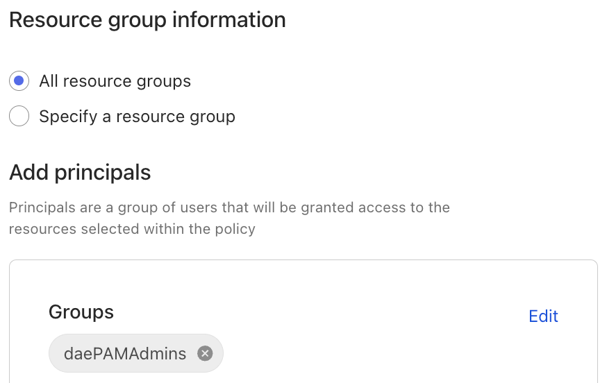

5.  Click the **Add Rule** button to add a rule to the policy

6.  On the **Add rule to policy** page give it a name and select the
    Accounts to protect.

    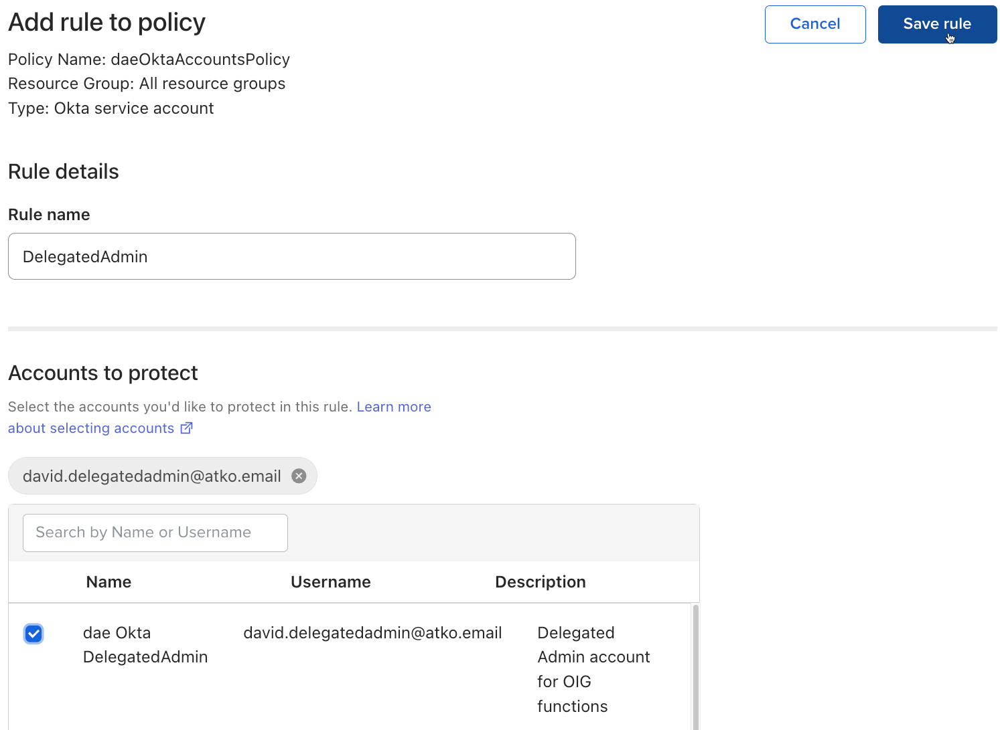

    You will see that there are two optional settings you can enable:
    **Approval requests** and **Maximum Checkout** time. These are the
    same as for other policy rules. Note that there is currently no MFA
    option for service accounts yet (this may be enabled by the time you
    read this guide). We will not enable either of the current options.

7.  Click the **Save rule** button

8.  On the **Create policy** page, click the **Save policy** button

9.  On the **Policy details** *Read only* page, toggle on the **Publish
    policy** option, then confirm, to make the policy live.

    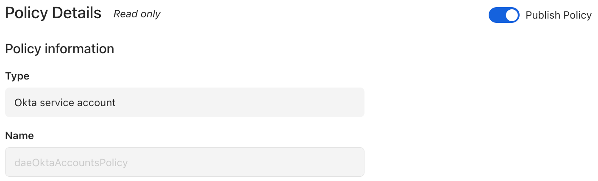

The policy and account are now ready to test.

### Test Accessing the Okta Service Account

To test:

1.  Log into the **Okta Dashboard** as a user who is in the group you
    assigned as a Principal group in the policy in the previous section
    (in my example it was daePAMAdmins). Note that if this is different
    to your admin user, you will need to either log off the admin user
    or start a new incognito browser window.

2.  Click on the **Okta Privileged Access** tile on the Dashboard

3.  In OPA go to **MY PRIVILEGED ACCESS &gt; Okta Service Accounts** and
    you should see the account you set up earlier.

    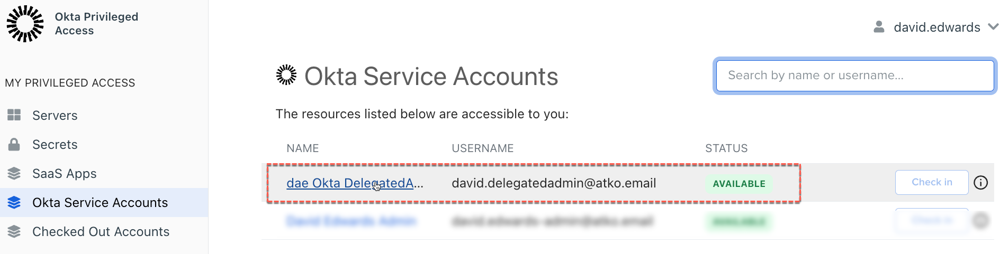

    Note that the account has a status of AVAILABLE, meaning it has not
    been checked out (nor is it currently going through a password
    rotation). The Check In button is also disabled.

4.  Click on the **NAME** of the account to open it and see the Access
    methods available to use the account.

    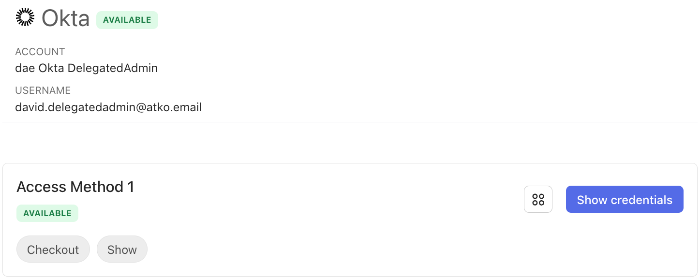

    This is the same as for any other resource (like a secret or server)
    where there may be different policy rules that apply to this user
    accessing this resource. In this case there is only one, so only one
    Access Method is shown. There is no Access Request condition on the
    account, so the action button is **Show credentials**, rather than a
    Request Access button.

5.  Click the **Show credentials** button and then reveal the
    **Password** to show it’s not the one you set when you created the
    account.

    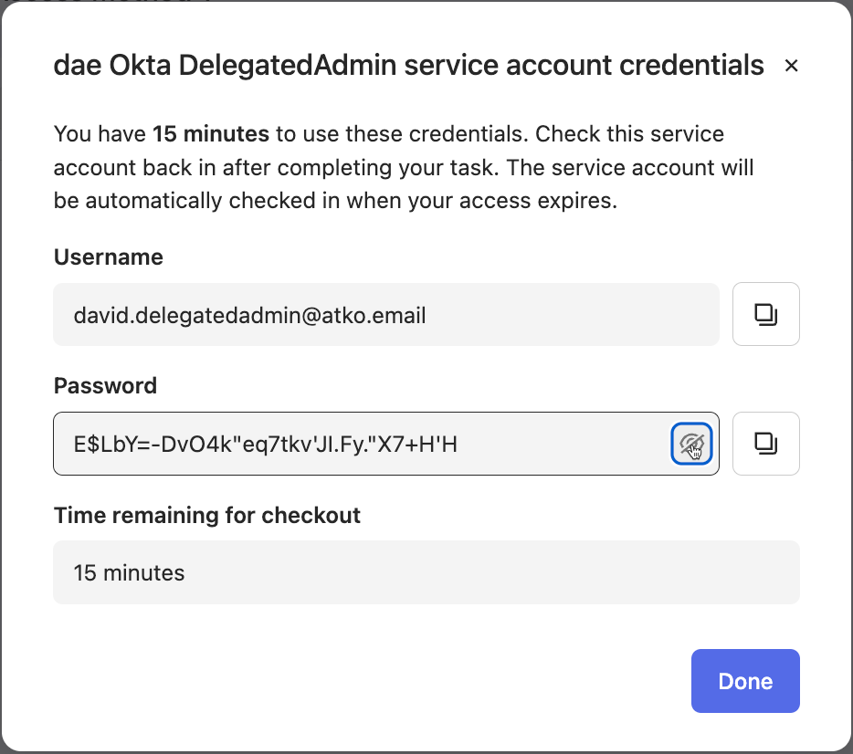

6.  Open a new incognito browser window, go to your Okta org and then
    copy and paste the **Username** and **Password** from the service
    account credentials dialog to log into Okta.

7.  On the **Okta Dashboard**, click on the **Admin** button and if
    needed go through any MFA configuration for the account (Okta admin
    accounts will normally be forced to use MFA).

8.  Once in the **Admin UI** look at the menu items to confirm that the
    shared account has only the functions based on the role(s) you
    assigned to it.

    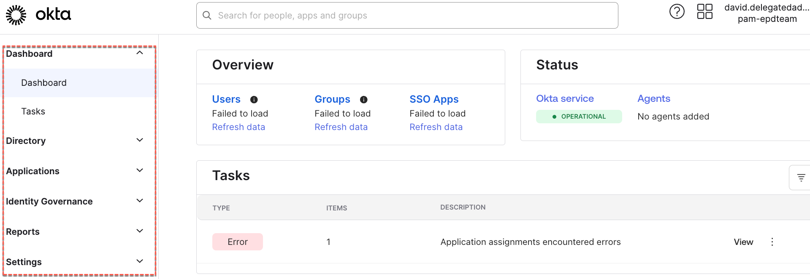

9.  Go back to the window where you revealed the credentials and click
    the **Done** button. It will be shown as Checked Out now.

    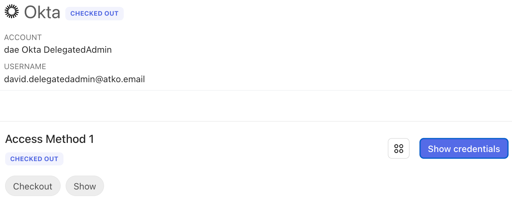

    Note that the Show credentials button is still enabled, so you can
    continue to reveal the credentials whilst still in the checkout time
    period.

10. Go to the **MY PRIVILEGED ACCESS &gt; Checked Out Accounts** menu
    option and see your account there with how long it has remaining.

    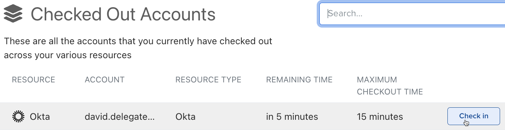

11. Click the **Check in** button. On the Check in confirmation screen,
    click the **Check in** button.

    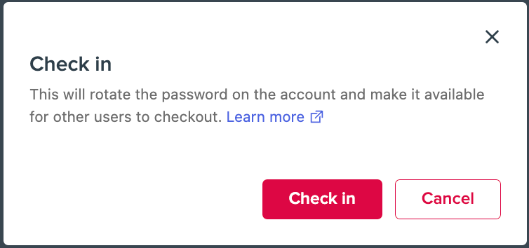

12. The **Checked Out Accounts** page will refresh and your account will
    disappear. The account is no longer checked out and as the
    credentials have been rotated.

    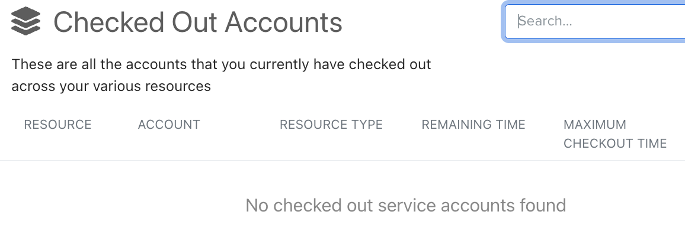

13. You could also check the system log entries for your test user and
    the service account user to see the activity, including the issuing
    of creds and the password rotation on check in.

This completes testing of the Okta service accounts.
