# Managing BYO SaaS App Service Accounts

SaaS service accounts come in two flavors - manual and automatic. Manual
SaaS app service accounts do not have password rotation - the password
saved in OPA for the account is the password in the application. This is
similar to having generic secrets in the OPA vault but has the benefit
of being tied to the app (and could potentially be migrated to automatic
if the OIN integration is later updated). Automatic SaaS app service
accounts do have password rotation and the new (rotated) password is
pushed to the SaaS app via the Okta Integration Network (OIN)
integration.

In this section we will look at the manual SaaS app service accounts,
which follow a BYO model. You “Bring your own” accounts and credentials
and store them in the OPA vault. For SaaS app service (shared) accounts
the flow is very similar to the Okta service accounts.

### Create a Service Account in Okta

For this section you will need to create a dummy application as your BYO
app. I created a SAML 2.0 app, but any template app type will do and it
doesn’t need to be connected to a live application as there will be no
SSO or provisioning. You could use any of your apps if you wanted to
test with live data, but it is not necessary.

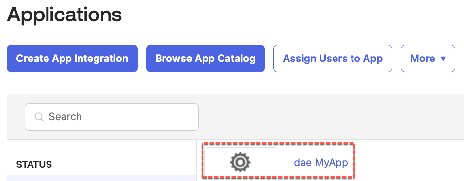

To create service account for the dummy app:

1.  In the Okta Admin UI, go into **Directory &gt; Service Accounts**, and
    click the **Create account** button

    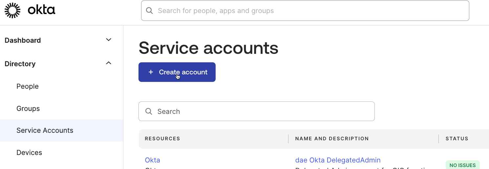

2.  On the **Create service account** page, select the **Application
    instance**. If you don’t see your app name in the dropdown list,
    start typing the name in the search box and it should appear.

    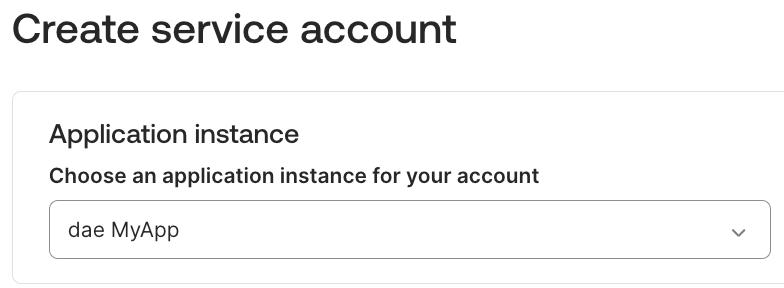

3.  When the dialog expands, enter the details for the service account
    you want to store: the **Account name** (this is a label to be used
    by Okta and OPA), optionally a **Description**, the account
    **Username** as defined in the app, and the **Password** for that
    account (you can click the eye icon to reveal the password).

    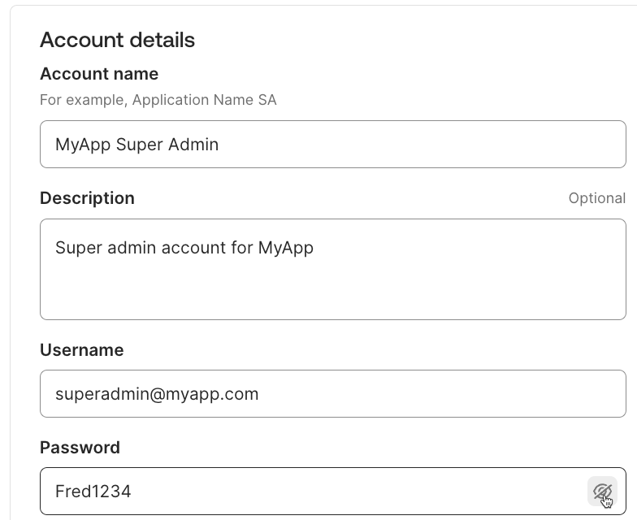

4.  Scroll down to see the **Additional information**. You could specify
    **Owner groups** or **users** (this is not currently used, but will
    come into use with Access Certification). We will not set anything
    here.

5.  Click the **Create** button to create the account.

6.  Back on the **Service accounts** view you can see the new account

    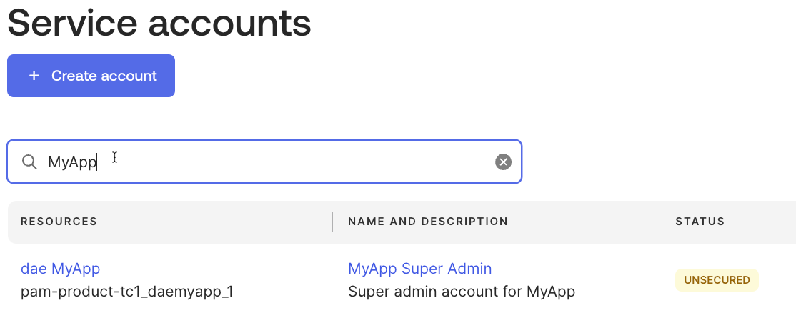

This account will be sync’d across to OPA and can be assigned to a
project.

### Create a Resource Group and Project in OPA

This set of steps is basically the same as done for the Okta service
accounts earlier:

1.  Create a new **Resource Group** for the SaaS service accounts and
    assign a **Delegated Resource Admins** group

2.  Create a **Project** within the resource group

3.  Select the **SaaS App Service Accounts** option for **Resource
    Type**

    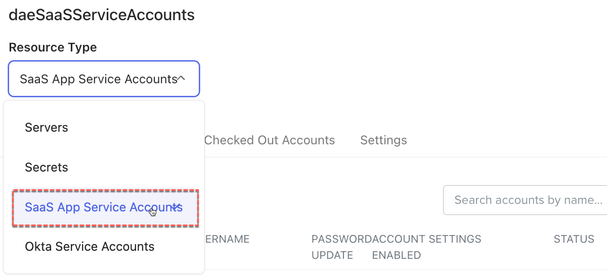

4.  Go to the **<u>Settings</u>** tab, and set the **Schedule password
    rotation** and **Checkout option** as before (neither will be
    relevant for manual service accounts, but we will reuse this
    resource group and project for an automated account later).

The resource group and project are now ready to assign the service
account.

### Assign the Service Account to the Project

This set of steps is basically the same as done for the Okta service
accounts earlier:

1.  Go into **RESOURCE ADMINISTRATION &gt; Resource Assignment** and find
    the new service account.

    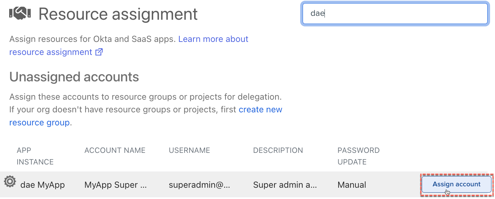

    Note that the PASSWORD UPDATE option is set to Manual. This is
    because in the sync from Okta there is a setting to say that the
    Okta app is not one of the ones that supports password rotation, and
    this means the account will be Manual (i.e. no password rotation).

2.  Click the **Assign account** button to assign the account

3.  Select the **Resource Group** and **Project**, then click the
    **Assign** button

4.  The account disappears from the **Unassigned accounts** list

5.  Go check that the account is now showing in the resource group and
    project

    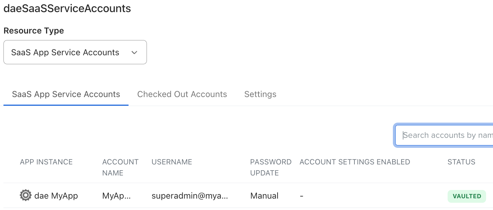

    The status shows as VAULTED as there is no password rotation. It is
    the same as having a generic secret stored in the vault.

The account can now be added to a policy and rule.

### Create a Policy and Rule for the Service Account

This set of steps is basically the same as done for the Okta service
accounts earlier:

1.  In Policies, click the **Create Policy** button, but select the
    **Default** option in the dropdown

2.  Give the new policy a Name, Description and assign a Principals
    group

3.  Click the **Add Rule** button and select the **SaaS App Service
    Account Rule** option

    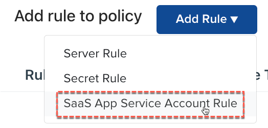

4.  On the **Add rule to policy** page, give it a **name** and select
    the **Password update method**. As this is a manual account, select
    the Manual option.

    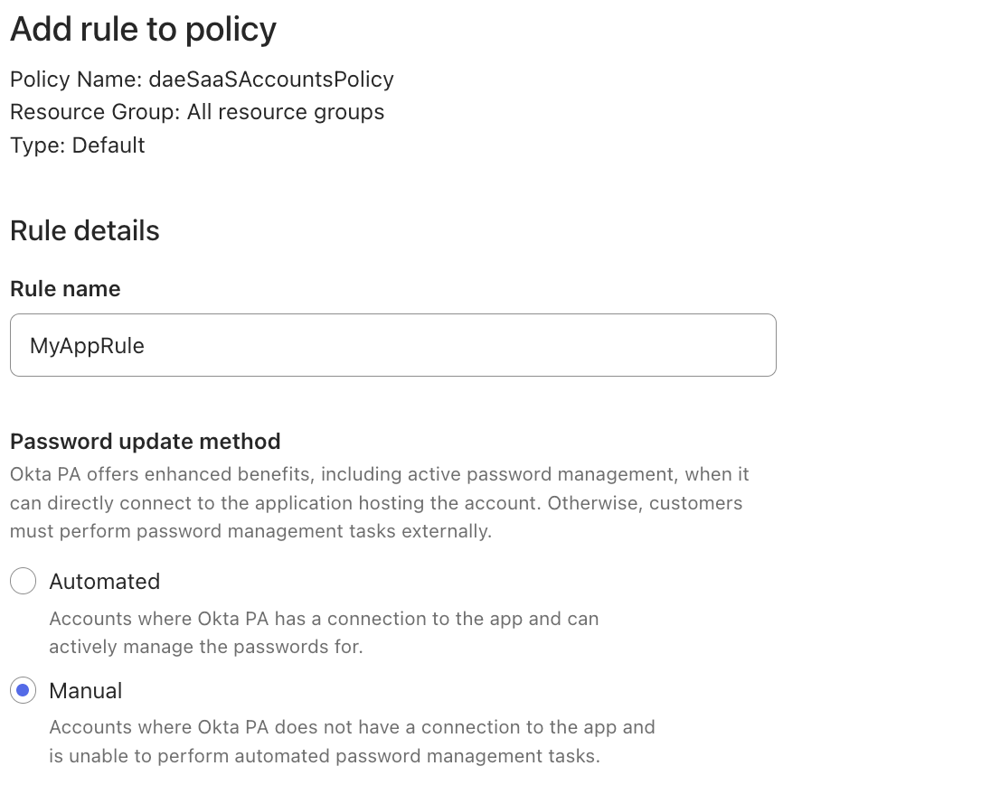

5.  Selecting the **Password update method** option will expose more
    settings.

    Set the **Permissions for service account** options. As this is a
    manual account, you can set one or both of Reveal and Update. For
    this example, select the **Reveal** option (you would need an option
    to Update the password if the password on the target system password
    will change, and this could be done in another policy assigned to
    another set of administrators).

    Select the **Accounts to protect**, which is the single account we
    created above.

    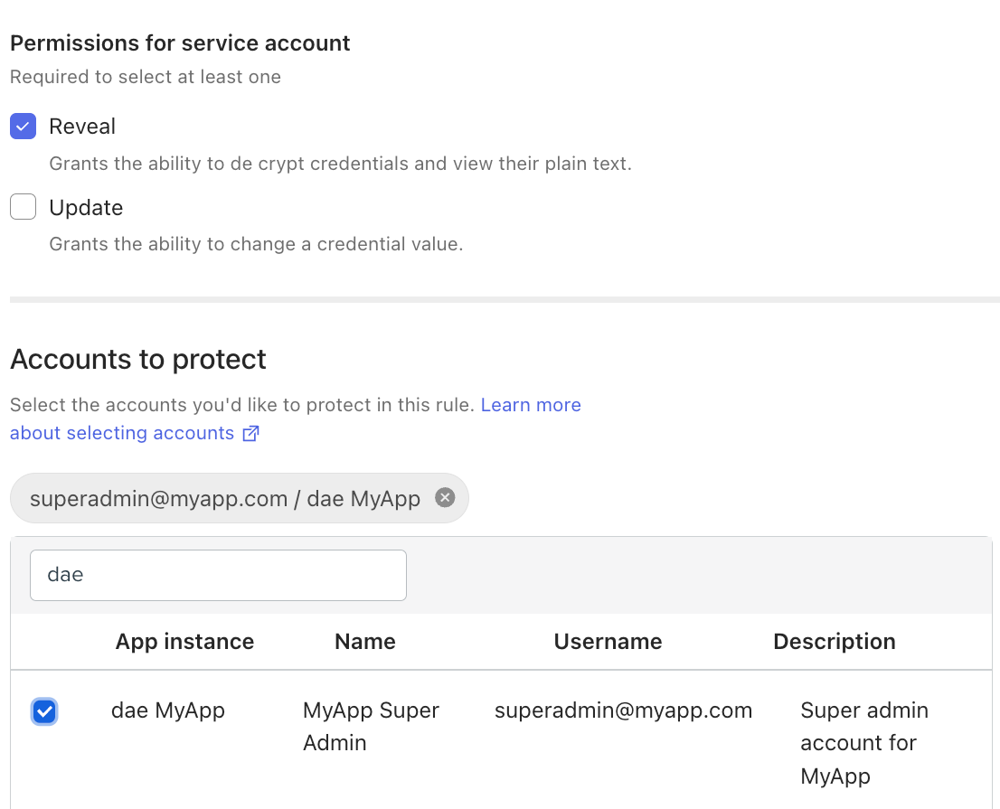

6.  **Save** the rule, **save** the policy and **enable** the policy as
    done for the Okta service account earlier.

With the rule and policy created and enabled, this can be tested as we
did for the Okta service account.

### Test Accessing the BYO SaaS Service Account

The approach to testing the BYO SaaS service accounts is similar to
testing the Okta accounts:

1.  Log into the **Okta Dashboard** as a user who is in the group you
    assigned as a Principal group in the policy in the previous section
    (in my example it was daePAMAdmins). Note that if this is different
    to your admin user, you will need to either log off the admin user
    or start a new incognito browser window.

2.  Click on the **Okta Privileged Access** tile on the Dashboard

3.  In OPA go to **MY PRIVILEGED ACCESS &gt; SaaS Accounts** and you
    should see the application(s) with service accounts.

    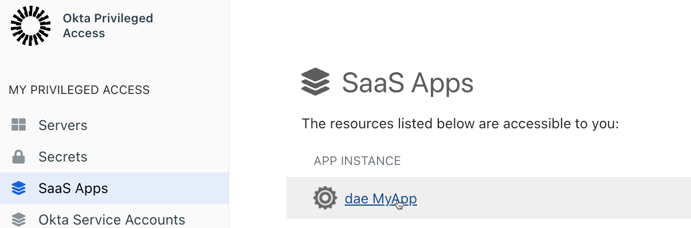

4.  Select the **APP INSTANCE** and you will be shown the service
    accounts for that app. You should see the account added above with a
    status of AVAILABLE.

    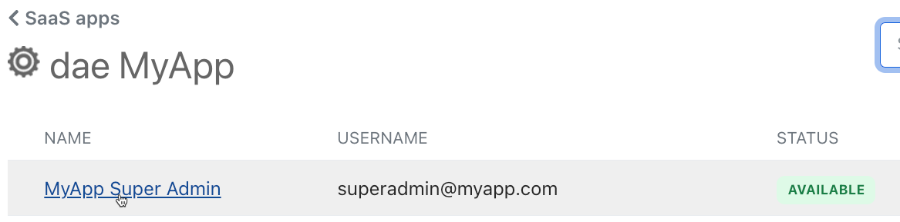

5.  Select the account **NAME**. You will be presented with the access
    methods to use this account. Note that there is no checkout shown as
    BYO (manual) accounts do not have checkout.

    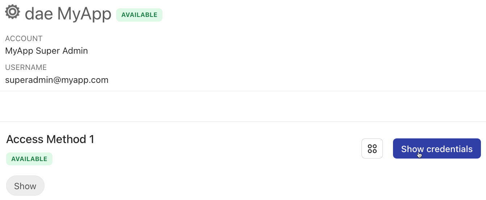

6.  Click the **Show credentials** button to see the Username and
    Password (click the eye icon to reveal the password).

    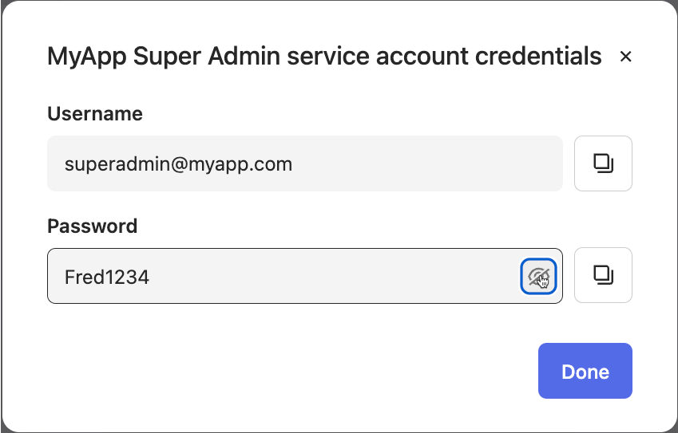

7.  You would copy’n’paste the username and password into the login
    prompts for that application. But as there is no real application,
    we will stop here.

This concludes the BYO SaaS app service account steps. Next we will look
at an integrated (automatic) SaaS app service account.
