# Managing Integrated SaaS App Service Accounts

The third use case is managing integrated SaaS App Service Accounts. In
many ways this is a hybrid of the Okta service account processes and BYO
SaaS app service accounts. Service accounts are tied to an application
in Okta and can have passwords rotated (with the OIN integration pushing
the new password to the account in the app) and the account passwords
can be revealed by end users. You will see the similarities as we walk
through managing and using an integrated SaaS app service account.

For this set of steps you will need one of the supported apps with
Provisioning enabled (note that it only needs provisioning enabled, it
does not need the Provisioning to App “Create Users”, “Update User
Attributes”, Deactivate Users" or “Sync User Passwords” options
enabled). Currently (Nov 2024) the supported list of apps is:
Salesforce, Office365, Google workspace, Servicenow UD and Zendesk. For
the following examples, a Salesforce instance is used. But you could use
any of the listed apps.

### Create a Service Account in Okta

Creating a service account for an integrated app is similar to creating
one for a BYO app. The steps are:

1.  Log into the integrated SaaS app and copy the login you want to use
    (i.e. copy the username to the clipboard)

2.  In the Okta Admin UI, go into **Directory &gt; Service Accounts**, and
    click the **Create account** button

    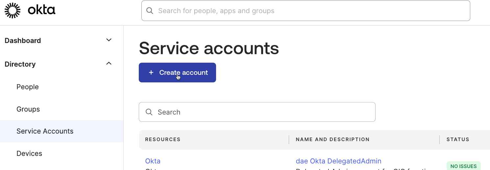

3.  On the **Create service account** page, select the **Application
    instance**. If you don’t see your app name in the dropdown list,
    start typing the name in the search box and it should appear.

    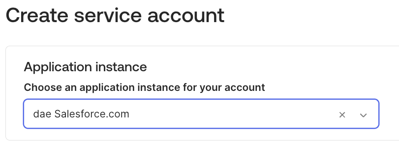

4.  As before, when the dialog expands, enter the details for the
    service account you want to store.

    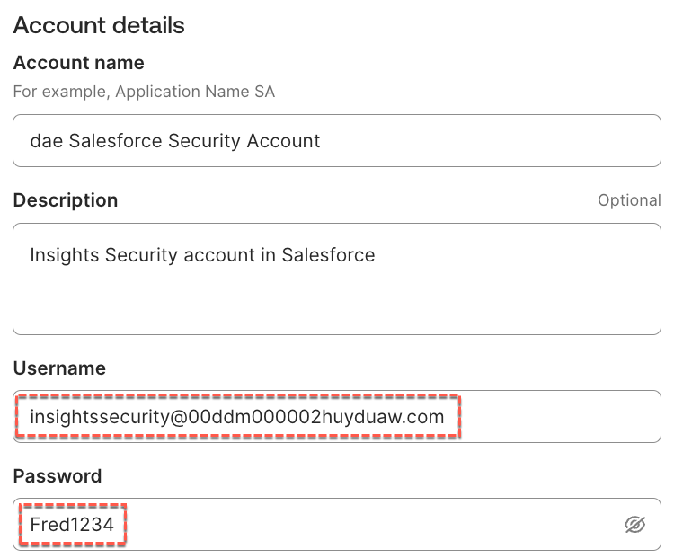

    The **Account name** and **Description** can be anything. The
    **Username** MUST match the account in the integrated SaaS app as it
    will be used to push the rotated password through the OIN
    integration. The **Password** can be anything as it will be rotated
    once the account is put into the vault.

5.  Click the **Create** button to create the service account. You
    should see the new account in the Service accounts list as
    UNSECURED.

    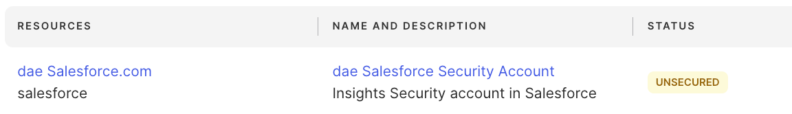

### Create a Resource Group and Project in OPA

You could create a new Resource Group and/or project for this account.
But in this case we will reuse the ones from earlier.

### Assign the Service Account to the Project

To assign the new service account:

1.  Go into Okta Privileged Access as your admin account that can manage
    resources.

2.  Go to **RESOURCE ADMINISTRATION &gt; Resource Assignment** and find
    your new account under the **Unassigned accounts** list

    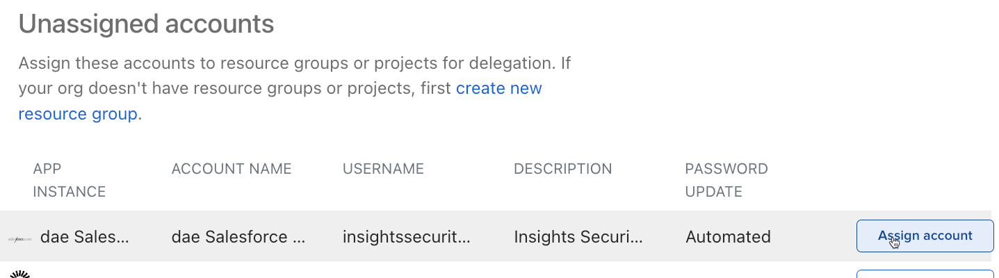

3.  Click the **Assign account** button

4.  Select the **Resource group** and **Project** you used in the
    previous section

    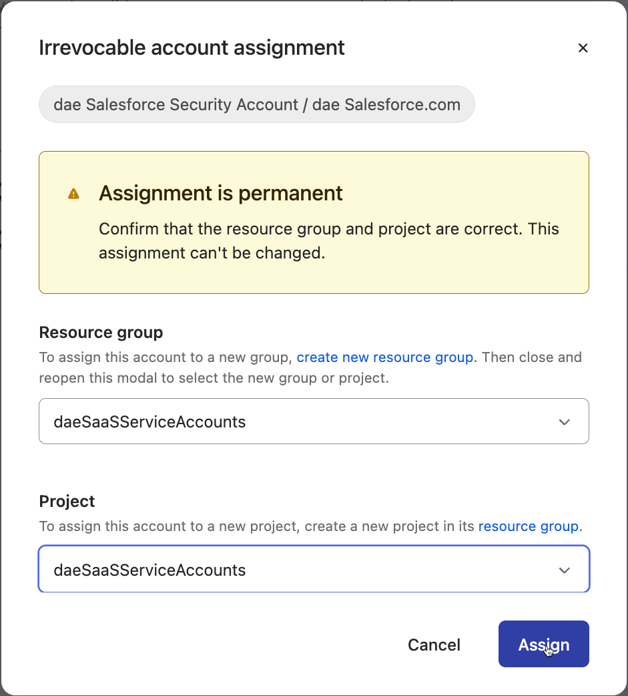

5.  Click the **Assign** button to assign it to the resource group and
    project

6.  You should see the account disappear from the Unassigned accounts
    list. Go into the resource group and project and you should see the
    new account assigned

    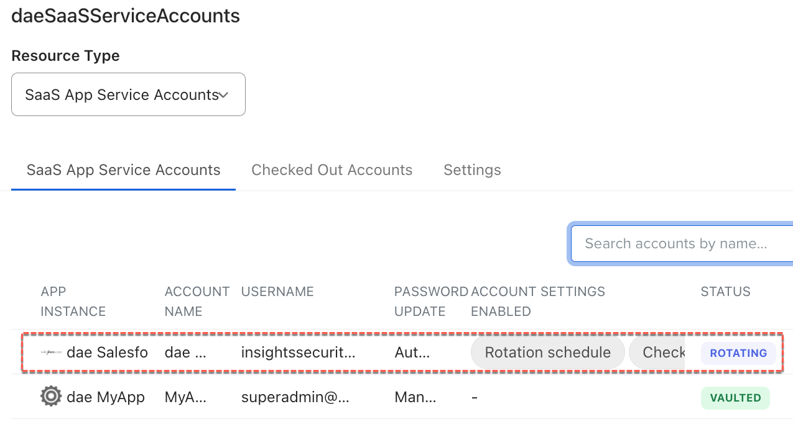

The service account is ready to use in a policy.

### Create a Policy and Rule for the Service Account

This set of steps is basically the same as done for the BYO SaaS app
service accounts earlier. We will reuse the Policy from earlier and
create a new rule for the integrated SaaS app:

1.  In **Policies**, open the policy you used in the previous use case.
    Select the **Actions** menu item and click **Edit** to edit the
    policy.

    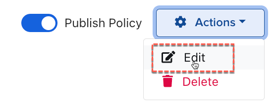

2.  Click the **Add Rule** button and select the **SaaS App Service
    Account Rule** option

    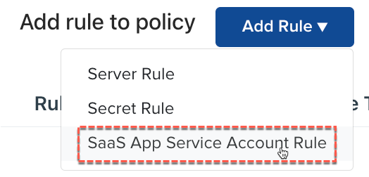

3.  On the **Add rule to policy** page, give it a **name** and select
    the **Password update method**. As this is an automated account
    (password will be rotated and sync’d), select the Automated option.

    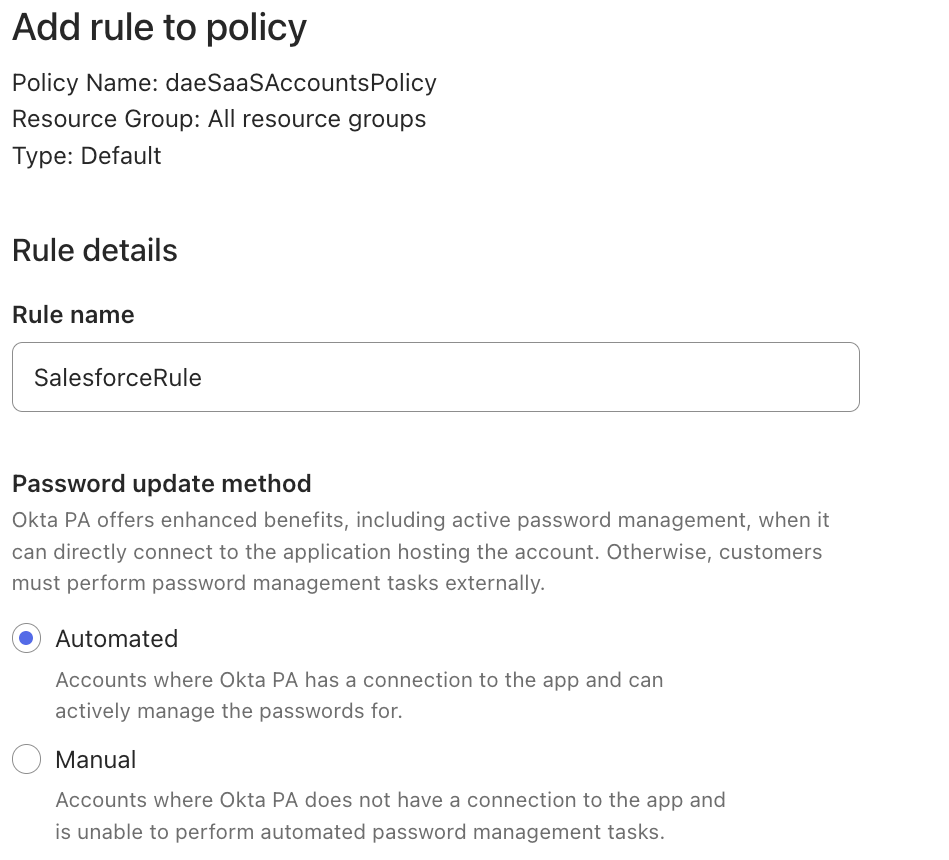

4.  Scroll down to the **Accounts to protect** section and select the
    new service account

    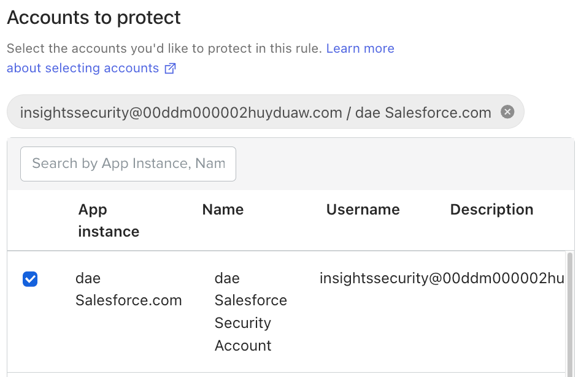

    You could set an **Approval request** flow or override the **Maximum
    Checkout time**, but we will skip this.

5.  Click on the **Save Rule** button to save.

6.  Click on the **Save Policy** button (it is already published, so no
    change required)

This policy is now ready to test.

### Test Accessing the BYO SaAs Service Account

The approach to testing the integrated SaaS service accounts is similar
to testing the BYO SaaS accounts:

1.  Log into the **Okta Dashboard** as a user who is in the group you
    assigned as a Principal group in the policy in the previous section
    (in my example it was daePAMAdmins).

2.  Click on the **Okta Privileged Access** tile on the Dashboard

3.  In OPA go to **MY PRIVILEGED ACCESS &gt; SaaS Accounts** and you
    should see the application(s) with service accounts.

    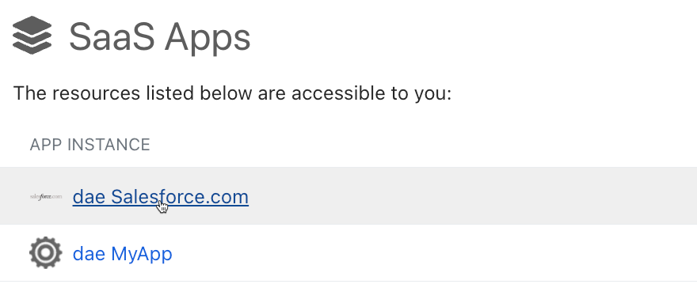

4.  Select the **APP INSTANCE** and you will be shown the service
    accounts for that app. You should see the account added above with a
    status of AVAILABLE.

    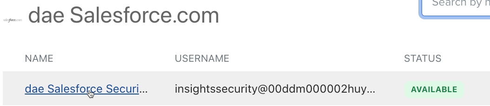

5.  Select the account **NAME**. You will be presented with the access
    methods to use this account. As this is an automated account it will
    be checked out.

    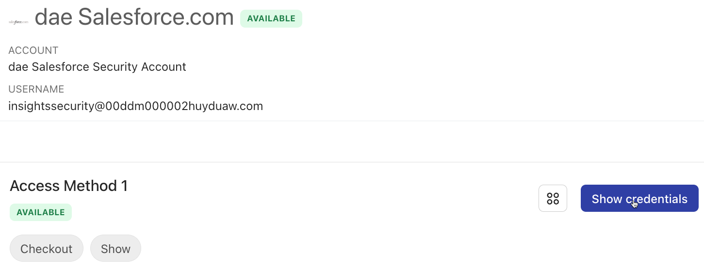

6.  Click the **Show credentials** button to see the Username and
    Password (click the eye icon to reveal the password).

    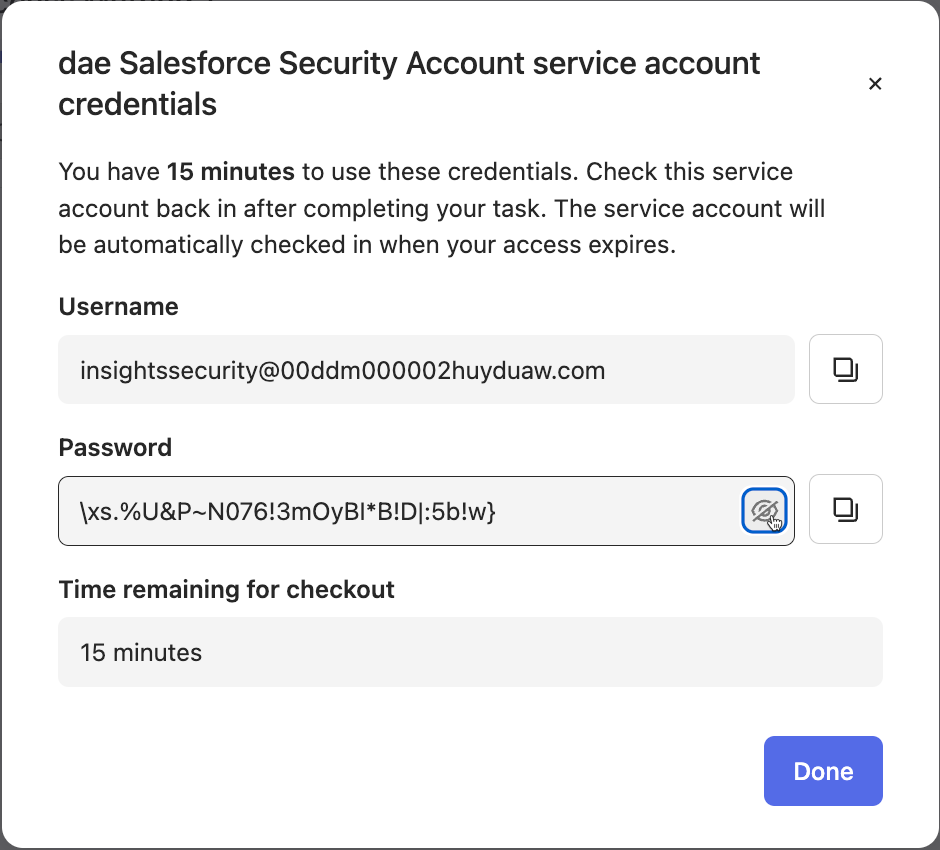

7.  You would copy’n’paste the username and password into the login
    prompts for that application. You could let the system automatically
    check it back in after 15 mins.

8.  Go to the **Checked Out Accounts** view and see your account there.

    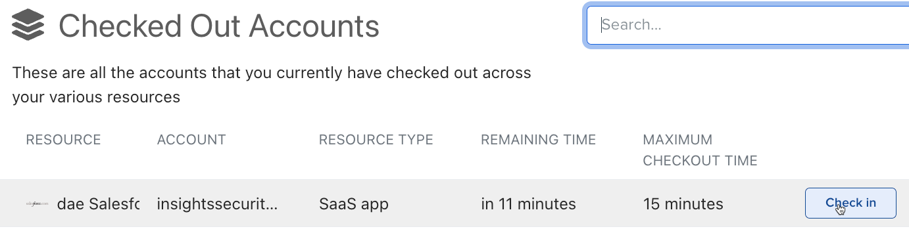

9.  Click the **Check in** button to check the account back in

10. Go back into the Okta admin UI and go to **Reports &gt; System Log**.

11. Scan through the entries to see the recent user activity. You may
    also see activity from when you created the account and the password
    was rotated.

    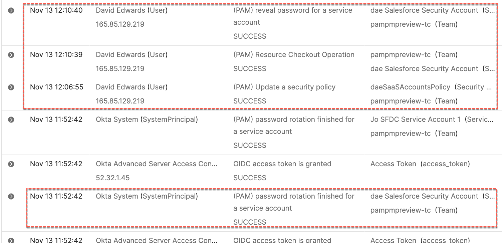

12. In the targets column, for one of the events involving your SaaS
    service account, click on the name of the account (e.g. <u>dae
    Salesforce Security Account</u>) to see all the events related to
    that account.

    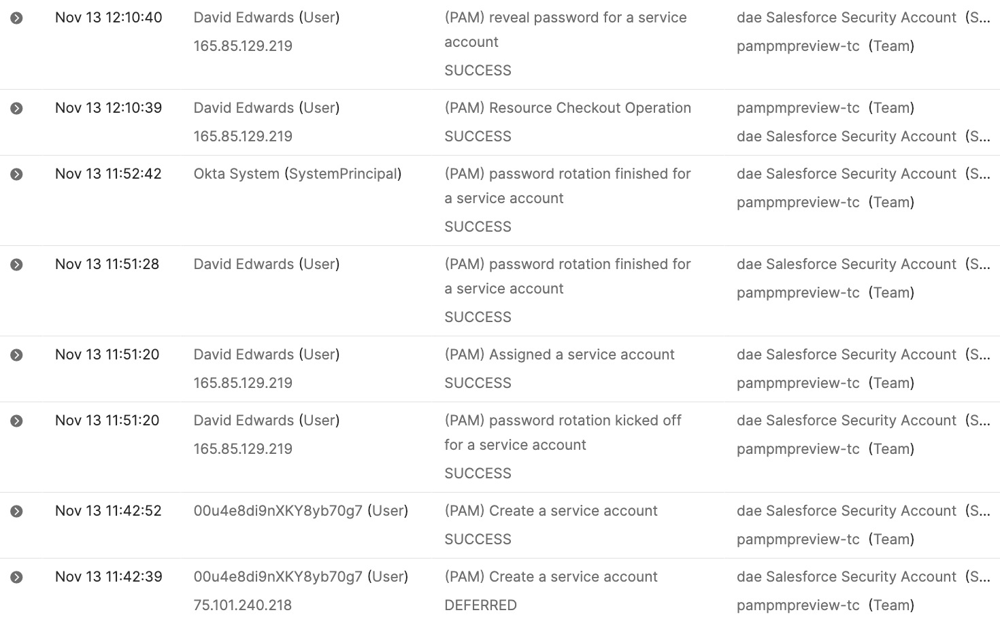

    This gives a good indication of the flow of events. You can see the
    service account being created, and its password being rotated as it
    was assigned to a project (and thus put in the vault). You will see
    checkout and checkin events. Note that you won’t see the downstream
    (Okta to app) password push in this view as it’s based on the app
    username, not the OPA service account name. But you will see it in
    the all events view (i.e. no filters).

The system log can be very useful in troubleshooting issues and
understanding the flow.

This concludes this use case and all use cases covered in this document.
